# Responsible AI with GitHub Copilot

## Overview

This course explores the use of AI in the context of GitHub Copilot, a generative AI tool for developers. It equips users with the knowledge and skills to use Copilot effectively while mitigating potential ethical and operational risks associated with AI usage.

## Mitigate AI risks

One of the primary concerns is that AI systems can sometimes make decisions that are difficult to interpret, leading to a lack of transparency and accountability. Additionally, AI can result in unintended and harmful outcomes, such as biased decision-making or privacy violations.

It is essential to implement robust governance frameworks, ensure transparency in AI processes, and incorporate human oversight.

## What is Responsible AI?

Responsible AI is an approach to developing, assessing, and deploying artificial intelligent systems in a safe, trustworthy, and ethical way.

## Microsoft and GitHub's six principles of responsible AI

- **Fairness**: *AI systems* should treat all people fairly.
- **Reliability and safety**: *AI systems* should perform reliably and safely.
- **Privacy and security**: *AI systems* should be secure and respect privacy.
- **Inclusiveness**: *AI systems* should empower everyone and engage people.
- **Transparency**: *AI systems* should be understandable.
- **Accountability**: *People* should be accountable for AI systems.

# Introduction to GitHub Copilot

## GitHub Copilot features

GitHub Copilot started an AI pair programmer that keeps developers in the flow by autocompleting comments and code.

- **Copilot chat**:
  - Ask questions about your code
  - Get explanations of logic or errors
  - Generate tests or documentation
  - Explore how to implement new features
- **Copilot pull request summaries**
- **Copilot code review assistance**
- **Copilot for the CLI**
  - ask for command suggestions, code snippets
  - generate shell scripts
  - understand output or errors
  - generate and improve projects from the CLI
- **Copilot Spaces** - provide a dedicated place to collaborate with AI on a project.
  - explore project structure
  - ask high‑level planning questions
  - refine requirements
  - iterate on designs
- **Copilot coding agent** - acts as an autonomous AI assistant. It performs multi-step coding tasks based on your instructions.
  - Generate multiple related files
  - Implement a feature set
  - Build scaffolding from a specification

## Subscription plans

- **GitHub Copilot Free** - 2000 code completions per month, 50 chat requests per month, and access to both GPT-4o and Claude 3.5 Sonnet models.
- **GitHub Copilot Pro**
  - Unlimited code completions and chat requests
  - Priority access to the latest AI models
  - Advanced code suggestions and explanations
  - Integration with supported IDEs (VS Code, Visual Studio, JetBrains, Neovim)
  - Automated test generation and code explanation features
- **GitHub Copilot Pro+** - includes all the features of Copilot Pro with additional access to premium model usage and priority performance on high-demand resources
  - All Pro features
  - Additional premium request capacity
  - Priority infrastructure access
- **GitHub Copilot Business** - for organizations that want to manage Copilot access and benefit from additional security and compliance features.
  - All Pro and Pro+ features for organization members
  - Centralized management and policy controls
  - Security vulnerability filtering
  - Code referencing and public code filtering
  - IP indemnity and enterprise-grade security, safety, and privacy
  - Chat in IDE and mobile
  - Filter for public code
- **GitHub Copilot Enterprise** - for large organizations and enterprises that require advanced capabilities, deeper integration, and enhanced personalization.
  - All Business features
  - Personalized code suggestions based on internal/private code
  - Integration with GitHub Enterprise Cloud
  - AI-powered search and documentation generation across your codebase
  - Enhanced pull request support with AI-powered tags and summaries
  - Organization-wide customization and fine-tuning of Copilot models
  - Deep integration with GitHub for chat and codebase exploration.

## Interact with Copilot

**Inline suggestions** - The suggestions that Copilot offers appear as grayed-out text ahead of your cursor.
- To accept a suggestion, select the Tab key or the > (right arrow) key.
- To reject a suggestion, keep typing or select the Esc key.

```python
def calculate_average(numbers):
    # Start typing here and watch Copilot suggest the function body
```

**Command palette** - `Ctrl+Shift+P`, **Copilot**

**Copilot chat** is an interactive feature that enables you to communicate with Copilot by using natural language. *How do I implement a binary search in Python?*

**Inline chat** enables context-specific conversations with Copilot directly within your code editor.

- Place your cursor where you want assistance.
- Use the keyboard shortcut `Ctrl+I` (Windows or Linux) or `Cmd+I` (Mac) to open inline chat.
- Ask questions or request changes specific to that code location.

Slash commands are shortcuts that allow you to quickly perform actions in Copilot. These commands provide a convenient way to interact with Copilot without needing to navigate through menus.

- `/explain` - Provides an explanation of the selected code.
- `/suggest` - Offers code suggestions based on the current context.
- `/tests` - Generates unit tests for the selected function or class.
- `/comment` - Converts comments into code snippets.

Copilot uses natural language processing to convert **comments into code**. You can describe the functionality that you want in a comment. When you select the `Enter` key, Copilot generates code based on your description.

**Multiple suggestions**
1. When Copilot offers a suggestion, look for the light bulb icon.
2. Select the icon or use `Alt+]` (Windows/Linux) or `Option+]` (Mac) to cycle through alternatives.

**Explanations** - Understanding existing code is crucial, especially in large projects. You can use the **Explain This** feature to get explanations for code snippets.
1. Select a block of code.
2. Right-click the code block, and then select **Copilot: Explain This** on the shortcut menu.
3. Read the explanation that Copilot provides for the selected code.

**Automated test generation**
1. Select a function or class.
2. Use the command palette to select **Copilot: Generate Unit Tests**.
3. Review the test cases that Copilot suggests for your code.

**Keep in mind that Copilot learns from context. Keeping your code well structured and commented helps Copilot provide more accurate and relevant assistance. The more you interact with Copilot, the better it becomes at understanding your coding style and preferences.**

# Introduction to prompt engineering with GitHub Copilot

## Prompt engineering foundations and best practices

Prompt engineering is the process of crafting clear instructions to guide AI systems to generate context-appropriate code tailored to your project's specific needs. This ensures the code is syntactically, functionally, and contextually correct.

## Principles of prompt engineering

**4 Ss**:
- **Single**: Always focus your prompt on a single, well-defined task or question.
- **Specific**: Ensure that your instructions are explicit and detailed.
- **Short**: While being specific, keep prompts concise and to the point.
- **Surround**: Utilize descriptive filenames and keep related files open.

## Best practices in prompt engineering

### Provide enough clarity

Building on the *Single* and *Specific* principles, always aim for explicitness in your prompts.

*Write a Python function to filter and return even numbers from a given list*

### Provide enough context with details

Enrich Copilot's understanding with context, following the *Surround* principle. The more contextual information provided, the more fitting the generated code suggestions are.

### Provide examples for learning

Using examples can clarify your requirements and expectations, illustrating abstract concepts and making the prompts more tangible for Copilot. Well-crafted examples help Copilot understand patterns quickly, leading to more accurate initial suggestions that require fewer revision cycles. This approach is particularly effective for generating boilerplate code, test templates, and repetitive implementations that form the foundation of larger features.

### Assert and iterate

Strategic iteration. Your first prompt might not always yield production-ready code. Rather than spending time manually refining the output, treat it as the beginning of an efficient dialogue with Copilot.

If the first output isn't quite what you're looking for, don't start from scratch. Instead, erase the suggested code, enrich your initial comment with added details and examples, and prompt Copilot again. Each iteration builds on Copilot's understanding of your specific requirements.

## How Copilot learns from your prompts

### Zero-shot learning

GitHub Copilot generates code without any specific examples, relying solely on its foundational training. This approach is ideal for rapidly implementing common patterns and standard functionality.

Ex. *create a function to convert temperatures between Celsius and Fahrenheit*

### One-shot learning

Single example is given, aiding the model in generating more context-aware responses that follow your specific patterns and conventions. Creating consistent implementations across your codebase, accelerating feature development while maintaining code standards.

### Few-shot learning

Copilot is presented with several examples, which strike a balance between zero-shot unpredictability and the precision of fine-tuning. This approach excels at generating sophisticated implementations that handle multiple scenarios and edge cases, reducing the time spent on manual testing and refinement.

*Example 1, Example 2, ...*

### Chain prompting and managing chat history

For complex features that require multiple steps, you might engage in extended conversations with GitHub Copilot Chat. Maintaining long conversation histories can become inefficient and costly in terms of processing.

For example, you might start with a basic implementation, then iteratively add error handling, tests, documentation, and optimizations. Each turn builds on the previous context, but the full history grows longer:

- **Turn 1**: "Create a user authentication function" 
- **Turn 2**: "Add error handling for invalid credentials"
- **Turn 3**: "Add unit tests for the authentication function" 
- **Turn 4**: "Add JSDoc comments to document the function" 
- **Turn 5**: "Optimize the function for better performance"

**Long prompts with full conversation history can consume 2–3 PRUs (Premium Request Units) per turn. Summarizing context or resetting the conversation can keep it closer to 1 PRU per request.**

- **Summarize context** when conversations become lengthy: "Based on our previous discussion about user authentication, now add rate limiting to prevent brute force attacks"
- **Reset and provide focused context** for new features: Start fresh with essential details rather than carrying forward the entire conversation
- **Use concise references** to previous work instead of repeating full implementations

## Role prompting for specialized tasks

Role prompting involves instructing GitHub Copilot to act as a specific type of expert, which can significantly improve the quality and relevance of generated code for specialized domains. This approach helps accelerate development by getting more targeted solutions on the first try.

### Security expert role

*Act as a cybersecurity expert. Create a password validation function that checks for common vulnerabilities and follows OWASP guidelines.*

This approach typically generates code that includes:

- Input sanitization
- Protection against common attacks
- Industry standard validation patterns
- Security best practices

### Performance optimization role

*Act as a performance optimization expert. Refactor this sorting algorithm to handle large datasets efficiently.*

This often results in:
- Optimized algorithms and data structures
- Memory-efficient implementations
- Scalability considerations
- Performance monitoring suggestions

### Testing specialist role

*Act as a testing specialist. Create comprehensive unit tests for this payment processing module, including edge cases and error scenarios.*

This typically produces:
- Thorough test coverage
- Edge case handling
- Mock implementations
- Error condition testing

## GitHub Copilot user prompt process flow

### Inbound flow

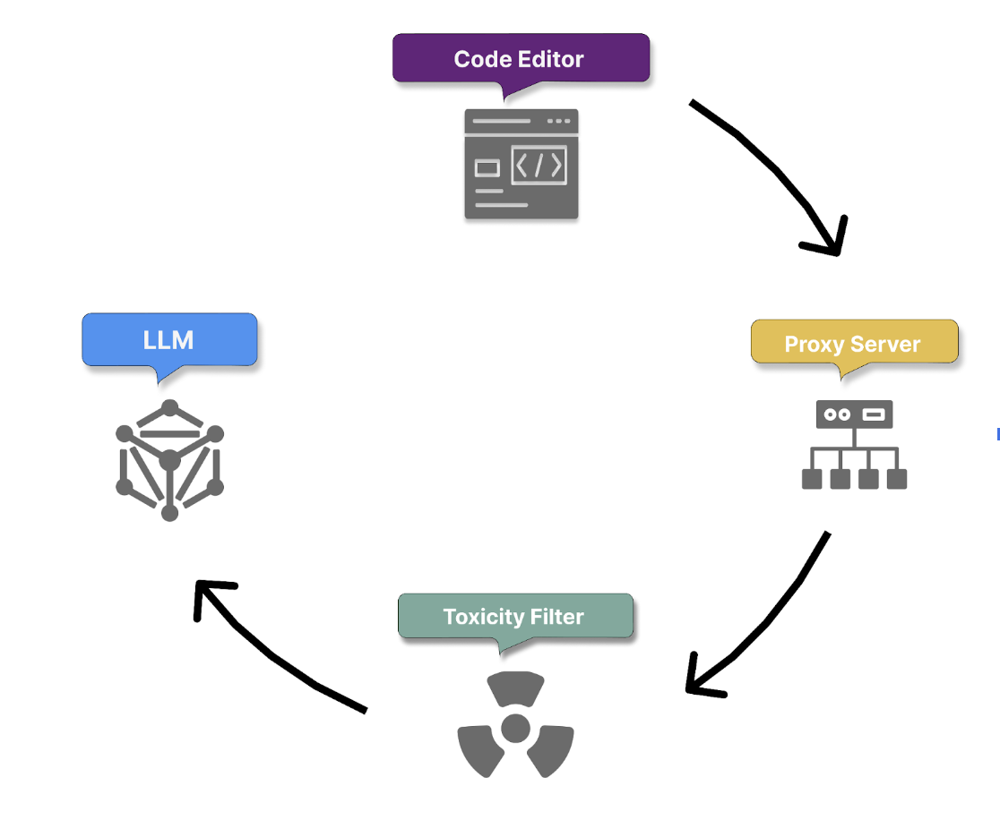

#### 1. Secure prompt transmission and context gathering

GitHub Copilot securely receives the user prompt, which could be a Copilot chat or a natural language comment provided by you within your code.

Simultaneously, Copilot collects context details:
- **Code before and after the cursor position**, which helps it understand the immediate context of the prompt.
- **Filename and type of the file being edited**, allowing it to tailor code suggestions to the specific file type.
- **Information about adjacent open tabs**, ensuring that the generated code aligns with other code segments in the same project.
- **Information on project structure and file paths**
- **Information on programming languages and frameworks**
- **Pre-processing using Fill-in-the-Middle (FIM) technique to consider both the preceding and following code context**, effectively expanding the model's understanding allowing Copilot to generate more accurate and relevant code suggestions by leveraging a broader context.

#### 2. Proxy filter

Once the context is gathered and the prompt is built, it passes securely to a proxy server hosted in a GitHub-owned Microsoft Azure tenant. The proxy filters traffic, blocking attempts to hack the prompt or manipulate the system into revealing details about how the model generates code suggestions.

#### 3. Toxicity filtering

Copilot incorporates content filtering mechanisms before proceeding with intent extraction and code generation, to ensure that the generated code and responses don't include or promote:
- **Hate speech and inappropriate content**
- **Personal data**

#### 4. Code generation with LLM

The filtered and analyzed prompt is passed to LLM Models, which generate appropriate code suggestions.

### Outbound Flow

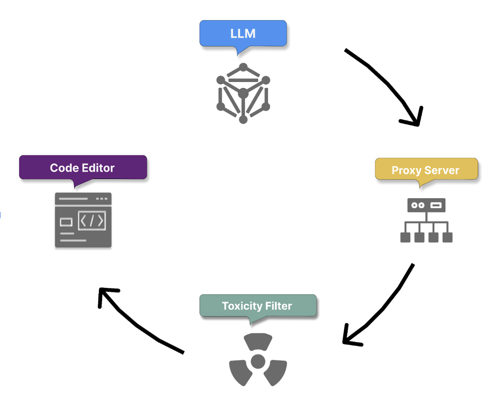

#### 5. Post-processing and response validation

Once the model produces its responses, the toxicity filter removes any harmful or offensive generated content. The proxy server then applies a final layer of checks to ensure code quality, security, and ethical standards. These checks include:

- **Code quality**: Responses are checked for common bugs or vulnerabilities, such as cross-site scripting (XSS) or SQL injection.
- **Matching public code (optional)**: Optionally, administrators can enable a filter that prevents Copilot from returning suggestions over ~150 characters if they closely resemble existing public code on GitHub. This prevents coincidental matches from being suggested as original content. If any part of the response fails these checks, it is either truncated or discarded.

#### 6. Suggestion delivery and feedback loop initiation

Only responses that pass all filters are delivered to the user. Copilot then initiates a feedback loop based on your actions to achieve the following:
- Grow its knowledge from accepted suggestions.
- Learn and improve through modifications and rejections of its suggestions.

#### 7. Repeat for subsequent prompts

## GitHub Copilot data

### Data handling for GitHub Copilot code suggestions

**GitHub Copilot in the code editor** does not retain any prompts like code or other context used for the purposes of providing suggestions to train the foundational models. **It discards the prompts once a suggestion is returned.**

### Data handling for GitHub Copilot chat

GitHub Copilot Chat operates as an interactive platform, allowing developers to engage in conversational interactions with the AI assistant to receive coding assistance. Some steps:
- **Formatting**
- **User engagement** - You can actively engage with the response by asking follow-up questions, requesting clarifications, or providing additional input.
- **Data retention** - Retains prompts, suggestions, and supporting context for 28 days

### Prompt types supported by GitHub Copilot Chat

**Direct Questions** - *How do I implement a quick sort algorithm in Python? Why is my React component not rendering?*
**Code-Related Requests** - *Write a function to calculate factorial. Fix this error in my code. Explain this code snippet.*
**Open-Ended Queries** - *What are the best practices for writing clean code?*
**Contextual Prompts** - *Here's a part of my code, can you suggest improvements?*

### Limited context windows

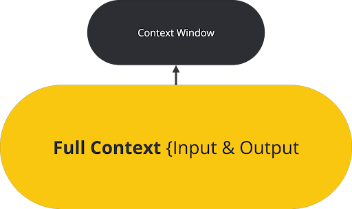

**Context window** - The amount of surrounding code and text the model can process simultaneously to generate suggestions. Around 200-500 lines of code or up to a few thousand tokens.

Copilot Chat currently operates with a context window of 4k tokens, providing a broader scope for understanding and responding to user queries compared to the standard Copilot.

Breaking down complex problems into smaller, more focused queries or providing relevant code snippets can significantly enhance the model's ability to provide accurate and helpful responses.

## GitHub Copilot Large Language Models (LLMs)

**Large Language Models (LLMs)** are artificial intelligence models designed and trained to understand, generate, and manipulate human language. 

**Volume of training data** - LLMs are exposed to vast amounts of text from diverse sources.

**Contextual understanding** - They excel in generating contextually relevant and coherent text. 

**Machine learning and AI integration** - LLMs are grounded in machine learning and artificial intelligence principles. They're neural networks with millions, or even billions, of parameters that are fine-tuned during the training process to understand and predict text effectively.

**Versatility** - They can be tailored and fine-tuned to perform specialized tasks, making them highly versatile and applicable across various domains and languages.

**Role of LLMs in GitHub Copilot and prompting** - GitHub Copilot utilizes LLMs to provide context-aware code suggestions.

**Fine-tuning LLMs** - Fine-tuning is a critical process that allows us to tailor pretrained large language models (LLMs) for specific tasks or domains.

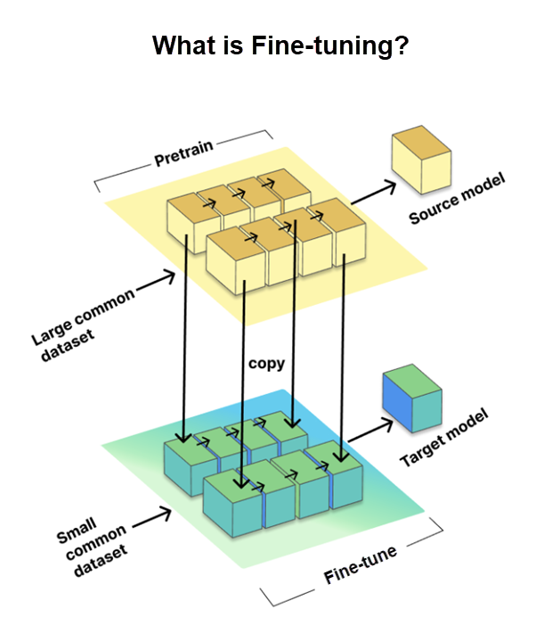

**LoRA fine-tuning** - Traditional full fine-tuning means to train all parts of a neural network, which can be slow and heavily reliant on resources. But **LoRA (Low-Rank Adaptation)** fine-tuning is a clever alternative. It's used to make large pretrained language models (LLMs) work better for specific tasks without redoing all the training.
- LoRA adds smaller trainable parts to each layer of the pretrained model, instead of changing everything.
- The original model remains the same, which saves time and resources.
- It beats other adaptation methods like adapters and prefix-tuning.
- It's like getting great results with fewer moving parts.

LoRA fine-tuning is about working smarter, not harder, to make LLMs better for your specific coding requirements when using Copilot.

# Introduction to Copilot Spaces

Unlike general Copilot Chat, which surfaces broad suggestions, a Space allows you to focus the model on specific files, issues, pull requests, and tailored instructions.

## What is a GitHub Copilot Space?

It’s a dedicated Copilot chat grounded in a curated set of context you choose. The Space is itself like a LLM and you can feed it GitHub files, issues, pull requests, and your own free‑text instructions to provide context to your specific topic. Unlike general Copilot Chat, a Space allows you to focus the model on specific files, issues, pull requests, and tailored instructions.

## Setting Context for Copilot Spaces

The effectiveness of a Copilot Space depends on the context you provide. You can attach specific files (such as scripts, configuration, or documentation), relevant issues or pull requests, and tailored instructions. By curating this input, you help Copilot focus on the information that matters most for your scenario. **The context order matters**: leading with the most critical files or instructions helps drive more accurate and relevant responses.

## Setup: Attaching Files (Uploads) and Instructions in Copilot Spaces

## The ideal time you want to use and create a GitHub Copilot Spaces

Use a Space when you want consistent, reproducible answers on a tightly scoped topic, like a particular service, a runbook or playbook, or a known dataset. Spaces trade breadth for depth. Keep Spaces small and focused.

## Creating your first space

1. To create a space, go to https://github.com/copilot/spaces, and click Create space.
2. Give your space a name.
3. Choose whether the space is owned by you or by an organization you belong to. Organization-owned Spaces can be shared using GitHub's built-in permission model.
4. Optionally, add a description. This doesn't affect the responses Copilot gives in the space, but it can help others understand the context of the space.
5. Click Save in the top right corner of the page.
6. Adding context to a space. You can add two types of context to your space:
  - **Instructions**: Free text that describes what Copilot should focus on within this space. Include its areas of expertise, what kinds of tasks it should help with, and what it should avoid. This helps Copilot give more relevant responses based on your intent.
  - **Attachments**: This context is used to provide more relevant answers to your questions. Additionally, Spaces always refer to the latest version of the code on the main branch of the repository.

To add attachments, click Add to the right of "Attachments", then choose one of the following options:
- Attach files and folders
- Link pull requests and issues
- Upload a file
- Add text content

## Sharing, Discoverability, and Governance

To ensure your Space delivers lasting value, it must be easy to find, securely shared, and well-maintained.

### Visibility and sharing

When you create a Space, set visibility according to how broadly you intend others to use it. Depending on your environment, options may include keeping it under your personal ownership or making it visible to your organization.

### Security and access

Security follows GitHub's existing permissions. A Space doesn't grant new access; it only surfaces content that viewers are already entitled to see. If a Space links to private repositories, issues, or pull requests, only users with the appropriate repo permissions see that material reflected in answers.

Avoid pasting sensitive data into free‑text notes; prefer linking to version‑controlled files where normal review and permissions apply.

### Versioning and freshness

Spaces stay fresh by referencing live GitHub sources. Linked files reflect the repository's default branch, and attached issues and pull requests evolve as they change, reducing the need to copy content into separate documents. If you need branch‑specific guidance or a historical snapshot, consider narrowing your references to the relevant files, adding a brief example in free text, or—if supported in your environment—attaching a text file that captures the exact content you want the Space to use. Keep the scope small so updates remain predictable and grounded.

### Governance

Treat governance as lightweight but intentional. Assign an owner who maintains the Space, add a short "How to use this Space" note at the top of the instructions, and include 1–3 canonical examples that define "good" output. Establish naming conventions (for example, "ServiceName—Onboarding Helper") and review cadence (for example, at each release) to prune stale sources and keep instructions aligned with reality. When a Space grows beyond a single job, split it into smaller Spaces so discoverability stays high and answer quality remains consistent.

## Summary

GitHub Copilot Spaces deliver significant business value by enabling teams to achieve faster, more accurate outcomes through context-grounded AI assistance. By curating a focused set of sources—such as code files, documentation, issues, and pull requests—Spaces reduce ambiguity and improve the predictability and quality of Copilot's responses. This targeted approach minimizes rework, accelerates decision-making, and ensures outputs align with organizational standards. Spaces also enhance collaboration and governance by leveraging GitHub's existing permission model, making it easier to share knowledge securely while maintaining compliance. Ultimately, Copilot Spaces help organizations scale expertise, reduce cognitive load, and improve productivity across development and operational workflows.

You should now be able to:

- Explain what Spaces are and when to use them versus general Copilot Chat
- Create, configure, and iterate on a Space with targeted context and custom instructions
- Apply best practices for high‑quality, grounded answers within model context limits

# Using advanced GitHub Copilot features

## Advanced GitHub Copilot features

### The basics

When GitHub Copilot is enabled, it provides you with suggestions. These suggestions are called ghost text. You can either ignore the ghost text, or accept it by pressing the Tab key. The suggestions don't require a prompt because by default GitHub Copilot uses the files you have open as context. However, you can provide a prompt using a comment, the chat window, or the inline chat within your code.

### Chatting with GitHub Copilot

GitHub Copilot allows you to have an interactive discussion using the chat feature. In Visual Studio Code, you can click the chat icon on the left sidebar, which opens the chat interface in a dedicated pane.

In this pane, you can ask questions about the code you're currently working on or other software-related questions.

### Using inline chat

Besides the dedicated chat pane, you can use the inline chat. It allows you to interact with GitHub Copilot without leaving your code.

Access the inline chat by using `Ctrl+i` on Windows or `Command+i` on a Mac. One of the benefits of using the inline chat is that you don't have to switch context by going to a different pane. The suggestions and interactions happen closer to the code.

### Slash commands

Within the chat pane or when using the inline chat, you can use slash commands. These commands allow GitHub Copilot to use a specific intent for quickly solving common development tasks.

If you type a forward slash in the chat pane or inline chat, you should see a drop-down menu with all the slash commands available. For example, the `/tests` slash command helps you write tests, while the `/docs` command is intended for writing documentation.

Using specific slash commands to create a question is a good way to get better responses without having to write longer prompts.

### Agents

Agents allow you to ask questions using a specific context. For example the `@terminal` agent helps you chat with GitHub Copilot to interact with the terminal.

Another agent is `@workspace`, which is aware of your entire workspace. It allows you to ask questions about the entire project. To use an agent, prefix your question with the agent, for example: `@workspace how can I package this project?`.

## Applied GitHub Copilot techniques

### Advanced tasks with GitHub Copilot

It's common to work with an existing project as an engineer. When fixing code or implementing features, we need to write documentation and tests and work with terminal commands. Let's go through some ways you can accomplish this using GitHub Copilot.

#### Implicit prompts

For example, if you're working on a Python project, and you have a file open with the following code that has a bug in it:

```python
with open("file.txt", "r") as file:
    # Read the file and print the content
    contents = file.read
```

After selecting the code and using `Ctrl+i` on Windows or `Command+i` on a Mac, you can ask GitHub Copilot to help you fix the code using the inline chat and the `/fix` slash command.

If you only type `/fix`, you might get a response from GitHub Copilot similar to this suggestion: *"To fix the code, I would add parentheses after file.read to call the read method and fix the typo in the method name."*

Slash commands can be used to both in the inline chat and the chat interface. In addition to the /fix command, here are some of the most useful slash commands you can use in Copilot chat:
- `/doc`: Adds comments to the specified or selected code.
- `/explain`: Gets explanations about the code.
- `/generate`: Generates code to answer the specified question.
- `/help`: Gets help on how to use Copilot chat.
- `/optimize`: Analyzes and improves the runtime of the selected code.
- `/tests`: Creates unit tests for the selected code.

#### Selective context

GitHub Copilot can be customized to provide suggestions based on the context you're working on. For example, you can ask GitHub Copilot to provide suggestions based on the entire workspace or the terminal output.

GitHub Copilot can give you an accurate suggestion for your project without requiring you to open many files. Imagine you need to package your project using a `Dockerfile`. You can use the `@workspace` agent to ask GitHub Copilot how to help you out. For example, open GitHub Copilot Chat and type the following command:

`@workspace I need to create a Dockerfile for this project, can you generate one that will help me package it?`

If the suggestions aren't exactly what you are looking for, you can reword the prompt and be more specific. For example, you could ask GitHub Copilot to use a specific step when creating the `Dockerfile`:

`@workspace help me create a Dockerfile to package this project but make sure you are using a Virtual Environment for Python.`

In addition to the @workspace agent, you can use other agents:
- `@terminal:` Provides suggestions based on the terminal output.
  - Example: `@terminal How do I fix the error message I'm seeing?`
- `@file`: Focuses on the content of a specific file.
  - Example: `@file Can you help me refactor this function in main.py?`
- `@directory`: Considers the contents of a specific directory.
  - Example: `@directory How can I optimize the scripts in the utils directory?`


# GitHub Copilot Across Environments: IDE, Chat, GitHub.com, and Command Line Techniques

## Code completion with GitHub Copilot

GitHub Copilot code completion features live directly within your IDE, where you write and review your code. GitHub Copilot integrates seamlessly with editors like Visual Studio Code, offering features such as autosuggestions, a multiple suggestions pane, and support for various coding styles.

## GitHub Copilot supported languages

- Python
- JavaScript
- Java
- TypeScript
- Ruby
- Go
- C#
- C++

GitHub Copilot can assist with many other languages and frameworks as well.

## Auto suggestions

Copilot offers code suggestions as you type: sometimes completing the current line, sometimes suggesting a whole new block of code. You can accept all, part, or ignore the suggestion.

## Multiple suggestions pane

When you're working on a code block and GitHub Copilot offers a suggestion, you see a grayed-out code snippet. To explore more options and accelerate your development workflow, hover over the suggestion to reveal the GitHub Copilot control panel. This feature allows you to quickly evaluate multiple approaches to the same problem, helping you choose the most suitable solution for your specific context.

Click the forward or backward arrow buttons in the control panel to see the next or previous suggestions. You can also use keyboard shortcuts to rapidly cycle through options:

- macOS: **Option** (⌥) or **Alt+]** (next), **Option** (⌥) or **Alt+[** (previous)
- Windows or Linux: **Alt+]** (next), **Alt+[** (previous)

While GitHub Copilot is superb at suggesting code for you, it also demonstrates its ability to adapt through the following ways:

- **Method Implementation**: When you start typing a method name, Copilot can suggest the entire implementation, following your established coding style.
- **Naming Conventions**: It picks up on your preferred naming conventions for variables, functions, and classes.
- **Formatting:** Copilot adapts to your indentation style, bracket placement, and other formatting preferences.
- **Comment Style**: It can mimic your comment style, whether you prefer inline comments, block comments, or doc strings.
- **Design Patterns**: When your project consistently uses certain design patterns, Copilot suggests code that aligns with these patterns.

## Using coding comments for suggestions

A key aspect of this capability is how it incorporates coding comments to enhance its suggestions.

### Understanding comment context

When integrated into your existing codebase, GitHub Copilot uses various aspects of your code to provide more relevant suggestions, including code comments. By understanding the intent behind the comments, Copilot can provide more accurate and context-aware code suggestions through two key processes:
- **Natural Language Processing**: Copilot uses advanced natural language processing (NLP) techniques to interpret the meaning and intent behind comments in the code.
- **Contextual Analysis**: It analyzes comments in relation to the surrounding code, understanding their relevance and purpose within the broader context of the file or project.

## Types of comments utilized

- **Inline comments**: Short explanations next to specific lines of code.
- **Block comments**: Longer explanations that might describe a function or class.
- **Docstrings:** Formal documentation strings in languages like Python.
- **TODO comments**: Notes about future implementations or improvements.
- **API Documentation**: Comments that describe the usage and parameters of functions or methods.

## Comment-driven code generation

Copilot uses comments in several ways to generate and suggest code:
- **Function implementation**: When a function is described in comments, Copilot can suggest an entire implementation based on that description.

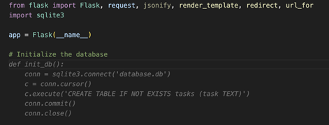

- **Code completion**: Copilot uses comments to provide more accurate code completions, understanding the developer's intent.

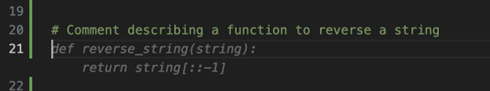

In this example, we have a comment describing a function to reverse a string. Based on this comment, Copilot is likely to suggest an implementation using Python's slice notation with a step of -1, which efficiently reverses the string.

- **Variable naming**: Comments can influence Copilot's suggestions for variable names, making them more descriptive and context-appropriate.

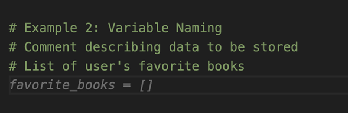

Here, we have a comment describing a list of the user's favorite books. Copilot would likely suggest descriptive variable names that match the context. In this case, it suggested "favorite_books" as the variable name, which clearly describes the content of the list.

- **Algorithm selection**: When comments describe a specific algorithm or approach, Copilot can suggest code that aligns with that method.

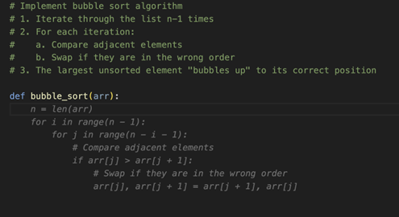

## GitHub Copilot Chat

GitHub Copilot Chat is an advanced feature of the GitHub Copilot ecosystem, designed to provide developers with an interactive, conversational AI assistant directly within their development environment. It allows developers to have natural language conversations about their code, ask questions, and receive intelligent responses and suggestions in real-time.

GitHub Copilot Chat is beneficial in certain scenarios:
- **Complex code generation** - implement complex algorithms, data structures, or generate boilerplate code for specific design patterns; create intricate regular expressions, construct detailed SQL queries, or develop advanced data structures.
- **Debugging assistance** - It can help identify logical errors and provide step-by-step explanations of problematic sections of code. One way to achieve this result is by using Copilot inline-chat by highlighting the piece of code containing the error, right clicking and selecting Copilot, then inline-chat.
- **Code explanations** - Copilot Chat can also be used to better understand complex code snippets. It can break down code into simpler terms, explain the purpose and functionality of unfamiliar code, and offer insights into best practices and potential optimizations.

## How to improve GitHub Copilot Chat responses

### Scope referencing

To enhance the accuracy and relevance of the responses provided by GitHub Copilot Chat, it’s important to properly scope your questions using references.
- **File references**: You can specify a particular file in your question by adding a `#file:` before the file name.
- **Environment References** - You can reference the entire solution or workspace by using `@workspace`. This feature allows Copilot Chat to consider the broader context of the projects and configurations that are currently open in your Visual Studio IDE. `@workspace where is the calculate function?`

### Slash commands
- `/doc`
- `/explain`
- `/fix`
- `/generate`
- `/optimize`
- `/tests`

### Model selection and premium features

GitHub Copilot Chat offers different AI models to optimize your development workflow.

#### Standard models (GPT-4o):

- Provide fast, reliable responses for most development tasks
- Consume 1 PRU per request
- Ideal for routine coding assistance, code explanations, and basic debugging
- Examples: Simple function generation, syntax help, basic refactoring suggestions

#### Premium models (o1-preview, o1-mini):

- Offer enhanced reasoning capabilities for complex problems
- Consume 2 PRUs per request (double the standard rate)
- Better suited for sophisticated analysis, complex algorithms, and architectural decisions
- Examples: Advanced debugging of multi-threaded code, complex algorithm design, security analysis

### Copilot agents

- `@workspace` - This agent allows you to extend the context of whatever questions you ask Copilot to the whole project.  It is useful for getting code generated that would fit in your project right away, using information from your whole project. It can also be utilized for getting answers about your whole codebase.

You can also use the “@workspace /new” smart action, which allows you to generate a completely new project from scratch based on your requirements. For example, “@workspace /new generate new html file pages and JavaScript for advanced calculations“
- `@terminal` - This agent is useful for command-line related questions. For example, you could ask it to find the largest file in a directory or explain the last command you ran.
- `@vscode` - Use this agent to ask questions related to Visual Studio Code, such as how to debug or change settings within the IDE.

Advanced agents like @workspace and complex operations may consume more Premium Request Units (PRUs). Simple queries typically use 1 PRU, while complex workspace analysis or project generation can use 2-5 PRUs.

### Sharing feedback on GitHub Copilot Chat

Most IDEs with Copilot Chat integration have built-in feedback mechanisms. For example, in Visual Studio Code, you can find feedback options at the beginning of GitHub Copilot Chat's suggestions. Hover over a suggestion, and you should see "thumbs up" and "thumbs down" buttons.

## GitHub Copilot on GitHub.com

### Accessing Copilot on GitHub.com

Copilot is integrated throughout the GitHub web interface, appearing as a chat button or inline suggestions in various contexts. You can access Copilot features in several areas:

- **Repository pages** - Get explanations of code, documentation, and project structure
- **Issues and pull requests** - Generate summaries, suggest solutions, and draft responses
- **Discussions** - Help formulate responses and provide technical insights
- **Code review** - Analyze changes and suggest improvements

### GitHub Copilot agent tasks on GitHub.com

When using Copilot on GitHub.com, you can perform various agent-driven tasks. These tasks can run in the background for you while you focus on other work.

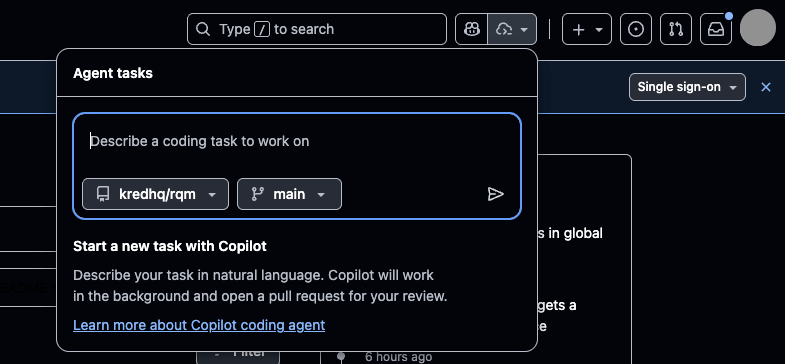

### Repository exploration and documentation

- **Code explanation**: Ask Copilot to explain complex code sections, functions, or entire files
- **Project overview**: Get AI-generated summaries of repository purpose, architecture, and key components
- **Documentation generation**: Create or improve README files, API documentation, and code comments

### Pull request assistance

- **PR summaries**: Generate comprehensive summaries of changes made in a pull request, helping reviewers quickly understand the scope and impact of modifications
- **Review suggestions**: Get recommendations for code improvements and potential issues before formal review, reducing review cycles
- **Merge conflict resolution**: Receive guidance on resolving conflicts between branches, streamlining the merge process
- **Documentation updates**: Automatically suggest updates to README files, changelogs, and other documentation based on code changes

*PR summary generation and advanced pull request assistance features consume Premium Request Units (PRUs). Typically, generating a PR summary uses 1-2 PRUs depending on the complexity and size of the changes.*

### Issue management

- **Issue analysis**: Break down complex problems into actionable tasks
- **Solution brainstorming**: Generate potential approaches to resolve reported issues
- **Reproduction steps**: Help create clear steps to reproduce bugs or issues

Example: "Analyze this issue and suggest potential solutions with implementation approaches".

### Code review and collaboration

GitHub Copilot enhances your code review process by providing intelligent insights and suggestions that help maintain high code quality and catch potential issues early:
- **Review comments**: Generate thoughtful code review comments with specific suggestions
- **Security analysis**: Identify potential security vulnerabilities or best practice violations
- **Performance optimization**: Suggest improvements for code efficiency and performance

*Code review features consume Premium Request Units (PRUs) as part of Copilot's advanced capabilities. Each code review request typically uses 1-3 PRUs depending on the scope and complexity of the analysis.*

Example: "Review this code change and provide feedback on security and performance considerations"

## GitHub Copilot Explain error in actions

GitHub Copilot can help explain and resolve errors that occur in GitHub Actions workflows. This feature analyzes failed workflow runs and provides insights into what went wrong and how to fix it.

- **Error analysis**: Copilot examines log files and identifies the root cause of failures
- **Solution suggestions**: Provides specific recommendations to resolve workflow issues
- **Best practices**: Offers guidance on improving workflow reliability and performance
- **Context awareness**: Understands the relationship between different workflow steps and dependencies

## GitHub Copilot for the Command Line

GitHub Copilot CLI brings Copilot directly into the command line, where it can explain commands, suggest shell commands from natural language, and help you work safely and interactively with your files and projects.

Copilot CLI uses GitHub authentication and runs independently from GitHub CLI, though it uses your existing credentials. 

## GitHub Copilot for the Command Line

GitHub Copilot CLI brings Copilot directly into the command line, where it can explain commands, suggest shell commands from natural language, and help you work safely and interactively with your files and projects.

Copilot CLI uses GitHub authentication and runs independently from GitHub CLI, though it uses your existing credentials.

### Installing and launching Copilot CLI

`brew install copilot-cli` - brew script

`curl -fsSL https://gh.io/copilot-install | bash` - bash script

`copilot` - bash command

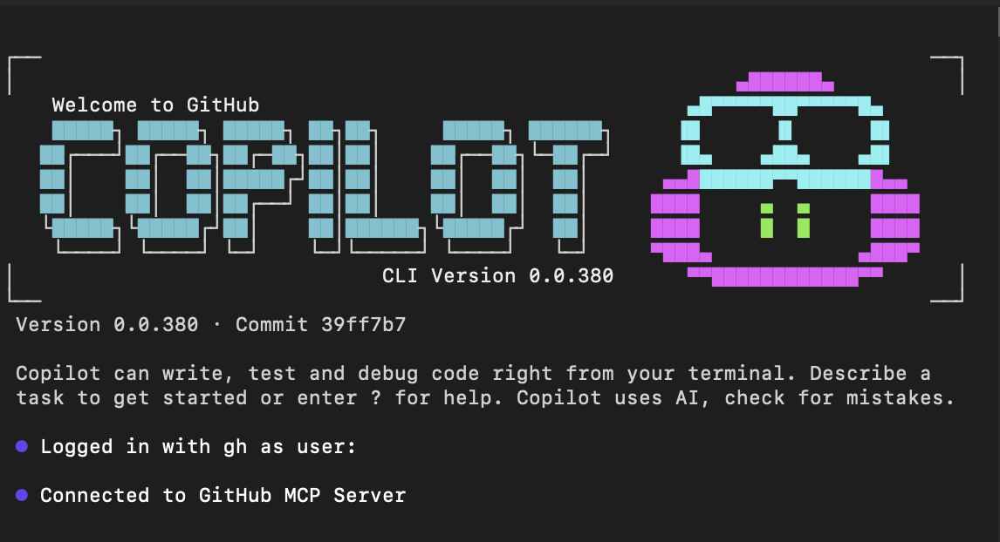

On first launch, Copilot asks whether you trust the files in the current folder. Copilot may read, modify, or execute files in this directory during the session, so only proceed in locations you trust.

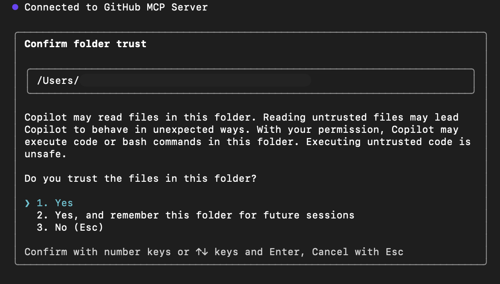

You can use the `@` to select a specific file you want to work with as context.

Inside an interactive session, you can:

- **Use slash commands (`/command`)** to control the session and configure Copilot CLI.
- **Type natural language prompts** to explain, suggest, or revise commands.

For **one-shot** prompts without entering full interactive mode:

```bash
# umesto /explain
copilot -i "explain brew install git"
# umesto /suggest
copilot -i "suggest find large files and delete them"
```

### Common slash commands

| Slash Command | Description |
| -- | -- |
| `/help` | 	Show available commands and options |
| `/explain <command>` |	Ask Copilot to explain any shell command |
| `/suggest <task>` | Ask Copilot to suggest a shell command for a task |
| `/revise` |	Revise the last suggestion based on your instructions |
| `/feedback` |	Submit feedback on a response or suggestion |
| `/exit` | Exit interactive mode |
| `/model <model>` | Select which AI model to use |
| `/theme [auto\|dark\|light]` | Change terminal theme |
| `/skills` | Manage skills for enhanced capabilities |
| `/mcp` | Manage MCP server configuration |
| `/list-dirs` |	Show allowed directories for file operations |
| `/reset-allowed-tools` | Reset allowed tools list |

### Example workflows

```text
> Explain what `git reset --hard HEAD` does
```

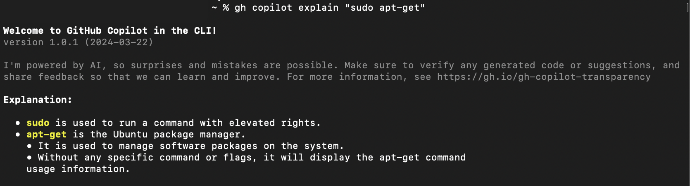

```text
> Find and delete all .log files in my home folder
```

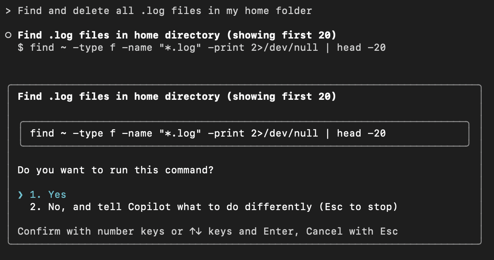

```text
> Include only files modified in the last 7 days
```

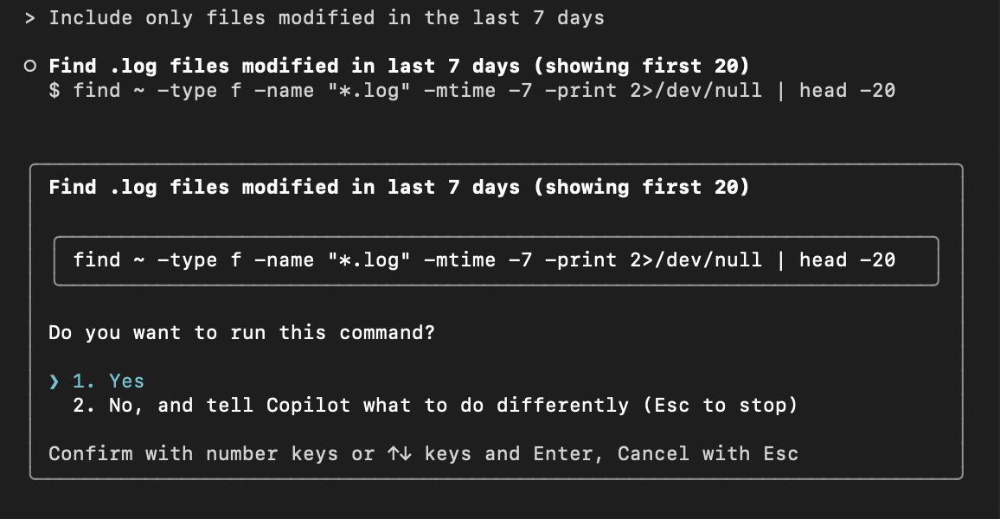

```text
> /feedback
```

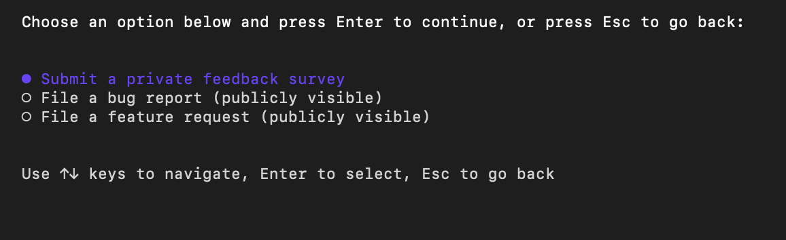

```text
> /exit
```

### Configuration options

In Copilot CLI, configuration is handled via:

1. **Slash commands** inside interactive mode
  - `/model` - choose AI model
  - `/theme` - change terminal theme
  - `/skills` - manage enhanced capabilities
  - `/reset-allowed-tools` - reset tools
  - `/list-dirs` - view allowed directories
  - `/mcp` - MCP server settings
2. **Copilot CLI configuration** (non-interactive mode)

Copilot CLI configuration is managed through permission prompts, command-line flags, and local configuration files. These settings control what Copilot can access and do on your behalf.

Common configuration options include:
- **Trusted directories** – Control where Copilot can read, edit, and run files.
- **Tool permissions** – Allow or restrict Copilot from running shell commands or modifying files using flags like `--allow-tool` or `--deny-tool`.
- **Path permissions** – Control which directories Copilot can access.
- **URL permissions** – Manage which external domains Copilot can connect to.

### Tips for effective use

- Use **interactive mode** (`copilot`) for exploratory tasks.
- Use **one-shot mode** (`copilot -i`) for quick answers.
- **Natural language input works** - you don’t always need slash commands.
- Always review commands before execution.
- Combine Copilot CLI with GitHub CLI (`gh`) for repository and issue management.
- Use **slash commands** when you want structured actions or feedback.

# Management and customization considerations with GitHub Copilot

## Explore GitHub Copilot plans and their associated management and customization features

GitHub enables developers and organizations to maximize their potential by prioritizing security, privacy, compliance, and transparency as we develop, iterate, and innovate GitHub Copilot.

Every developer and organization has specific needs. That's why GitHub Copilot has several pricing plans.

### Management policy features

| Feature |	Free & Pro |	Business | Enterprise |
| -- | -- | -- | -- |
| Public code filter | ✅ | ✅ | ✅ |
| User management | ❌ | ✅ | ✅ |
| Data excluded from training by default | ❌ | ✅ | ✅ |
| Enterprise-grade security | ❌ | ✅ | ✅ |
| IP indemnity | ❌ | ✅ | ✅ |
| Content exclusions | ❌ | ✅ | ✅ |
| SAML SSO authentication | ❌ | ✅ | ✅ |
| Require GitHub Enterprise Cloud | ❌ | ❌ | ✅ |
| Usage metrics | ❌ | ✅ | ✅ |

### Customization features

| Feature | Free & Pro | Business | Enterprise |
| -- | -- | -- | -- |
| Tailor chat conversations to your private codebase | ❌ | ❌ | ✅ |
| Unlimited integrations with Copilot Extensions (public beta) | ✅ | ✅ | ✅ |
| Build a private extension for internal tooling (public beta) | ✅ | ✅ | ✅ |
| Attach knowledge bases to chat for organizational context | ❌ | ❌ | ✅ |

When you're selecting a GitHub Copilot pricing plan, you and your organization should consider these key factors:
- **Data privacy and security**: The plans offer varying levels of data privacy and security measures. For instance, GitHub Copilot Business and Enterprise are the only plans that provide more robust privacy controls. These controls include the ability to exclude specific files from GitHub Copilot analysis, access detailed audit logs, and provide IP indemnity.
- **Policy management**: The ability to manage Copilot policies at an organizational level is crucial. Business and Enterprise plans allow for comprehensive policy management, to help ensure that sensitive data is handled according to the organization's privacy policies.
- **Data collection and retention**: Understanding how data is collected and retained is essential for compliance with data privacy regulations. Individual subscribers can choose whether GitHub collects and retains their prompts and Copilot suggestions.
- **IP indemnity and data privacy**: For businesses and enterprises, IP indemnity and data privacy are critical to avoiding legal, security, and customer issues. Evaluating the need for these features can help determine the most suitable pricing plan for your business.

## Explore contractual protections in GitHub Copilot and disabling matching public code

To help ensure that your organization remains compliant with legal requirements, you should understand how contractual protections and GitHub Copilot features can help safeguard your code and data.

### Contractual protections

To help ensure that your organization remains compliant with legal requirements, GitHub Copilot offers:

- **IP indemnity**: The GitHub Copilot Business and Enterprise plans include IP indemnity, which provides legal protection against intellectual property claims related to the use of Copilot suggestions. With IP indemnity, if any suggestion from GitHub Copilot is challenged as infringing on third-party IP rights, GitHub assumes legal responsibility. For GitHub to assume legal responsibility, the Matching public code setting must be blocked.
- **Data Protection Agreement (DPA)**: GitHub offers a DPA that outlines the measures taken to protect your data and ensure compliance with data privacy regulations. These agreements provide transparency and assurance that your data is handled securely and responsibly.
- **GitHub Copilot Trust Center**: The GitHub Copilot Trust Center provides detailed information about how GitHub Copilot works, including security, privacy, compliance, and intellectual property safeguards. This resource helps organizations feel confident using GitHub Copilot while adhering to best practices and legal requirements.

### Filtering out matching public code

GitHub Copilot can help minimize potential code overlap by identifying and filtering out code suggestions that match publicly available code. This feature is essential for maintaining the originality and security of your codebase. It can reduce the risk of incorporating nonsecure or noncompliant code into your projects.

#### Key distinctions

| Scope | Who can manage | What it controls | Notes |
| -- | -- | -- | -- |
| **Organization (Business/Enterprise plans)** | Admins | Public Code filter for all members; required for IP indemnity | Organization admins can block suggestions matching public code for all members. This is required to activate Intellectual Property Indemnity. |
| **Personal account (Free, Pro, Pro+) – individually paid** | Individual user | Toggle to Allow or Block suggestions matching public code | Users who purchase their own Copilot license can fully control this setting in their personal account under Copilot → Features → Privacy. |
| **Personal account (Free, Pro, Pro+) – org-provided** | Individual user | Toggle to Allow or Block suggestions matching public code | If your seat is assigned by an organization, the toggle may be locked and will reflect the organization’s policy. |

### Managing the organizational public code filter

For organizations on **Business or Enterprise plans**, admins can control whether Copilot *blocks suggestions that match public code*. This is important for compliance and to enable IP indemnity.

Steps for organization admins:
- In the upper-right corner of GitHub, click your profile picture, then select Your enterprises or Your organizations.
- Next to the enterprise or organization you want to configure, click Settings.
- In the left sidebar, click Copilot under Code, planning, and automation.
- Click Features, then scroll to the Privacy section.
- Locate Suggestions matching public code and choose the desired option (e.g., Block to prevent matching suggestions across the organization).
- Click Save to apply the changes.

### Managing public code suggestions for personal users

If you are paying for your own Copilot license (Free, Pro, or Pro+), you can control suggestions matching public code directly in your account.

Steps for personal license holders:

- In the upper-right corner of GitHub, click your profile picture, then select Settings.
- In the left sidebar, click Copilot under Code, planning, and automation.
- Click Features, then scroll to the Privacy section.
- Locate Suggestions matching public code and toggle between Allow or Block according to your preference.
- Your choice will immediately affect the suggestions Copilot provides in your personal environment.

## Manage content exclusions

The content exclusion feature in GitHub Copilot helps protect sensitive information by preventing the use of specific files, directories, or repositories to inform code-completion suggestions.

Configurations for content exclusion:
- **Configure content exclusions for repositories**
  1. On GitHub, go to the main page of the repository.
  2. Under the repository name, select **Settings**.
  3. In the sidebar, in the **Code & automation section**, select **Copilot**.
  4. In the **Repositories and paths to exclude section**, specify the files or directories to exclude from Copilot suggestions.
- **Configure content exclusions for organizations**
  1. In the upper-right corner of GitHub, select your profile photo, and then select **Your organizations**.
  2. Next to the organization, select **Settings**.
  3. On the left sidebar, select **Copilot > Content exclusion**.
  4. Enter the details of files or repositories to exclude from Copilot suggestions.

## Impact of content exclusion on code suggestions

You can use content exclusions to configure GitHub Copilot to ignore certain files. When you exclude content from GitHub Copilot:
- Code completion is no longer available in the affected files.
- The content in affected files won't inform code completion suggestions in other files.
- The content in affected files won't inform GitHub Copilot Chat responses.

Content exclusions can significantly affect the quality and relevance of code suggestions that GitHub Copilot generates. When you exclude certain files or directories, GitHub Copilot won't use the content in those files to inform its suggestions. This action can lead to more secure and compliant code suggestions, but it might also reduce the overall context available to GitHub Copilot. This reduction could potentially affect the accuracy and usefulness of the suggestions.

## Limitations of content exclusions

- **IDE limitations**: In some integrated development environments (IDEs), content exclusions might not apply when you're using certain features, such as Copilot Chat. For example, in Visual Studio Code and Visual Studio, content exclusions are not applied when you use the `@github` chat participant in your question.
- **Semantic information**: Copilot might still use semantic information from an excluded file if the IDE provides the information in a nonexcluded file. This includes type information and hover-over definitions for symbols or function calls used in code.
- **Policy scope**: Content exclusion settings apply only to members of the organization in which you configure the content exclusion. Anyone else who can access the specified files can still see code completion suggestions and Copilot Chat responses referencing the specified files.

# Troubleshoot common problems with GitHub Copilot

## Code suggestions are missing

One of the most common problems that users encounter with GitHub Copilot is the absence of code suggestions. If Copilot isn't providing code suggestions in your editor, try these troubleshooting actions:

- **Check your internet connection**
- **Update the Copilot extension**
- **Verify IDE compatibility**
- **Review content exclusions**: If certain files are excluded from a Copilot analysis, suggestions might not appear for those files.

## Content exclusions aren't working as expected

- **Delayed application of exclusions**: After you add or change content exclusions, the changes can take up to 30 minutes to take effect in IDEs where the settings are already loaded. To apply changes immediately, reload the content exclusion settings in your IDE.
- **Inadequate scope of exclusions**:
  - Content exclusion settings apply only to members of the organization in which you configured the exclusion. Ensure that all relevant team members have the appropriate settings applied.
  - Check the GitHub Copilot icon on the status bar. If a GitHub Copilot content exclusion applies to the file, the GitHub Copilot icon has a diagonal line through it. Hover over the icon to see whether an organization or the parent repository disabled GitHub Copilot for the file.
- **IDE-specific limitations**: In some IDEs, content exclusions might not apply when you're using certain features, such as GitHub Copilot Chat.

## Code suggestions are unsatisfactory

- **Provide clear context**
- **Use Copilot commands**
- **Adjust prompt length**

# Developer use cases for AI with GitHub Copilot

## Common AI use cases for streamlining developer productivity

GitHub Copilot offers numerous ways to accelerate and simplify common development tasks.

### Accelerate learning new programming languages and frameworks

- **Code suggestions**: Offers context-aware code snippets suggestions that illustrate the usage of unfamiliar functions and libraries, guiding developers on proper usage and implementation when working with new frameworks.
- **Language support**: Supports a wide range of languages, helping you transition smoothly from one language to another.
- **Documentation integration**: By providing inline suggestions related to API usage and function parameters, GitHub Copilot reduces the need to constantly refer to external documentation.

### Minimizing context switching

- **In-editor assistance**: GitHub Copilot provides code suggestions directly in the IDE, minimizing the need to search for solutions online.
- **Quick references**: When working with APIs or libraries, GitHub Copilot can suggest correct method calls and parameters, reducing the need to consult documentation.
- **Code completion**: By autocompleting repetitive code patterns, GitHub Copilot allows developers to maintain their train of thought without interruption.

### Enhanced documentation writing

- **Inline comments**: Generates contextually relevant inline comments explaining complex code sections.
- **Function descriptions**: Automatically suggests function descriptions, including parameter explanations and return value details.
- **README generation**: Assists in creating project README files by suggesting structure and content based on the project's codebase.
- **Documentation consistency**: Helps maintain consistent documentation style across a project.

### Automating the boring stuff

- **Boilerplate code generation**: GitHub Copilot can quickly produce boilerplate code for common functionalities, such as setting up a REST API or creating a class structure.
- **Sample data creation**: When testing, GitHub Copilot can generate realistic sample data, saving time on manual data creation.
- **Writing unit tests**: GitHub Copilot can suggest test cases and even generate entire unit tests based on the code suggested.
- **Code translation and refactoring**: GitHub Copilot assists in code refactoring by suggesting improved patterns or more efficient implementations and even converting programming languages.

#### Advanced boilerplate automation scenarios

- **Database schema and ORM setup**: Generate complete database models, migration files, and ORM configurations based on simple entity descriptions.
- **API endpoint scaffolding**: Create entire REST API endpoints with proper error handling, validation, and documentation comments.
- **Configuration management**: Generate configuration files for different environments (development, staging, production) with appropriate settings.
- **Test infrastructure**: Set up complete testing frameworks including mock data, fixtures, and helper functions for complex testing scenarios.

*Complex multi-file generations consume more PRUs (~3–5 PRUs for complete project scaffolding). Simple boilerplate tasks typically use 1–2 PRUs.*

#### Story-driven development automation

GitHub Copilot excels at transforming simple user stories and feature requirements directly into complete, production-ready implementations:

- **Feature scaffolding**: Convert high-level feature descriptions into complete code structures with proper separation of concerns, including database models, API endpoints, and frontend components.
- **Business logic implementation**: Generate core functionality based on business rules described in plain language, automatically handling common patterns like validation, data transformation, and workflow logic.
- **Integration patterns**: Create standardized patterns for connecting different parts of your application ecosystem, including authentication, logging, and external service integration.
- **End-to-end automation**: From a single user story, generate the complete feature stack including backend logic, database changes, API documentation, and basic frontend implementation.
- **Quality built-in**: Automatically include error handling, input validation, logging, and basic security considerations as part of the initial implementation.

### Accelerating pull request workflows

#### PR-ready code generation

When working on features or bug fixes, Copilot helps create comprehensive changes that minimize review cycles:

- **Complete implementations**: Generate full feature implementations with proper error handling, logging, and edge case coverage.
- **Consistent code patterns**: Ensure new code follows established project conventions and architectural patterns.
- **Documentation integration**: Include inline comments, function documentation, and README updates as part of the initial code generation.
- **Test coverage**: Generate corresponding unit tests, integration tests, and example usage alongside new functionality.

#### Intelligent code review assistance

- **Pre-submission quality checks**: Before creating a PR, use Copilot to identify potential issues, suggest improvements, and ensure code quality standards are met.
- **Review comment drafting**: Generate constructive, specific review comments that explain issues clearly and suggest concrete improvements with code examples.
- **Rapid iteration**: When reviewers request changes, Copilot can immediately generate multiple implementation alternatives, allowing authors to choose the best approach without extensive rewriting.
- **Documentation refinement**: Automatically improve code comments and documentation based on reviewer questions and feedback, ensuring clarity for future maintainers.
- **Conflict resolution**: Assist in resolving merge conflicts by understanding the intent of both code branches and suggesting optimal integration approaches.

*Asking Copilot for multiple refactor drafts in a PR can consume 2–3 PRUs per draft.*

#### Collaborative development workflows

- **Code standardization**: Help maintain consistent coding styles and patterns across team members.
- **Knowledge sharing**: Generate code that follows team best practices, helping junior developers learn from senior patterns.
- **Context preservation**: When taking over someone else's work, Copilot can help understand existing code and continue development in the same style.
- **Merge conflict resolution**: Assist in resolving complex merge conflicts by understanding the intent of both code branches.

### Orchestrated AI workflows

GitHub Copilot can work as part of orchestrated workflows where multiple AI capabilities complement each other.

#### Multi-agent development patterns

Consider a workflow where different AI agents handle distinct aspects of feature development:

- **Draft agent**: Copilot generates initial code implementations based on feature requirements
- **Review agent**: A secondary AI reviews the draft for code quality, security issues, and adherence to project standards
- **Documentation agent**: Automatically generates or updates documentation based on the code changes
- **Test agent**: Creates comprehensive test suites for the new functionality

*Each handoff consumes ~1 PRU. A 2-agent draft–review flow typically uses 2–3 PRUs.*

#### Advanced reasoning capabilities

For complex development scenarios, GitHub Copilot offers premium reasoning modes that provide deeper analysis and more sophisticated code generation:

- **Enhanced context understanding**: Analyzes larger codebases and more complex relationships between components
- **Advanced architectural suggestions**: Provides recommendations for system design and integration patterns
- **Complex refactoring assistance**: Handles sophisticated code transformations while preserving functionality
- **Multi-file coordination**: Orchestrates changes across multiple files while maintaining consistency

*Premium runs add more context and reasoning but often double PRU consumption (~4+ per request).*

#### Automated story completion workflows

GitHub Copilot can transform user stories and requirements into complete, deployable features through automated workflows:

- **Requirements parsing**: Analyze user stories and acceptance criteria to generate implementation plans
- **Feature scaffolding**: Create complete feature structures including controllers, services, models, and tests
- **Integration setup**: Generate the necessary code to integrate new features with existing system components
- **Quality assurance automation**: Include comprehensive error handling, logging, and monitoring for new features

### Personalized code completion

- **Contextual understanding**: GitHub Copilot analyzes the development environment and project structure to offer more accurate and relevant code completions.
- **Learning from patterns**: As developers work on a project, GitHub Copilot learns from their coding patterns and preferences, tailoring suggestions accordingly.

## Align with developer preferences

GitHub Copilot is designed to seamlessly integrate into developers' workflows, adapting to their preferences and coding styles.

### Developer tastes and AI assistance

#### Code generation and completion

- **Multiple suggestions**: When faced with ambiguous scenarios, GitHub Copilot provides multiple code suggestions, allowing developers to choose the most appropriate option.
- **Language-specific idioms**: GitHub Copilot understands and suggests language-specific idioms and best practices, helping developers write more idiomatic code.

#### Writing unit tests and documentation

- **Test case generation**: Based on function signatures and behavior, GitHub Copilot can suggest relevant test cases, including edge cases that developers might overlook.
- **Documentation stubs**: GitHub Copilot can generate initial documentation stubs for functions, classes, and modules, which developers can then refine.
- **Comment expansion**: When developers write brief comments, GitHub Copilot can expand them into more detailed explanations, saving time on documentation.

#### Code refactoring

- **Pattern recognition**: GitHub Copilot identifies common patterns in code and suggests more efficient or cleaner alternatives.
- **Modern syntax suggestions**: For languages with evolving syntax (like JavaScript ECMAScript), GitHub Copilot can suggest modern language features that may be more concise or performant.
- **Consistency maintenance**: GitHub Copilot helps maintain consistency across the codebase by suggesting refactoring that aligns with existing code style.

#### Debugging assistance

- **Error explanation**: When faced with error messages, GitHub Copilot can often provide plain-language explanations and suggest potential fixes.
- **Log statement generation**: GitHub Copilot can suggest relevant log statements to help diagnose issues in complex code paths.
- **Test case suggestions**: For bugs that are difficult to reproduce, GitHub Copilot can suggest additional test cases that might help isolate the issue.

#### Data science support

- **Statistical functions**: It provides assistance in implementing statistical functions and tests, helping data scientists quickly apply appropriate statistical methods by adapting to the datasets.
- **Data visualization**: It offers code suggestions for creating data visualizations using popular libraries like Matplotlib, Seaborn, or Plotly, helping data scientists quickly generate insightful graphs and charts.
- **Data preprocessing**: It can suggest code for common data preprocessing tasks such as handling missing values, encoding categorical variables, or scaling numerical features.
- **Model evaluation**: GitHub Copilot can assist in writing code for model evaluation metrics and visualization of model performance.

#### Preference for streamlined workflows

##### Integrated development experience

Developers prefer tools that work seamlessly within their existing environment rather than requiring external applications or complex setup:

- **IDE-native assistance**: GitHub Copilot operates directly within popular development environments, providing suggestions without breaking focus.
- **Contextual awareness**: The tool understands the current project context, suggesting relevant code that fits naturally with existing patterns and conventions.
- **Minimal configuration**: Unlike many AI tools that require extensive setup, GitHub Copilot works effectively with minimal configuration, respecting developer preference for "it just works" tools.

##### Autonomous task completion

Many developers appreciate tools that can handle entire features or stories independently, reducing the need for manual intervention:

- **End-to-end feature generation**: From user requirements to deployable code, including tests and documentation, all generated in a cohesive manner.
- **Smart defaults**: GitHub Copilot chooses sensible defaults for implementation details, allowing developers to focus on high-level logic rather than boilerplate decisions.
- **Progressive enhancement**: Developers can start with generated code and then refine it, rather than starting from scratch, which aligns with preferences for iterative development.

##### Quality-first automation

Developers want automation that enhances rather than compromises code quality:

- **Built-in best practices**: Generated code incorporates security considerations, error handling, and performance optimizations from the start.
- **Consistency maintenance**: Automated code follows project conventions and team standards without requiring manual enforcement.
- **Comprehensive coverage**: Features come with appropriate testing and documentation, meeting professional development standards automatically.

## AI in the Software Development Lifecycle (SDLC)

GitHub Copilot's capabilities extend beyond individual coding tasks, influencing various stages of the Software Development Lifecycle.

## Enhancing the SDLC with GitHub Copilot

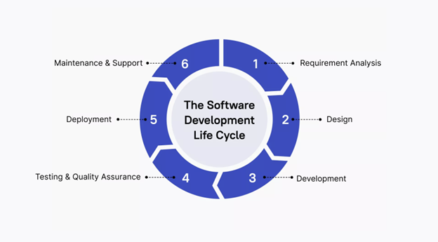

### Requirement analysis

- **Rapid prototyping**: Quickly generate code snippets based on high-level descriptions, allowing for faster proof-of-concept development.
- **User story implementation**: Transform user stories into initial function or class definitions, providing a starting point for development.
- **API design**: Suggest API structures based on described functionality, helping to flesh out system architectures.

### Design & development

- **Boilerplate code generation**: Automatically create repetitive code structures, saving time on setup tasks.
- **Design pattern implementation**: Suggest appropriate design patterns based on the problem context, promoting best practices.
- **Code optimization**: Offer more efficient code alternatives, helping developers write performant code from the start.
- **Cross-language translation**: Assist in translating concepts or code snippets between different programming languages.

#### Testing & quality assurance

- **Unit test creation**: Generate test cases based on function signatures and behavior, ensuring comprehensive test coverage.
- **Test data generation**: Create realistic test data sets, saving time on manual data creation.
- **Edge case identification**: Suggest test scenarios that cover edge cases, improving the robustness of tests.
- **Assertion suggestions**: Propose appropriate assertions based on the expected behavior of the code being tested.

#### Automated testing workflows

- **Test suite architecture**: Design complete testing frameworks that include unit tests, integration tests, and end-to-end testing scenarios for complex features.
- **Test automation pipelines**: Generate test configuration files and CI/CD integration that automatically runs appropriate test suites based on code changes.
- **Quality gates:** Create automated quality checks that ensure code meets standards before progression through the development pipeline.
- **Performance testing:** Generate performance benchmarks and load testing scenarios to validate system behavior under various conditions.

### Deployment

- **Configuration file generation**: Help create deployment configuration files for various environments.
- **Deployment script assistance**: Suggest commands or scripts for common deployment tasks.
- **Documentation updates**: Assist in updating deployment documentation to reflect recent changes.

### Maintenance & support

- **Bug fix suggestions**: Propose potential fixes for reported issues based on error messages and surrounding code.
- **Code refactoring:** Suggest improvements to existing code, helping to keep the codebase modern and efficient.
- **Documentation updates:** Assist in keeping code comments and documentation in sync with changes.
- **Legacy code understanding**: Help developers understand and work with unfamiliar or legacy code by providing explanations and modern equivalents.

## Building with orchestrated AI workflows

Modern software development increasingly benefits from coordinated AI assistance where multiple AI capabilities work together to handle complex development tasks.

### Simple agent orchestration patterns

- **Draft agent (GitHub Copilot)**: Analyzes feature requirements and generates initial implementation including:

  - Core functionality with proper error handling
  - Basic unit tests covering main scenarios
  - Inline documentation explaining the implementation
  - Integration points with existing code

- **Review agent**: Analyzes the draft code and provides:

  - Code quality assessment against project standards
  - Security vulnerability identification
  - Performance optimization suggestions
  - Architectural pattern compliance review

### Advanced orchestration capabilities

- **Architectural decision support**: Analyze trade-offs between different implementation approaches considering scalability, maintainability, and performance.
- **Cross-system impact analysis**: Understand how changes in one component affect other parts of a distributed system.
- **Complex refactoring coordination**: Orchestrate changes across multiple files and modules while preserving system functionality and performance.
- **Integration pattern optimization**: Suggest optimal patterns for connecting new features with existing system architecture.

### Comprehensive feature delivery workflows

- **Analysis phase**: Parse user stories and technical requirements to create implementation plans
- **Implementation phase**: Generate complete feature code including all necessary components
- **Quality assurance** phase: Create comprehensive test suites and quality checks
- **Documentation phase**: Generate user documentation, API docs, and maintenance guides
- **Deployment phase**: Create deployment scripts and monitoring configurations

## Understand limitations and measure impact

### Identify limitations of GitHub Copilot

#### Code quality and correctness

- **Potential for errors**: GitHub Copilot can sometimes suggest code that contains bugs or doesn't fully meet requirements.
- **Security concerns**: Generated code may not always adhere to best security practices, requiring careful review.
- **Context misinterpretation**: GitHub Copilot might misunderstand the broader context, leading to inappropriate suggestions.

#### Language and framework specificity

- **Varying performance**: GitHub Copilot's effectiveness can vary across different programming languages and frameworks.
- **Niche technologies**: For less common or newer technologies, suggestions may be less accurate or relevant.

#### Dependency on training data

- **Bias in suggestions**: GitHub Copilot's suggestions reflect patterns in its training data, which may include biases or outdated practices.
- **Copyright concerns**: There's ongoing debate about the copyright implications of code generated from trained models.

#### Complex problem solving

- **Limitation in high-level design**: GitHub Copilot excels at code-level tasks but may not grasp complex architectural decisions.
- **Creativity constraints**: While helpful, GitHub Copilot cannot replace human creativity in solving novel problems.

### Measure productivity gains

Understanding the productivity gains provided by GitHub Copilot is essential to maximizing its benefits. The **REST API for GitHub Copilot usage metrics** and **GitHub Copilot Developer Survey** offers a powerful way to measure and analyze how GitHub Copilot influences your development workflow.

#### Use the REST API endpoints for GitHub Copilot usage metrics

GitHub provides a REST API to access GitHub Copilot usage metrics for enterprise members, teams, and organization members.

##### Get a summary of GitHub Copilot usage for enterprise members

**Endpoint**: `GET /enterprises/{enterprise}/GitHub Copilot/usage`

This endpoint provides a daily breakdown of aggregated usage metrics for GitHub Copilot completions and GitHub Copilot Chat across all users in an enterprise. It includes details on suggestions, acceptances, and active users, further broken down by editor and language.

##### Get a summary of GitHub Copilot usage for an enterprise team

**Endpoint**: `GET /enterprises/{enterprise}/team/{team_slug}/GitHub Copilot/usage`

##### Get a summary of GitHub Copilot usage for organization members

**Endpoint**: `GET /orgs/{org}/GitHub Copilot/usage`

### Implementing a measurement framework

To systematically assess GitHub Copilot’s impact, consider the following framework, using the GitHub Copilot usage metric API at each stage:

1. **Evaluation**: During the initial phase of adopting GitHub Copilot, focus on leading indicators such as developer satisfaction and task completion rates. Use the API to collect metrics like Average Daily Active Users, Total Acceptance Rate, and Lines of Code Accepted.
2. **Adoption**: As GitHub Copilot becomes more integrated into your team’s workflow, continue to monitor productivity metrics and enablement indicators. The API can provide insights into user engagement and identify areas where further training may be needed.
3. **Optimization**: Once GitHub Copilot is fully adopted, use the REST API for GitHub Copilot usage metrics to fine-tune its impact on broader organizational goals, such as reducing time-to-market or improving code quality across the team.
4. **Sustained efficiency**: Continuously evaluate GitHub Copilot’s effectiveness as your organization evolves. The API allows for ongoing monitoring and adjustment to ensure long-term productivity gains.

#### Use the GitHub Copilot developer survey

1. **Survey cadence and timing**

When deploying the GitHub Copilot Developer Survey, it's important to establish a regular cadence to avoid survey fatigue while still gathering meaningful data.

  - **Short-form survey**: Can be conducted every two weeks if frequent feedback is needed.
  - **Long-form survey**: Recommended to be conducted no more than once every four weeks, particularly at the end of the evaluation and adoption stages.

2. **Structuring the survey**

The survey questions should be tailored to fit your organization’s specific needs, ensuring that the data collected is relevant and actionable. Here’s how to structure both the short-form and long-form surveys:

  - **Short-form survey**: Focuses on immediate feedback, capturing developers' overall satisfaction with GitHub Copilot, specific challenges faced, and time saved or wasted.
    - Example questions:
      - "How would you feel if you could no longer use GitHub Copilot?"
      - "When using GitHub Copilot, I enjoy coding more / write better quality code / complete tasks faster."
      - "What challenges have you encountered in using GitHub Copilot since your last survey?"

  - **Long-form survey**: Offers a deeper analysis of GitHub Copilot’s impact, capturing detailed insights into its usage and benefits, and how it affects team dynamics.
    - Example questions:
      - "I use GitHub Copilot to code in a familiar language / explore a new language / write repetitive code."
      - "When using GitHub Copilot, my team provides better code reviews / merges code to production faster."
      - "What challenges have you encountered in using GitHub Copilot since your last survey?"

3. Analyzing survey results

- **Privacy considerations**: Ensure that survey responses are anonymized and cannot be traced back to individual developers, meeting privacy obligations.
- **Data tracking**: Collate the survey responses into existing Business Intelligence (BI) tools or spreadsheets for ease of analysis. Over time, track the results to identify trends and make informed decisions about GitHub Copilot’s implementation.

4. Continuous improvement

Use the insights gathered from the surveys to make informed decisions about GitHub Copilot's deployment in your organization. Focus on addressing the challenges identified, leveraging the benefits reported by developers, and adjusting the tool’s use to maximize productivity.

# Develop unit tests using GitHub Copilot tools

## Examine the unit testing tools and environment

GitHub Copilot Chat can be used to suggest unit tests based on the code you specify.

*Generated test cases may not cover all possible scenarios. Manual testing and code reviews are necessary to ensure the quality of your code.*

### GitHub Copilot support for unit testing

GitHub Copilot can help with the following testing tasks:

- **Set up testing frameworks**: get help configuring the right testing framework and VS Code extensions for your project and language.
- **Generate test code**: create unit tests, integration tests, and end-to-end tests that cover your application code.
- **Handle edge cases**: generate comprehensive test suites to cover edge cases and error conditions.
- **Fix failing tests**: receive suggestions for fixing test failures.
- **Maintain consistency**: personalize GitHub Copilot to generate tests that follow your project's coding practices.

#### Set up your testing framework

GitHub Copilot can help set up the testing framework and VS Code extensions for your project. GitHub Copilot suggests appropriate testing frameworks based on your project type.

1. Open the Chat view.
2. Enter the `/setupTests` command in the chat input field.
3. Follow GitHub Copilot's guidance to configure your project.

#### Write unit tests with GitHub Copilot

You can generate unit tests using the following GitHub Copilot tools:

- **Chat view**: Use the Chat view to generate unit tests for a project, class, or method using the Ask, Plan, or Agent.
- **Inline Chat**: Use Inline Chat to generate unit tests for selected classes or methods.
- **Smart actions**: Use the Generate Tests smart action to generate unit tests for selected code without writing a prompt.
- **Code line completions**: Use code line completions to suggest addition unit tests for an existing test case.

#### Fix failing tests

GitHub Copilot integrates with the Test Explorer in Visual Studio Code and can help with fixing failing tests.

1. In the Test Explorer, hover over a failing test.
2. Select the **Fix Test Failure** button (sparkle icon)
3. Review and apply GitHub Copilot's suggested fix.

Alternatively, you can:

1. Open the Chat view.
2. Enter the `/fixTestFailure` slash command.
3. Follow GitHub Copilot's suggestions to fix the test

#### Maintain consistency

If your organization has specific testing requirements, you can customize how GitHub Copilot generates tests to ensure they meet your standards. You can personalize how GitHub Copilot generates tests by providing custom instructions. For example:

- Specify preferred testing frameworks
- Define naming conventions for tests
- Set code structure preferences
- Request specific test patterns or methodologies

### Visual Studio Code support for unit tests

To create and run C# unit tests in Visual Studio Code, you need the following resources:

- The .NET 8.0 SDK or later.
- The C# Dev Kit extension for Visual Studio Code.
- A test framework package added to your project.

#### C# Dev Kit support for unit tests

The C# Dev Kit extension for Visual Studio Code provides a rich set of features to help you create and manage unit tests for your C# projects. It includes the following features:

- Test Explorer - A tree view to show all the test cases in your workspace.
- Run/Debug test cases - A feature to run and debug test cases.
- View test results - A feature to view the test results.
- Testing commands - Commands to run all tests, run failed tests, and more.
- Testing settings - Settings specific to testing.
- Test framework package

The C# Dev Kit supports the following test frameworks:

- xUnit
- NUnit
- MSTest

#### Enabling a test framework

The Command Palette in Visual Studio Code provides the easiest way to enable a test framework for your project. You can open the Command Palette in the following ways:

- Press the **Ctrl + Shift + P** keys (Windows/Linux) or **Cmd + Shift + P** (macOS).
- Open the **View** menu, and then select **Command Palette**.
- Open the Solution Explorer view, right-click the solution folder, and then select **New Project**. This option opens the **Command Palette** with the **.NET:New Project...** command already selected.

#### xUnit

Open the Command Palette and select **.NET:New Project...** then select **xUnit Test Project** and provide name and location for the new project. This command creates a new project and directory that uses xUnit as the test library and configures the test runner by adding the following `<PackageReference />` elements to the project file.

- `Microsoft.NET.Test.Sdk`
- `xUnit`
- `xunit.runner.visualstudio`
- `coverlet.collector`

From the Terminal, you can run the following command:

`dotnet add [location of your test csproj file] reference [location of the csproj file for project to be tested]`

#### NUnit

- `Microsoft.NET.Test.Sdk`
- `NUnit`
- `NUnit3TestAdapter`

`dotnet add [location of your test csproj file] reference [location of the csproj file for project to be tested]`

#### MSTest

- `Microsoft.NET.Test.Sdk`
- `MSTest.TestAdapter`
- `MSTest.TestFramework`
- `coverlet.collector`

`dotnet add [location of your test csproj file] reference [location of the csproj file for project to be tested]`

### Develop unit tests in Visual Studio Code using GitHub Copilot Chat

The Unit testing process can be broken down into three stages:

- Use Visual Studio Code to create a test project for your unit tests.
- Use GitHub Copilot Chat to develop unit test cases for your C# project.
- Use Visual Studio Code and the C# Dev Kit to run and manage your unit tests.

#### Create a test project

You need to create a test project that will be used to hold your unit tests.

#### Generate unit test cases using GitHub Copilot Chat

You can use GitHub Copilot Chat to complete the following tasks:

- Write unit test cases for your test framework based on the code open in the editor or the code snippet you highlight in the editor. GitHub Copilot identifies your test framework and coding style and generates matching code snippets.
- Identify and write test cases for edge cases and boundary conditions that might be difficult to identify manually. For instance, GitHub Copilot can suggest test cases for error handling, null values, or unexpected input types.
- Suggest assertions that ensure the function is working correctly, based on the code's context and semantics. For example, generate assertions to ensure that function input parameters are valid.

Consider the following scenarios when asking GitHub Copilot Chat to generate unit test cases:

- If a single method is visible in full in the editor, you could ask GitHub Copilot Chat to generate a unit test for the method by typing `Write a unit test for the method in the #editor`.
- If there are multiple methods visible or the intended method extends beyond what's visible in the editor, select the code you want to generate a unit test for, then ask GitHub Copilot: `#selection write a unit test for the selected code`.

#### Run and manage unit tests in Visual Studio Code

- Run/Debug test cases: C# Dev Kit generates shortcuts (the green play button) on the left side of the class and method definition.
- Test Explorer: The Test Explorer is a tree view to show all the test cases in your workspace.
- View test results: After running/debugging the test cases, the state of the related test items is updated in both editor decorations and the Test Explorer.
- Visual Studio Code testing commands: There are testing commands (for example, Run All Tests) that can be found by searching for Test: in the Command Palette.
- Visual Studio Code testing settings: There are Visual Studio Code settings specific to testing that can be found by searching for Testing in the Settings editor.

## Create unit tests using the Generate Tests smart action

The Generate Tests smart action is a feature of GitHub Copilot that helps you create unit tests for your code. It analyzes the code in the current file and generates test cases based on the code's structure and behavior. This feature is particularly useful for developers who want to ensure their code is thoroughly tested and meets quality standards.

### Generate unit tests for a file

1. Open the file that contains the code you want to test.

2. Right-click inside the code editor, select **Generate Code**, and then select **Generate Tests**.

3. GitHub Copilot analyzes the code and generates unit tests for all functions and methods in the file.

The generated tests are displayed in the code editor, typically in a new test file or at the end of the current file, depending on your project's structure and testing framework.

The generated tests should include assertions and test cases that cover various scenarios for each function or method.

4. Review the generated tests.

You can make adjustments, such as changing the test names, modifying or removing test cases, or adding additional assertions.

Select **Accept** or **Close** to accept or discard the suggested unit tests.

5. Save the test file.

Test files are typically saved to a separate "tests" directory in a project that's configured for unit tests. Your options will depend on your project's structure and testing framework.

6. Run the tests to ensure they pass and verify the functionality of your code.

7. If necessary, refine the tests by adding additional test cases or modifying existing ones.

8. Save the file again after making any changes to the tests.

### Generate unit tests for a selection

1. Open the file that contains the code you want to test.

2. Select the code block that you want to test.

3. Right-click the selected code, select **Generate Code**, and then select **Generate Tests**.

4. GitHub Copilot analyzes the selected code and generates unit tests for the selected function or method.

5. Review the generated tests and make any necessary adjustments.

6. Save the file.

7. Run the tests to ensure they pass and verify the functionality of your code.

8. If necessary, refine the tests by adding additional test cases or modifying existing ones.

9. Save the file again after making any changes to the tests.

## Create unit tests using Inline Chat

The Inline Chat feature of GitHub Copilot allows you to create unit tests directly in the code editor. This is useful when you want to create tests for specific functions or methods without having to switch to the Chat view, but want more control than the Generate Tests smart action provides.

1. Open the file that contains the code you want to test.

2. Select the code block that you want to test.

3. Open an Inline Chat session.

Use the **Ctrl+I** keyboard shortcut to open the Inline Chat session. Alternatively, you can select **Editor Inline Chat** from one of the GitHub Copilot menus.

4. Enter a prompt that generates unit tests for the selected code.

For example: "`/tests Generate unit tests for this method. Validate both success and failure, and include edge cases.`"

5. Review the suggested unit tests.

You can make adjustments, such as changing the test names, modifying or removing test cases, or adding additional assertions.

The generated tests are displayed in the code editor. GitHub Copilot generates test code in an existing test file, or creates a new test file if one doesn't exist.

6. Select **Accept** or **Close** to accept or discard the suggested unit tests.

7. Save the test file.

Test files are typically saved to a separate "tests" directory in a project that's configured for unit tests. Your options will depend on your project's structure and testing framework.

8. Build the project to ensure the test file is included in the build and can be executed.

Resolve any build errors that may occur.

9. Run the tests to ensure they pass and verify the functionality of your code.

10. If necessary, refine the tests using Inline Chat to add or modify test cases.

## Create unit tests using Chat view modes

The Chat view in Visual Studio Code provides three built-in agents that can be used to create unit tests: Ask, Plan, and Agent. Each agent has its own strengths, and the best agent to use depends on the specific task at hand.

- The Ask agent is optimized for asking questions about your code projects, coding topics, and general technology concepts.
- The Plan agent is optimized for creating a structured, step-by-step implementation plan before writing any code.
- The Agent is optimized for starting an agentic coding workflow.

*When you use the Chat view with the Agent, GitHub Copilot may make multiple premium requests to complete a single task. Premium requests can be used by user-initiated prompts and follow-up actions GitHub Copilot takes on your behalf. The total premium requests used depends on the complexity of the task, the number of steps involved, and the model selected.*

### Use the Ask agent to create unit tests

To create unit tests using the Ask agent, follow these steps:

1. Open the file that contains the code you want to test.
2. Open the Chat view and start a new chat session using the Ask agent.
3. Add context to the chat session.
  - You can add context to the chat session by dragging and dropping files from Visual Studio Code's EXPLORER view into the Chat view. You can also use the Add Context button.
  - You can open external files in the code editor to include resources that aren't part of the workspace and use them to provide specific context.
  - You can use Copilot Chat with your project context to guide prompts and generate more relevant suggestions. This is especially useful when creating tests for multiple functions or methods in a file, or when generating tests for an entire file.
4. Enter a prompt that asks for unit tests for the code in the file.
    For example: "`I need to create unit tests for the code in this file. The tests should be written in Python and use the unittest framework. Please generate the tests and explain how they work.`"
5. Review the suggested unit tests, and refine the results using updated prompts if necessary.
6. Move the suggested unit tests into a test file.
  - For example, create a test file in the same directory as the code file, and then insert the suggested unit tests into the file.
  - You can use the Ask agent to suggest updates for specific tests after creating the test file, or use other GitHub Copilot tools to help with updates.
  - You can also use the Apply in Editor button to apply the suggested unit tests directly to the code file.
7. Save the test file.
  - Test files are typically saved to a separate "tests" directory in a project that's configured for unit tests. Your options depend on your project's structure and testing framework.
  - You can use the Ask agent to suggest updates for specific tests after creating the test file, or use other GitHub Copilot tools to help with updates.
8. Run the tests to ensure they pass and verify the functionality of your code.
9. If necessary, refine the tests by adding more test cases or modifying existing ones.
10. Save the file again after making any changes to the tests.

### Use the Plan agent to plan unit tests

*Similar to Ask agent*

### Use the Agent to create unit tests

The Agent can be used to automate tasks within your unit testing process. For example, you can use the Agent to scaffold a test project, create test files, run tests, generate test reports, or perform other tasks related to unit testing. The Agent is best for creating unit tests that require a more in-depth understanding of the project.

To create unit tests using the Agent, follow these steps:

1. Open the file that contains the code you want to test.
2. Open the Chat view and start a new chat session using the **Agent**.
3. Let the Agent determine the context.
When using the Agent, you don't need to specify the context. GitHub Copilot will automatically determine the relevant context and files to edit.
4. Optionally, select the Tools icon to configure which tools can be used for responding to your request.
  - You can select the tools that you want to use for responding to your request. For example, you can select the **Test Explorer** tool to run tests or the **Terminal** tool to run commands.
  - You can also select the GitHub Copilot tool to use GitHub Copilot's code generation capabilities.
5. Enter a prompt that defines the intended tasks.
  For example: "`Ensure that a suitable unit tests project is prepared for the selected code file. Create a test file in the unit test project that includes unit tests for all methods in the selected file. Unit tests should be written in C# and use the xUnit framework. Run the tests to ensure expected results.`"
6. Monitor the progress of the Agent as it performs the tasks.
    - Confirm tool invocations and terminal commands. You can confirm or reject the tool invocations and terminal commands that the Agent suggests. For example, you can confirm the command to run the tests or the command to generate a test report.
    - Interrupt the Agent if necessary. You can interrupt the Agent if you want to stop the tasks that it's performing. For example, you can interrupt the Agent if you want to change the context or if you want to change the tools that are being used.
7. Review the files that the Agent created or updated during the specified tasks, and then keep or discard updates.
  - You can use new prompts to correct or enhance specific tests if necessary.

# **Part 2**

# Building applications with GitHub Copilot agent mode

## What is GitHub Copilot Agent Mode?

Unlike traditional coding assistants that provide simple autocomplete-style suggestions, Agent Mode functions as an autonomous peer programmer that helps developers accomplish more with less effort.

With Agent Mode, GitHub Copilot can create applications from scratch, refactor code across multiple files, write and run tests, and migrate legacy code to modern frameworks. It can also generate documentation, integrate new libraries, and answer complex questions about a codebase. 

### How GitHub Copilot agent mode works

One of the most powerful aspects of Agent Mode is its ability to analyze an entire codebase and determine relevant files and dependencies before making changes. Instead of relying solely on the immediate context of a single file, Agent Mode evaluates the broader structure of a project, ensuring that modifications are consistent and align with best practices. This deeper level of understanding makes Copilot capable of assisting with tasks that require a project-wide perspective, such as refactoring across multiple files or updating an entire application to use a new framework.

Agent Mode works dynamically by processing requests in iterative cycles. When given a task, it:
- Determines the relevant files and dependencies before making edits.
- Suggests and executes code changes while ensuring they align with the project structure.
- Runs terminal commands as needed, such as compiling code, installing dependencies, and running tests.
- Monitors and refines its output, iterating multiple times to remediate issues and improve accuracy.

### Interact with GitHub Copilot

- **Inline Suggestions** - real-time code completions as you type.
- **Copilot Chat** - dedicated chat panel where you can ask coding-related questions; it tailors responses based on the context of your project files and dependencies.
- **Copilot Edits** - apply changes across multiple files to align with specific goals, making it easier to implement large-scale updates efficiently.
- **Agent Mode** - orchestrating development tasks dynamically; iterates multiple times to improve accuracy

### Benefits of Agent Mode

Developers can significantly increase productivity while maintaining full control over their projects. Since Copilot handles many of the tedious aspects of coding—such as repetitive edits, dependency management, and testing—it reduces cognitive load and allows developers to focus on higher-level design and problem-solving. Because Agent Mode iterates on its own outputs, it helps ensure code quality by catching errors and refining solutions before they require manual review.

## Explore the power of autonomous development assistance

### Autonomous operation

Copilot Agent Mode independently analyzes coding requests, dynamically identifies relevant files, determines appropriate terminal commands, and implements comprehensive solutions without explicit step-by-step instructions.

#### Example

**Task**: Create a new REST API endpoint.

**Agent Mode autonomously:**

- Creates API routes (`routes/api.js`)
- Updates main application (`app.js`)
- Installs necessary dependencies (`npm install express`)
- Generates test cases (`tests/api.test.js`)

Although highly autonomous, Agent Mode provides developers with complete transparency and control over each proposed change.

### Handling complex, multi-step tasks

Agent Mode excels in breaking down complex tasks into structured, sequential actions.

#### Multi-step task example

**Task**: Integrate a new database into an existing application.

**Agent Mode performs the following autonomously**:

1. Updates dependencies (`npm install mongoose`)
2. Generates database connection logic (`database.js`)
3. Modifies environment configuration (`.env`)
4. Creates relevant data model definitions (`models/userModel.js`)
5. Writes associated automated tests (`tests/userModel.test.js`)

### Multi-step orchestration workflows

Agent Mode excels at coordinating complex development processes through intelligent orchestration. Rather than requiring manual intervention at each step, Agent Mode can draft, review, and refine code in a seamless workflow that accelerates development cycles.

#### Draft-review-accept workflow

**Scenario**: Adding user authentication to an application

1. **Draft phase**: Agent Mode analyzes the requirements and generates:
  - Authentication middleware (`middleware/auth.js`)
  - User login routes (`routes/auth.js`)
  - Password hashing utilities (`utils/password.js`)
  - Basic frontend login form (`views/login.html`)
2. **Review phase**: Agent Mode immediately evaluates its own draft:
  - Identifies potential security vulnerabilities in password handling
  - Suggests improvements to error handling patterns
  - Recommends additional validation for edge cases
  - Proposes unit tests for critical authentication functions
3. **Accept phase**: Learner reviews the refined, PR-ready implementation:
  - Complete feature with built-in security best practices
  - Comprehensive error handling and validation
  - Ready-to-merge code that follows project conventions
  - Documentation and tests included from the start

*Each handoff in Agent Mode consumes ~1 PRU. A 2-step draft–review sequence typically uses 2–3 PRUs.*.

#### Automated foundation building

Agent Mode shines when handling repetitive setup tasks, allowing developers to focus on core business logic rather than boilerplate implementation:

**Scenario**: Setting up a new microservice

**Agent Mode automatically generates**:

- Project structure with standard directories (`src/`, `tests/`, `config/`)
- Package configuration (`package.json`, `Dockerfile`, `.gitignore`)
- Testing framework setup (`jest.config.js`, sample test files)
- CI/CD pipeline configuration (`.github/workflows/test.yml`)
- Environment configuration templates (`.env.example`, `config/default.js`)
- Basic monitoring and logging setup (`utils/logger.js`, health check endpoints)

**Developer focuses on**:

- Implementing specific business logic and domain models
- Customizing the generated foundation for unique requirements
- Adding specialized integrations and custom workflows

#### Advanced reasoning capabilities

For complex scenarios requiring deeper analysis, Agent Mode can leverage premium reasoning to provide more sophisticated solutions:

- **Architectural decision analysis**: Evaluate trade-offs between different implementation approaches
- **Cross-system impact assessment**: Understand how changes affect multiple components
- **Performance optimization strategies**: Identify bottlenecks and suggest improvements
- **Security vulnerability analysis**: Detect and propose fixes for potential security issues

*Premium reasoning (using more advanced models) provides richer context and deeper analysis, but it often doubles PRU consumption. A single request may use ~4+ PRUs compared to ~2 with the standard model.*

### Using intelligent tools and context awareness

To effectively complete tasks, Agent Mode uses context from your project's files, dependencies, and prior actions. By analyzing existing project structure and context, it offers accurate and contextually relevant outputs.

#### Context-aware deployment example

**Scenario**: Deploying a React application.

**Agent Mode intelligently**:

- Recognizes project type via `package.json`
- Runs suitable build scripts (`npm run build`)
- Prepares deployment scripts aligned with existing workflow contexts

### Iterative improvement and self-healing

One of Copilot Agent Mode's core strengths is its iterative problem-solving capability. If an error occurs, Agent Mode autonomously detects, corrects, and revalidates its solutions, significantly minimizing manual debugging effort.

#### Self-healing example

**Issue**: Generated unit tests initially fail due to a syntax error.

**Agent Mode autonomously**:

- Detects the cause of failure
- Applies a corrective solution
- Re-runs the tests until they pass successfully

### Ensuring user control and oversight

Despite its autonomy, Agent Mode keeps developers fully in control. Every action proposed by Agent Mode can be reviewed, adjusted, or reverted at any time, ensuring alignment with project standards.

#### Developer control example

**Situation**: Agent Mode proposes extensive changes to authentication logic.

**Developer can**:

- Review summarized changes in a pull request
- Request specific modifications or revisions
- Easily undo or adjust changes as required

### Limitations and practical considerations

Agent Mode does have limitations. It may struggle with specialized domain logic, nuanced business rules, or when critical project context is missing.

#### Limitation example

**Limitation**: Poorly documented custom business logic.

**Possible outcomes**:

- Less accurate or incomplete solutions
- Increased need for manual review and intervention

Understanding these limitations helps developers set realistic expectations and provide clearer context to maximize results.

# Accelerate development with GitHub Copilot Cloud Agent

## Understanding and enabling the GitHub Copilot Cloud Agent

### What is GitHub Copilot Cloud Agent, who can use it and where it's available.

GitHub Copilot Cloud Agent is an autonomous development assistant that runs inside GitHub itself. Rather than pairing with you only in your IDE, the agent acts like a background teammate. You give it a clearly scoped task—such as a bug fix, an incremental feature, or documentation update—and it creates a branch, explores the codebase, generates an implementation plan, and drafts code while keeping you in control of when and whether to open a pull request.

### Availability and plans

- **Plans**: Available on Copilot Pro, Copilot Pro+, Copilot Business, Copilot Enterprise.
- **Repositories**: Works in all GitHub-hosted repositories except those owned by managed user accounts or where the agent is explicitly disabled.

### What the Copilot Cloud Agent does

Copilot Cloud Agent can take on a wide range of development tasks:

- Fix bugs and regressions.
- Implement incremental new features.
- Improve test coverage or generate missing tests.
- Update or create documentation.
- Address technical debt and "nice-to-have" backlog items.

You can delegate work to the agent in two primary ways:

- **Assign an issue to Copilot**
- **Ask Copilot to make code changes**

When the agent finishes, it requests your review. You can mention @copilot in a pull-request comment to ask it to iterate on its work.

### How it differs from traditional IDE assistants

With Copilot Cloud Agent :

- All work happens as commits on GitHub.
- The agent automates branch creation, commit messages, and code drafting, while letting you decide if and when to open a PR.
- Work is visible in session logs and PR history for traceability.
- You steer via PR review comments rather than synchronous local sessions.

### Cloud agent vs. "Agent Mode" in IDEs

- **Cloud agent**: Runs autonomously in a GitHub Actions-powered environment to complete development tasks you assign through issues or Copilot Chat.
- **Agent mode (Copilot Edits)**: Performs autonomous local edits directly in your IDE session.

### Enabling the Copilot Cloud Agent

Before assigning tasks to Copilot, ensure the agent is enabled:

- **Organization-owned repositories**
- **Personal repositories**

**Usage Costs: GitHub Actions + PRUs**

Copilot Cloud Agent uses two main resources:

- **GitHub Actions minutes** for the ephemeral build/test environment where the agent works.
- **Copilot Premium Requests (PRUs)** to power advanced model reasoning.

## Security, risks, and limitations of the Copilot Cloud Agent

### Security model and built-in protections

- **Subject to governance** - Organization and enterprise settings govern availability; all your security policies continue to apply to the agent.
- **Restricted environment** - The agent runs inside a sandbox on GitHub Actions with firewalled internet access and read-only access to your repository.
- **Branch limits** - It can only create and push to branches beginning with `copilot/`, and all branch protections and required checks still apply.
- **Permission-aware** - The agent only responds to users with write permission. Comments from others are ignored.
- **Outside-collaborator rules** - Draft PRs from the agent require approval by a user with write permission before Actions run. The person who requested the PR can't approve it.
- **Compliance and attribution** - All commits are coauthored with the developer who assigned the task or requested the PR, so attribution is clear. Existing "required approvals" rules remain intact.

### Risks and mitigations

- **Risk**: Agent pushes code

  **Mitigations**: Only users with write access can trigger agent work. Pushes are restricted to `copilot/` branches (not `main/master`). The agent's credentials allow simple push only (no direct `git push`). GitHub Actions workflows won't run until a write-permission user clicks "Approve and run workflows". The requestor can't approve the agent's PR, maintaining required approvals.

- **Risk**: Access to sensitive information

  **Mitigation**: The agent's internet access is firewall-restricted by default; you can customize or disable the firewall per policy.

- **Risk**: Prompt injection

  **Mitigation**: Hidden characters (such as HTML comments) are filtered before passing user input to the agent. This reduces the chance of hidden harmful instructions in comments or issues.

### Known limitations

**Workflow limitations**

- Can only make changes in the same repository as the assigned issue or PR.
- Context scope is limited to the assigned repository by default (can be broadened via MCP).
- Opens exactly one pull request per task.
- Can't modify an existing PR it didn't create (add it as a reviewer if you need feedback instead by leveraging GitHub Copilot code review).

**Compatibility limitations**

- Doesn't sign commits. If you require signed commits, you must rewrite the commit history before merging.
- Requires GitHub-hosted Ubuntu x64 runners. Self-hosted runners are not supported.
- Not available for personal repositories owned by managed user accounts (runners unavailable).
- Doesn't honor content exclusions; the agent can see and update excluded files.
- The "Suggestions matching public code" policy isn't enforced by the agent; references may not be provided.
- Works only with GitHub-hosted repositories.
- You can't change the AI model used by the agent; it's selected by GitHub.

## Assigning, tracking, and troubleshooting Copilot Cloud Agent tasks

The GitHub Copilot Cloud Agent acts as an autonomous teammate that works directly inside GitHub. Once it is enabled, you can assign it a task, watch its progress in real time, and guide its work by leaving comments on its pull requests.

### Assigning issues to Copilot

When you assign an issue to Copilot, the agent acknowledges it by adding an 👀 reaction to the issue. It then creates a dedicated `copilot/` branch, opens a draft pull request linked to the issue, and begins an agent session inside a GitHub Actions-powered environment. As it works, Copilot pushes commits to the branch and updates the pull request body with status messages. Once the task is complete, Copilot posts a "Copilot finished work" event and requests your review.

On GitHub.com, you assign an issue to Copilot just like you would assign it to another user. Navigate to the repository's Issues tab, open the issue you want to delegate, and in the right sidebar under Assignees, select Copilot. Copilot receives the issue title, description, and any existing comments at the time of assignment. Later comments on the issue are not seen by the agent, so add new information as comments directly on the agent's pull request.

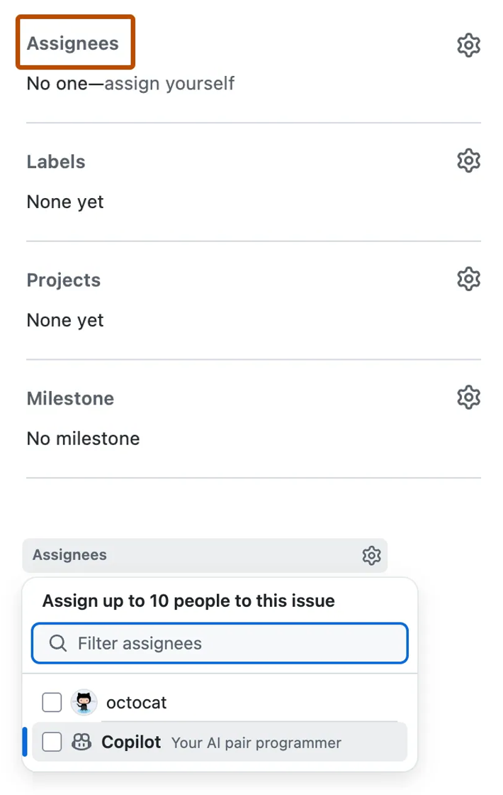

You can also assign issues to Copilot from the list of issues on a repository's Issues page, from GitHub Projects, or by using GitHub Mobile. For command-line workflows, you can use the GitHub CLI (`gh issue edit`) to add Copilot as an assignee.

### Assigning via the API

You can assign issues to Copilot programmatically through the GraphQL API. First, check that the coding agent is available by querying `suggestedActors` for the repository and verifying that `copilot-swe-agent` appears as a suggested actor. Next, fetch the repository ID. To create and assign a new issue, use the `createIssue` mutation, passing the repository ID and Copilot's bot ID. To assign an existing issue, fetch the issue ID and then use the `replaceActorsForAssignable` mutation to add Copilot as the assignee. This approach is useful for integrating Copilot into automated workflows.

#### Availability check

```
query {
  repository(owner: "octo-org", name: "octo-repo") {
    suggestedActors(capabilities: [CAN_BE_ASSIGNED], first: 100) {
      nodes { login __typename ... on Bot { id } ... on User { id } }
    }
  }
}
```

#### Get repository ID

```
query {
  repository(owner: "octo-org", name: "octo-repo") { id }
}
```

#### Create and assign a new issue

```
mutation {
  createIssue(
    input: {
      repositoryId: "REPOSITORY_ID",
      title: "Implement comprehensive unit tests",
      body: "DETAILS",
      assigneeIds: ["BOT_ID"]
    }
  ) {
    issue { id title assignees(first: 10) { nodes { login } } }
  }
}
```

#### Assign an existing issue

```
query {
  repository(owner: "monalisa", name: "octocat") {
    issue(number: 9000) { id title }
  }
}

mutation {
  replaceActorsForAssignable(
    input: { assignableId: "ISSUE_ID", actorIds: ["BOT_ID"] }
  ) {
    assignable {
      ... on Issue {
        id title
        assignees(first: 10) { nodes { login } }
      }
    }
  }
}
```

#### Tracking Copilot's progress

After you assign an issue to GitHub Copilot, the agent provides visible signals so you can follow its work from start to finish.

- **Immediate confirmation**. Shortly after you assign an issue, Copilot adds an 👀 reaction to the issue.

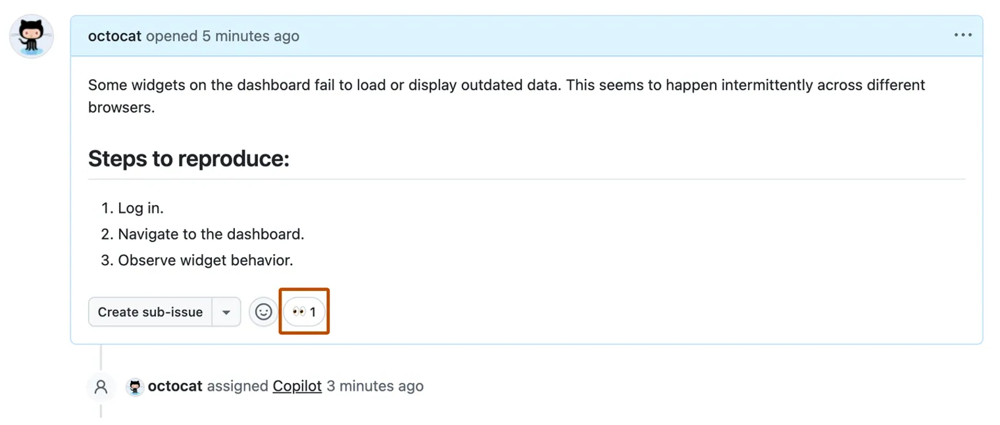

- **Draft pull request creation**. Within a few seconds, Copilot opens a draft pull request linked to the original issue. A new event appears in the issue's timeline showing the pull request.

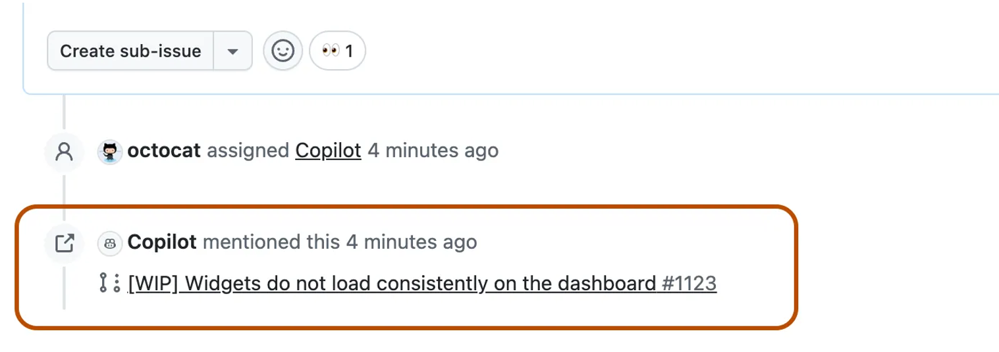

- **Active agent session**. Copilot starts an agent session to work on your issue. You'll see a "Copilot started work" event in the pull request timeline. As it runs, Copilot updates the pull request body with regular status messages and pushes commits to the dedicated branch.

- **Live session logs**. All your sessions-past and present-are visible from the Agents page. Click View session on the pull request to open the live session log viewer and watch Copilot's actions in real time. If you need to stop Copilot, click Stop session in the viewer.

- **Completion and review**. When Copilot finishes its work, the agent session ends automatically. A "Copilot finished work" event appears in the pull request timeline, and Copilot requests a review from you, triggering a notification.


### Iterating with Copilot

You guide Copilot's work the same way you would guide a human contributor-through comments and reviews. Mention @copilot in a pull request comment to request changes. Only comments from users with write permission to the repository are processed. Copilot posts an 👀 reaction to your comment to confirm that it has received the request, then adds "Copilot started work" to the pull request timeline as it resumes. This allows you to iterate on Copilot's work without leaving your normal review workflow.

### Approvals and workflows

Pull requests created by Copilot are always in draft state. They require human approval before merge, and GitHub Actions workflows triggered by the agent do not run automatically.

The developer who asked Copilot to create the pull request cannot approve it, which preserves your repository's "required reviews" rules and ensures an independent review before merge.

## Customizing, extending, and validating the Copilot Cloud Agent

GitHub Copilot Cloud Agent runs inside a secure, ephemeral GitHub Actions environment. With a few configuration steps you can preseed this environment to improve reliability and speed, extend the agent's capabilities with external tools through the Model Context Protocol (MCP), and apply best practices to test and validate the agent's output before merging.

### Preseeding the development environment

**Preinstall tools & dependencies with `copilot-setup-steps.yml`**

Create `.github/workflows/copilot-setup-steps.yml` on your repository's default branch. The workflow must define a **single job** named `copilot-setup-steps`. Include any steps needed to install dependencies or set up tools.

Example for TypeScript:

```yaml
name: "Copilot Setup Steps"

on:
  workflow_dispatch:
  push:
    paths:
      - .github/workflows/copilot-setup-steps.yml
  pull_request:
    paths:
      - .github/workflows/copilot-setup-steps.yml

jobs:
  copilot-setup-steps:
    runs-on: ubuntu-latest
    permissions:
      contents: read
    steps:
      - name: Checkout code
        uses: actions/checkout@v5
      - name: Set up Node.js
        uses: actions/setup-node@v4
        with:
          node-version: "20"
          cache: "npm"
      - name: Install JavaScript dependencies
        run: npm ci
```

Allowed configuration keys for the `copilot-setup-steps` job: `steps, permissions, runs-on, container, services, snapshot, timeout-minutes` (≤ 59). Any actions/checkout fetch-depth is overridden to allow safe rollback. The setup workflow runs standalone (so you can validate it) and then automatically before the agent starts.

**Larger GitHub-hosted runners**

- Add larger runners first
- In `copilot-setup-steps.yml`, set `runs-on` to the label/group (for example, `ubuntu-4-core`).
- **Only Ubuntu x64 runners are supported; self-hosted runners aren't supported.**

...

### Extend with the Model Context Protocol (MCP)

MCP is an open standard for connecting LLMs to tools and data. The agent can use **tools** provided by local or remote MCP servers to expand its capabilities.

*Note*: Copilot Cloud Agent supports MCP tools only (not resources or prompts). Remote MCP servers that require OAuth aren't supported.

**Default MCP servers**

- **GitHub MCP Server**: Access issues, PRs, and GitHub data with a read-only token scoped to the current repo by default (you can customize the token).
- **Playwright MCP Server**: Read, interact with, and take screenshots of web pages accessible inside the agent's environment (localhost/127.0.0.1).

**Repository configuration**

Admins can declare MCP servers via a JSON configuration in the repo. Once configured, the agent autonomously uses the available tools-no per-use approval prompts. See Extending GitHub Copilot Cloud Agent with MCP.

**Best practices**

- Review third-party MCP servers for performance and output quality implications.
- Prefer read tools; if write tools exist, allow only what's necessary.
- Carefully validate the MCP configuration before saving.

### Testing & validating agent output

You remain accountable for quality and security:

- Run CI (tests, linters, scanning) on every agent PR; these checks won't run until you click Approve and run workflows.
- Manually inspect high-impact or sensitive areas.
- Ask the agent to generate tests (e.g., "Add Jest unit tests for all functions in `src/utils/` following repo style") - multi-file test generation consumes PRUs.
- Enforce rulesets so agent PRs must pass tests + scanning + linting before merge.
- Label agent PRs (e.g., `agent-refactor`, `agent-tests`) to monitor, triage, and revert if needed.
- Iterate instructions in `.github/copilot-instructions.md` when you see repeated mistakes.
- Revert quickly if needed and request new changes from the agent.

**Using PRUs intentionally for validation**

Leverage PRUs for deeper validation tasks such as test coverage expansion, audits across directories, or risky area scans. Lightweight checks consume fewer PRUs, so apply them intentionally to maximize value.

## Responsible use of GitHub Copilot Cloud Agent on GitHub.com

### About Copilot Cloud Agent on GitHub.com

Copilot Cloud Agent is an autonomous and asynchronous software development agent integrated into GitHub. The agent can pick up a task from an issue or from Copilot Chat, create a branch, explore the codebase, generate an implementation plan, and draft code—letting you decide if and when to open a pull request.

Copilot Cloud Agent can generate tailored changes based on your description and configurations, including tasks like bug fixes, implementing incremental new features, prototyping, documentation, and codebase maintenance. If you decide to create a pull request, the agent can then iterate with you based on your feedback and reviews.

While working on your task, the agent has access to its own ephemeral development environment where it can make changes to your code, execute automated tests, and run linters. The agent has been evaluated across a variety of programming languages, with English as the primary supported language.

### How the agent works (end-to-end)

- **Prompt processing**

  The task provided to Copilot through an issue, pull request comment or Copilot Chat message is combined with other relevant, contextual information to form a prompt. Inputs can take the form of plain natural language, code snippets, or images.

- **Language model analysis**

  The prompt is then passed through a large language model, which analyzes the input to help the agent reason on the task and leverage necessary tools.

- **Response generation**

  The language model generates a response based on its analysis of the prompt. This response can take the form of natural language suggestions and code suggestions.

- **Output formatting**

  Once the agent completes its first run, it will update the pull request description with the changes it made. The agent may include supplemental information about resources it couldn't access and provide suggestions on the steps to resolve.

  You may provide feedback to the agent by commenting within the pull request or explicitly mentioning the agent (@copilot). The agent will then resubmit that feedback to the language model for further analysis. Once the agent completes changes based on feedback, it will respond to your comment with updated changes.

Copilot is intended to provide you with the most relevant solution for task resolution. However, it may not always provide the answer you are looking for. You are responsible for reviewing and validating responses generated by Copilot to ensure they are accurate and appropriate. Additionally, as part of our product development process, GitHub undertakes red teaming (testing) to understand and improve the safety of the agent.

### Use cases for Copilot Cloud Agent

- **Codebase maintenance**: Security fixes, dependency upgrades, and targeted refactoring.
- **Documentation**: Updating and creating new documentation.
- **Feature development**: Implementing incremental feature requests.
- **Improving test coverage**: Developing additional test suites for quality management.
- **Prototyping new projects**: Green fielding new concepts.

### Improving performance for Copilot Cloud Agent

- **Ensure your tasks are well-scoped by providing**:
  - A clear description of the problem to be solved or the work required.
  - Complete acceptance criteria on what a good solution looks like (for example, should there be unit tests?).
  - Hints or pointers on what files need to be changed.

- **Customize your experience with additional context** - Improve results by adding **custom Copilot instructions** so the agent understands how to build, test, and validate its changes.
- **Use Copilot Cloud Agent as a tool, not a replacement**
- **Use secure coding and code review practices**
- **Provide feedback**
- **Stay up to date**

### Security measures for Copilot Cloud Agent

- **Avoiding privilege escalation**
  - Copilot Cloud Agent will only respond to interactions from users with write access.
  - Actions workflows triggered by agent PRs require approval from a user with write access before they run.
  - Hidden characters (not rendered on GitHub.com) are filtered to reduce prompt-injection risks.
- **Constraining Copilot's permissions**
  - The agent only accesses the repository where it is scoped to; it cannot access other repositories.
  - Pushes are limited to branches with names beginning with copilot/ (not your default branch).
  - The agent does not have access to org/repo Actions secrets or variables at runtime. Only secrets/variables added to the copilot environment are passed to the agent.
- **Preventing data exfiltration** - A firewall is enabled by default to prevent accidental or malicious exfiltration of code or sensitive data.

### Limitations of Copilot Cloud Agent

- **Limited scope & quality**: The LLM may not handle certain code structures or obscure languages; quality varies by language coverage.
- **Potential biases**: Training data and retrieved context may include biases; the agent may lean toward certain languages or styles.
- **Security risks**: Generated code is based on repository context and could expose sensitive info if not reviewed; thorough review is required.
- **Inaccurate code**: Code may appear correct but be semantically/syntactically wrong or misaligned with intent. Validate fit, patterns, and style.
- **Public code**: The agent may produce matches/near-matches to public code even if "Block" is set; references may not be provided.
- **Legal/regulatory**: Ensure compliance with applicable obligations; avoid prohibited uses under terms of service and codes of conduct.

# Introduction to MCP Server

The GitHub MCP Server is a hosted, secure, scalable way to integrate your favorite GitHub features into your AI-assisted workflow. Built on the **Model Context Protocol (MCP)**, introduced by Anthropic, it's compatible with all of your favorite development tools.

Its suite of tools extends GitHub Copilot and other AI tools to help you automate tasks, manage repositories, and enhance your development experience with context-aware AI assistance.

## Simplify your AI workflow with GitHub MCP Server

AI is reshaping how developers work but making AI tools available across all environments can be challenging. GitHub MCP Server solves this by giving you a simple, scalable way to integrate GitHub Copilot to your code, along with related tools, and workflows.

Built on the Model Context Protocol (MCP), the GitHub MCP server removes setup friction and unlocks powerful capabilities from issue triage to semantic search across web, mobile, and desktop.

### What is MCP?

MCP (Model Context Protocol) is like a USB-C standard for your AI tools, providing a consistent and secure way for AI models to connect to the tools and data sources they need.

MCP offers:

- Access to a growing library of tools that your AI models can use immediately.
- Flexibility to work with different AI providers while keeping your workflows consistent.
- Integration into your existing development environment and processes.

### How MCP clients connect to servers and services

An MCP Client (such as Claude, an IDE, or another tool) can interact with MCP Servers and their connected services in three primary ways. The specific approach depends on whether the underlying resources are local or remote.

#### Local communication with local data

The MCP Client talks directly to an MCP Server running on your machine using the MCP Protocol. That server then connects to a local data source (for example, files, databases, or other resources stored on your computer).

**When to use it**: This setup is useful for local development, or anytime you want fast access to data that stays private on your machine.

#### Local server as a bridge to remote services

The MCP Client still connects to an MCP Server running locally. But instead of working only with local data, this server bridges to a remote service on the internet by calling its Web APIs.

**When to use it**: This model is common when a local tool needs to fetch or update information from a remote service but benefits from having a local server in between—for example, to handle caching, security checks, or data preprocessing.

#### Remote communication over the internet

In the final setup, the MCP Client connects to an MCP Server that lives entirely on the internet (not on your machine). That remote server then communicates with other external services via Web APIs.

**When to use it**: This approach is best when the resource or computation you need can't happen locally—like using cloud-based compute, SaaS platforms, or third-party integrations that only exist online.

### Why use GitHub MCP Server?

Let's first understand why GitHub MCP Server matters for your workflow. Using local MCP servers typically requires Docker, token management, and manual configuration, which can slow down your setup and block integration with web clients like GitHub.com.

Connecting to the GitHub-hosted server is quick and easy with no need for docker or config files. You can use AI tools like GitHub Copilot chat across web and mobile to scale your projects as they grow. GitHub MCP Server supports secure enterprise sign-in and gives you access to advanced features like semantic code search and automated fixes to boost your workflow.

GitHub MCP Server benefits include:

- Eliminates the need for Docker or manual configuration files.
- Provides easy one-click OAuth login for fast authentication.
- Allows you to work seamlessly across web, desktop, and mobile environments.
- Supports enterprise identity providers such as Entra and Auth0 for secure authentication.
- Scales automatically to meet your usage needs.

### GitHub MCP Server in action

GitHub MCP Server is an open-source server that connects GitHub Copilot and other AI tools directly to your repositories. It allows you to:

- Analyze and summarize your code to better understand your projects.
- Create and manage issues and pull requests.
- Automate repository triage and task tracking to save time.

Currently, GitHub MCP Server offers over 30 tools, enabling you to:

- Add issues, edit files, and create branches easily.
- Rank pull requests and issues to identify priorities.

## Configure, connect, and use GitHub MCP Server in VS Code

### Set up GitHub MCP Server in VS Code

#### Use OAuth

1. In Visual Studio Code, open the Command Palette by pressing Ctrl+Shift+P (Windows/Linux) or Cmd+Shift+P (Mac).
2. Type MCP: add server and press Enter.
3. From the list, select **HTTP (HTTP or Server-Sent Events).**
4. In the **Server URL** field, enter https://api.githubcopilot.com/mcp/, then press Enter.
5. When prompted to enter a **Server ID**, you can press Enter to use the default or type a custom ID if you prefer.
6. Choose where you would like to save your MCP Server configuration. You can add it to your user settings to use across all projects or to your workspace settings for the current project.
7. A prompt will appear asking you to authorize with GitHub using OAuth. Select **Allow** and sign in to your GitHub account if prompted.

After setup, GitHub MCP Server will be ready to use with your projects in VS Code. You can now start using AI-powered tools and workflows to automate tasks, manage issues, and analyze your code directly within your editor, helping you stay focused on your work while GitHub MCP Server handles the heavy lifting in the background.

#### Use Personal Access Token

In order to use Personal Access Token (PAT) for advanced control, you can follow these steps:

1. Create a PAT with repo and read: packages scope in your GitHub account.
2. You'll follow the same steps above, but cancel OAuth when prompted.
3. In your configuration file, add:
```json
"headers": {
  "Authorization": "Bearer ${input:github_token}"
}
```

4. Next, add an input prompt to securely enter your token:
```json
"inputs": [
  {
    "id": "github_token",
    "type": "promptString",
    "description": "GitHub Personal Access Token",
    "password": true
  }
]
```
5. Finally, restart the MCP server in VS Code and enter your PAT when prompted.
6. The MCP server will now be configured to use the PAT for authorization.

## Using GitHub MCP Server with Copilot Chat

### How to use GitHub MCP Server with Copilot Chat

1. Open Copilot Chat in Visual Studio Code and switch to Agent mode to activate the MCP Server tools.
2. Click on Select tools to view all the available MCP Server functionalities.
3. You can now try creating a new issue, summarizing a repository, or getting insights into your work using natural language prompts.
4. Follow the prompts within Copilot Chat to complete your tasks efficiently.

### Copilot's agentic capabilities and MCP

#### What are agentic capabilities?

Agentic capabilities give Copilot the ability to:

- Work independently by carrying out multi-step workflows without needing constant guidance.

- Make decisions by choosing which tools or approaches to use based on the context it has. Adapt and improve by responding to feedback, adjusting its approach, and iterating on results.

#### How MCP makes Agent mode stronger

Through MCP, Copilot can:

- Access external data, APIs, or enterprise tools directly.
- Stay in context across multiple platforms, without requiring you to switch applications.
- Complete “agentic loops,” where it dynamically seeks information, analyzes results, and makes informed next steps, all without restarting the process from scratch.

#### Benefits of combining MCP with Agent Mode

- **Extended context**: Copilot can draw on information from multiple systems, not just your code editor.
- **Reduced manual effort**: Routine work like opening issues, managing workflows, or running checks can be automated while you focus on higher-value decisions.
- **Seamless integration**: Copilot can carry out tasks that span tools and platforms, without needing custom connectors or constant switching.

#### Best practices for success

- **Be clear about goals**: Define what you want Copilot to achieve, and what the final output should look like.
- **Provide context**: Share background details about your project or workflow. This could include links, references, or prior steps.
- **Set boundaries**: If you want Copilot to stop at planning (and not make changes yet), state that. You can also limit which MCP tools are active.
- **Ask for confirmation**: Before big changes, have Copilot summarize its plan so you can approve or refine it.
- **Use prompt files or instructions**: Create custom prompt files that guide Copilot on how to behave with specific MCP servers. This keeps its behavior consistent and aligned with your workflows.

## More

### How MCP Tool Calling Works in Agent Mode

With every prompt you send, Copilot also includes the catalog (list + schema) of available tools. Copilot can then plan and decide:

- Is any tool needed for this request?
- Which tool(s) best match the intent?
- What arguments (per each tool's input schema) should be passed?

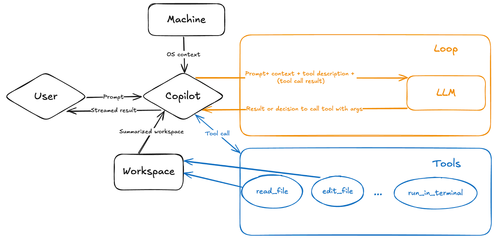

Copilot then executes the chosen tool call(s) and streams results back to the LLM.

You can also explicitly nudge Copilot to call a specific tool by including `#<tool_name>` in your prompt (e.g `#create_pull_request`, `#codebase`).

From here, Copilot can use a set of GitHub‑aware tools to do more than just read or edit code in your repo. Here are a few things you can ask it to do:

- Discover similar public projects to get inspiration.
- Search issues considering description, comments, and likes.
- Turn the new ideas you like into issues right away so you don’t lose them.
- Retrieve an issue, make changes on a branch, and start a pull request.

# Leveling up code reviews and pull requests with GitHub Copilot

## Introduction

Code reviews are vital for maintaining code quality and collaboration, but they often create bottlenecks. Developers juggle long review cycles, inconsistent feedback, and difficulty providing actionable suggestions-especially across multiple languages and frameworks. Small errors slip through, and pull requests can take days to merge.

GitHub Copilot helps resolve these challenges by acting as a collaborative reviewer and assistant. It doesn't replace humans but works alongside them-catching issues, suggesting improvements, drafting summaries, and even auto-fixing vulnerabilities. You can also customize Copilot with your own review guidelines, so it looks for the same patterns and standards you care about as a human reviewer. This means Copilot not only accelerates reviews but also enforces your team's best practices consistently across repositories. The result is faster reviews, higher quality, and less cognitive load for teams.

## What GitHub Copilot adds to the review process

### Key features of Copilot in code reviews

- **PR Summaries**: Copilot can automatically draft pull request descriptions that include a clear summary of changes and a list of affected files. This ensures reviewers start with context, not guesswork.
- **Security Fixes**: With Copilot code review integrated into GitHub Code Scanning, vulnerabilities are flagged across languages. For example, in JavaScript, Copilot can spot unsanitized input passed to eval() and comment:

  "eval() with user input can lead to code injection. Replace it with a safe parser like JSON.parse()." It then offers an inline patch aligned with your repository's security guidelines.
- **Line-by-Line Explanations**: Reviewers can highlight code and ask Copilot to explain functionality, helping them understand unfamiliar code quickly.
- **Drafting Comments**: Copilot can generate review comments based on best practices or team guidelines, making feedback clear and actionable.
- **Reviews in Your IDE**: In addition to working directly on GitHub.com, Copilot can also review code inside your IDE. This allows developers to catch and resolve issues before opening a pull request, speeding up the process and reducing rework.

### Understand how PRUs unlock advanced review capabilities

PRUs power these advanced capabilities. For example, assigning Copilot as a PR reviewer uses a PRU each time it posts comments. When combined with custom `.github/copilot-instructions.md` files, PRU-powered reviews align with your team's rules, whether they focus on readability, security, or style.

Example:

Without Copilot, a PR might include vague comments from a reviewer like "*Fix security issue here*". With the help of Copilot + PRUs, the review becomes:

"The use of `exec()` introduces a code injection vulnerability. Consider replacing it with `subprocess.run()` for safer command execution. Here's a suggested patch:" And it provides the code fix inline.

### Five different ways Copilot review helps developers

- Code review Suggestions
- Copilot reviews across multiple languages
- Formatting data in Pull requests
- Writing Effective Pull Request Summaries
- Explaining and Reviewing Code

### Using Copilot suggestions in code reviews

When you're reviewing a pull request, you might spot areas that could be improved but not have the time to draft the perfect example or snippet yourself. GitHub Copilot helps fill that gap without taking over the author's work. Inside the pull request "Files changed" view, you can highlight a line or block of code and ask Copilot to suggest improvements or flag potential issues. Copilot then generates a concrete, context-aware suggestion that you can copy into your review comment, making your feedback clearer and easier for the author to act on.

For example, while reviewing a Ruby file with repeated logic, you could highlight the relevant lines and ask:

"Suggest a cleaner Ruby refactor for this repeated code."

Copilot will propose an updated version that follows common Ruby best practices. You can paste its recommendation (or parts of it) into your review comment along with your own explanation. This keeps you focused on the overall quality and design while still giving the author actionable, high-value feedback-without blurring the line between reviewing and coding on their behalf.

### Reviewing across multiple languages

When you request a code review, Copilot can automatically highlight areas that don't follow best practices or team guidelines

Copilot will quickly generate improvements that align with the conventions of the language, enabling you to give stronger, more accurate review feedback even outside your primary area of expertise.

### Formatting data for pull requests

Pull requests are much clearer when they include well-formatted context such as metrics, screenshots, or test results. However, teams often forget to format this content consistently. GitHub Copilot can act as a second set of eyes during code review, automatically flagging poorly formatted tables in a pull request description and proposing a cleaner version that aligns with your company's style guidelines.

### Writing effective pull request summaries

Writing PR descriptions is often the last step in the process and can feel like a hurdle. Copilot makes this easier. From the PR description editor, you can use the Copilot icon to generate a draft summary or outline.

### Explaining and reviewing code

Sometimes you may be unfamiliar with the code in a pull request. Instead of struggling through it, you can ask Copilot to explain the changes. Copilot can also run an initial review of your own PRs before you request feedback from teammates.

## Using Copilot as a reviewer in GitHub.com

On GitHub.com, requesting a Copilot review is as simple as adding it from the Reviewers menu. Within seconds, Copilot generates a comment review-not an approval or rejection-so it never blocks merges but instead adds valuable context for human reviewers. You can also customize Copilot's behavior by adding a copilot-instructions.md file to your repository.

### How to code review on GitHub.com

1. **Open or create a pull request** - Start by creating a new pull request or navigating to an existing one in your repository.
2. **Add Copilot as a reviewer** - In the Reviewers menu, select Copilot.
3. **Wait for the review to complete** - Copilot begins analyzing your pull request right away. Reviews typically finish in less than 30 seconds, so you'll get results quickly without interrupting your workflow.
4. **Review Copilot's comments** - Scroll through the pull request to read Copilot's feedback. Suggestions are left as comments on the relevant lines of code.
5. **Apply Copilot's suggested changes** - When Copilot flags issues, you can commit fixes directly from the PR interface. For peer review comments, you can use Copilot to generate solutions quickly.
  
  Example prompt:

  "Suggest a fix for this review comment: Replace `exec()` with a safer function."

  Copilot proposes a patch using `subprocess.run()`. The developer tests it locally, commits, and ensures tests pass.

  PRUs make these fixes faster and smarter-enabling Copilot to analyze review comments alongside code context to propose high-quality solutions.

6. **Understanding the limits**

  Copilot's role in reviews is advisory. It doesn't approve or reject pull requests, and its comments don't count toward required approvals. Use it to catch issues early, generate actionable suggestions, and speed up routine checks, but rely on human reviewers for architectural decisions, nuanced trade-offs, and final sign-off.

## Catching issues early and automating reviews with Copilot

GitHub Copilot reviews don't have to wait until you open a pull request.

### Running Copilot reviews locally in your IDE

To guide reviews, create a `.github/copilot-instructions.md` file with rules such as:

- "Focus on security and avoid unsafe string interpolation."
- "Ensure functions have docstrings explaining parameters and return types."

Copilot then applies these rules automatically to reviews to analyze larger diffs and provide context-rich insights that align with your repo's style.

### Creating path-specific custom instructions

1. **Create the instructions directory**

  In the root of your repository, add a folder named .github/instructions if it doesn't already exist.

2. **Add instruction files**

  Inside that folder, create one or more files ending in .instructions.md (for example, security.instructions.md). The file name describes the purpose of the instructions.

3. **Define the paths to apply to**

  At the top of each file, add a frontmatter block with an applyTo keyword. Use glob syntax to target the files or directories where these instructions should apply.

  *Example - apply to Ruby models:*

  ```
  applyTo: "app/models/**/*.rb"
  ```

  *Example - apply to TypeScript files:*

  ```
  applyTo: "**/*.ts,**/*.tsx"
  ```

  To apply to all files in the repository, use:

  ```
  applyTo: "**"
  ```

4. **Write your custom guidance**

  Below the frontmatter, add your review guidance in plain language using Markdown. You can write it as a paragraph, on separate lines, or with blank lines for readability. Copilot will follow these instructions whenever it reviews or generates code for the matching paths.

### Leverage PRUs for deeper analysis in your IDE

When you run Copilot reviews directly inside your IDE-such as Visual Studio Code or JetBrains-you're not limited to the lightweight checks available on GitHub.com. By allocating Premium Request Units (PRUs) to these local reviews, Copilot can tap into more advanced models that analyze larger diffs, apply your repository's custom instructions, and surface higher-quality suggestions before code ever reaches a pull request. This means you can spot style violations, security gaps, and best-practice issues earlier in the development cycle, saving time during formal reviews and reducing back-and-forth with teammates. PRU-powered reviews in your IDE give you a deeper, context-rich analysis right where you write and test code, while still leaving final judgment and sign-off to human reviewers.

### Automating reviews and scaling with Rulesets

GitHub allows you to configure rulesets so Copilot is automatically assigned to all PRs targeting protected branches.

Pair Copilot reviews with status checks like tests or code scanning. This creates a pipeline where:

- Copilot reviews for style and readability.
- Code scanning flags vulnerabilities.
- Tests validate functionality.

### Automatic reviews for your account

This option is only available if you are on the Copilot Pro or Copilot Pro+ plan.

When you turn this feature on in your personal Copilot settings, every PR you open will automatically be reviewed. This helps individual developers catch issues early across all their work.

### Automatic reviews for a repository

Steps:

1. In the repository, click Settings.
2. In the left sidebar, expand Code and automation and select Rules → Rulesets.
3. Click New ruleset, then choose New branch ruleset.
4. Enter a name, set Enforcement status to Active, and select target branches (e.g., default branch).
5. Under Branch rules, check Require a pull request before merging.
6. In the expanded options, select Request pull request review from Copilot.
7. At the bottom, click Create.

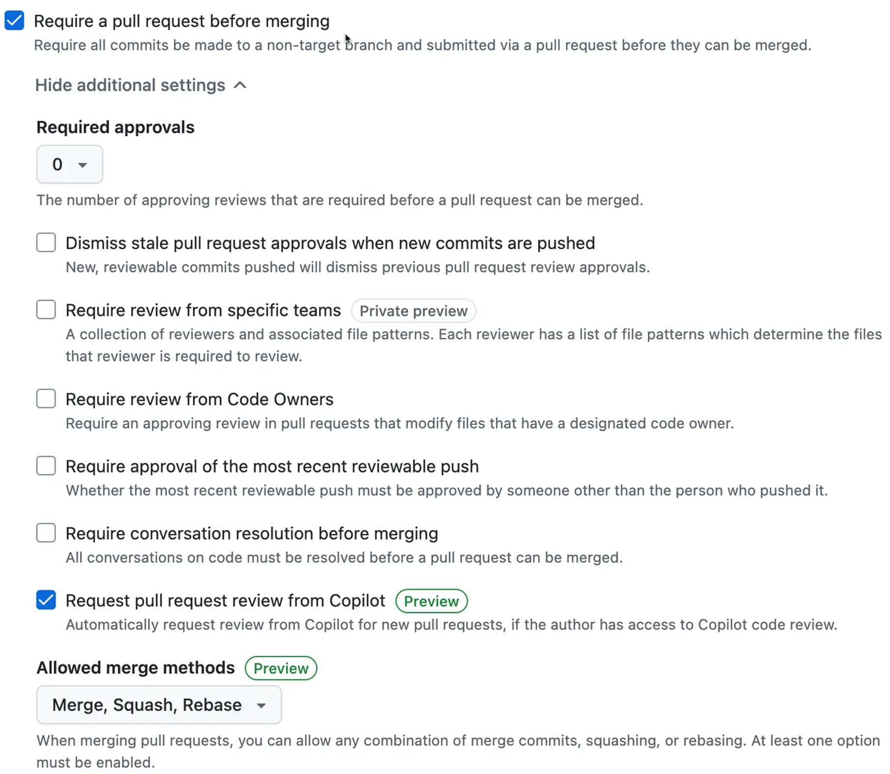

### Automatic reviews across an organization

Organization owners can create rulesets that apply to selected repositories, based on name patterns or inclusion/exclusion rules.

In the upper-right corner of GitHub, click your profile picture, then select Your organizations.

Choose the organization, then go to Settings.

In the sidebar, select Repository → Rulesets.
Click New ruleset → New branch ruleset.

Provide a ruleset name and set Enforcement status to Active.

Add target repositories by specifying inclusion or exclusion patterns (e.g., *service to match all service repos).

Define target branches.

Enable Require a pull request before merging, then check Request pull request review from Copilot.

Save by clicking Create.

## Measuring impact and optimizing premium request units (PRUs)

Every time you assign Copilot to review a large pull request, ask it to apply your repository's custom instructions to an entire codebase, or run a deep analysis of changes in your IDE, you're using PRUs. These premium resources give Copilot the additional processing power and context depth needed to provide richer reasoning, more reliable outputs, and suggestions that align with your team's standards.

### Understanding PRUs

Think of Premium Request Units (PRUs) as tokens that unlock Copilot's “extra gear.” Routine, lightweight tasks-like suggesting a small refactor to a single line-often don't consume PRUs. But premium-level tasks do. For example, asking Copilot to review a 1,500-line change across multiple files, apply your `.github/copilot-instructions.md` file, and check for security and style issues requires far more context and reasoning power.

With PRUs, Copilot can scan entire diffs, interpret your custom review guidelines, and return actionable fixes in seconds. Without them, it provides only its default, lightweight suggestions. PRUs make the difference between quick hints and full, context-rich analysis that's aligned with your team's standards-directly inside your pull requests or IDE.

**Example scenario**:

A developer pushes a massive refactor touching dozens of files. Copilot, assigned as a reviewer, uses PRUs to apply the repository's security and style guidelines to the entire change, flags several unsafe string interpolations, and even drafts Markdown comments explaining the issue. Instead of spending hours doing manual checks, human reviewers can now focus on the architectural impact of the refactor.

### Why PRUs matter for teams

- **Get deeper analysis**: Spot subtle vulnerabilities, duplicated logic, or style violations across large diffs before they reach production.
- **Enforce consistency**: Apply the same security, readability, or style checks across every pull request automatically.
- **Handle bursts of activity**: During busy release cycles, rely on PRU-powered reviews to keep quality steady while human reviewers handle complex design decisions.

**Example scenario**:

Your team maintains a microservices architecture in Go, Python, and TypeScript. During a pre-release crunch, Copilot uses PRUs to review each service for language-specific best practices-flagging a risky `eval()` call in JavaScript and recommending a safer parser, while also catching a missing error check in a Go handler. This lets your team merge fixes quickly across all services without missing critical details.

### Measuring the impact of PRU-powered reviews

To understand the return on PRUs, track metrics such as:

- **PR lead time**: How quickly pull requests go from open to merged after adding Copilot reviews.
- **Quality indicators**: Reduction in post-merge security or style issues flagged by other tools.
- **Developer experience**: Feedback on whether Copilot makes reviews faster or clearer.

**Example metric**:

Before using PRUs, large PRs took an average of three days to merge and frequently triggered style fixes after release. After enabling PRU-powered reviews, the same PRs merged in one day with far fewer follow-up commits.

### Optimizing PRU usage

- **Plan ahead**: Set alerts when you hit 75%, 90%, and 100% of your monthly PRU usage.
- **Use PRUs strategically**: Reserve premium reviews for large or high-risk changes; rely on standard Copilot suggestions for simple edits.
- **Refine your prompts**: Clean, specific requests reduce unnecessary retries and wasted PRUs.
- **Scale up if needed**: If your team consistently maxes out PRUs, consider a higher-tier Copilot plan to support the workload.

**Example scenario**:

A team notices that many PRUs are spent on trivial documentation changes. They update their workflow to use non-PRU requests for small edits and reserve PRU-powered reviews for code that affects production. As a result, their monthly PRU usage drops by 30% without losing quality.


