# Getting Started on Prompt Engineering with Generative AI

❌ *Šta je dobar poklon za prijatelja?*

✅ *Predloži poklon do 50$ za prijatelja koji se uselio u novi stan i voli kuvanje.*

**Prompt engineering** - umetnost i nauka iza dizajniranja efektivnih upita ili instrukcija za dobijanje željenih odgovora.

Pitaj bolja pitanja kako bi dobio bolje odgovore.

## How Generative AI Works

**Trained on massive dataset** - vesti, internet, knjige, naučni radovi...

Slično učenju jezika u školi - prvo slova, pa reči, pa rečenice, pa gramatika...

*Once upon a ____* (Bilo jednom _____) - predikcija sledeće reči.

*Moram do prodavnice da kupim...* **šta? U opštem slučaju može da bude bilo šta. Dodavanjem informacija i konteksta sužavamo izbor.** Npr. ako znamo da osoba treba da jede žitarice, jedan od ponuđenih odgovora će biti mleko.

**AI modeli vrše predikciju sledeće reči.**

## Side-by-side Prompt Comparisons

| Nejasan prompt | Bolji prompt |
| -- | -- |
| "Objasni API" | "Objasni šta je API u jednom paragrafu koristeći analogije iz stvarnog sveta za netehnička lica" |
| "Napiši API dokumentaciju" | "Napiši API *endpoint* dokumentaciju za `/users` putanju koja uključuje metode, parametre i primere" |
| "Pomozi mi sa *bug*-om" | "Predloži moguće uzroke za JavaScript grešku: 'undefined is not a function` u React-u kada se pritisne dugme" |
| "Napravi sažetak sastanka" | "Napravi sažetak ključnih odluka donetih na sastanku u obliku liste" |
| "Daj mi ideje za prezentaciju" | "Daj mi 5 ideja za 15-minutnu prezentaciju na temu optimizacije troškova *cloud*-a za DevOps timove"  |
| "Poboljšaj ovaj email" | "Ponovo napiši email da zvuči samouverenije i sažetije u kom se stajkholder pita za povratnu informaciju o tehničkom predlogu" |

AI alati su vremenom postali bolji, pa će nakon davanja odgovora posle generičkog prompta pitati korisnika za dodatne informacije kako bi odgovor bio bolji.

## Creating Effective and Structured Prompts - Anatomy of a Prompt

- **Persona** - What role should the model play? - Koju ulogu će model igrati?
- **Instructions** - What should the model do? This typically starts with an action word. - Šta će model raditi? Obično počine sa akcionom reči.
- **Input content** - Text to be processed by the model. - Tekst koji će model obraditi.
- **Format** - Requirements around format for the output, if any. - Zahtevi oko formata izlaza, ako ih ima.
- **Additional information** - Any other helpful context or background. - Bilo koji korisni kontekst ili informacije.

Primer 1:
- **Persona** - As a data analyst preparing report for executives...
- **Instructions** - ...generate a summary...
- **Input content** - ... of key findings from the Q2 sales performance dataset...
- **Format** - ...written in natural language with 3-4 insights, and one chart recommendation.
- **Additional information** - Avoid technical terms like p-values and regressions; instead, focus on business impact and trends.


Primer 2:
- **Persona** - As a technical writer creating internal documentation...
- **Instructions** - ...please summarize...
- **Input content** - ...the following API documentation for the `/login` and `/logout` endpoints...
- **Format** - ...into a concise quick reference guide with clear descriptions and example calls.
- **Additional information** - Assume the audience is familiar with REST APIs but not this particular service. Avoid overly technical jargon and keep it under 300 words.

## Zero-shot Prompting

**Zero-shot prompting** je jednostavan prompt koji uključuje nula primera, što znači da mu se ne daju eksplicitne informacije na kojima trenira, već se samo koristi opšte znanje stečeno tokom treniranja.

- *Summarize the key features of Amazon S3 for someone new to clound storage.*
- *Suggest five small AI side projects that a software developer could build in a weekend.*
- *Explain the difference between APIs and webhooks in plain English, without using any technical jargon.*

## Few-shot Prompting

**Few-shot prompting** uključuje nekoliko (**a FEW**) kontekstulanih primera kako bi se poboljšao učinak modela za dati zadatak.

---

- Example 1: Feedback: 'It's hard to find the settings menu.' - Category: Usability Issue.
- Example 2: Feedback: 'The app crashed twice today when uploading files.' - Category: Bug Report.

  Please categorize this feedback: 'I wish there was a dark mode option.' - Category:

  Response: Category: Feature Request.

---

Generate a compelling title for a blog about AI in project management. Use the examples below for ideas.

- Example 1: Blog about cloud migration: '5 Pitfalls to Avoid When Moving to the Cloud.'
- Example 2: Blog about remote work: 'Building a Strong Company Culture Without and Office.'

  Response: 'How AI is Reshaping Project Management: What You Need To Know

## Chain-of-thought Prompting

**Chain-of-thought prompting** se koristi prilikom rešavanja složenih problema tako što ih razbije na manje korake.

Ključne fraze: **step-by-step** ili **think out loud**.

---

A user reports that they can't log into your company's web app. They're entering the correct username and password, but still get an error.

What steps would you take to troubleshoot this issue? Think step by step.

---

We need to deploy a web app that must scale quickly under variable traffic. Step-by-step, reason through whether AWS Elastic Beanstalk, Azure App Service, or Kubernetes on GCP would be the best option.

---

A Python script that reads a CSV file and uploads data to a database is failing with a 'ValueError: could not convert string to float.' Think step-by-step through what could cause this error and how to fix it.

---

We want to improve the user onboarding flow for an SaaS app. Think through step-by-step what elements make a good onboarding experience, and how to measure success.

## General Strategies for Better Prompting

Kako dobiti bolje odgovore:

- **Koristi jasan cilj** - koristi akcione reči, specificiraj publiku i željeni izlazni format.
- **Pruži informacije/pozadinu i kontekst** - pruži relevantne činjenice, podatke i dokumenta.
- **Budi specifičan/određen** - koristi precizan jezik, razbij zadatke i kvantifikuj zahtev gde je to moguće.
- **Prođi kroz više iteracija i rafinisanja** - probaj različite dužine promptova, fraze i nivoe detalja.
- **Samo-refleksija** - pitaj za rupe/nedostatke u rasuđivanju i pretpostavkama.

---

Zadatak: Pitaj AI da objasni tehnički koncept netehničkoj osobi. Koristi 2 tipa promptova:

- Zero-shot
- Few-shot

Rešenje:

- Zero-shot - Explain client/server HTTP architecture to someone without technical background.
- Few-shot - Explain client/server HTTP to someone without technical background. Use simple, real-world analogy. Below are the examples that explain technical ideas simply:
  - Wi-Fi is like invisible cables connecting your device to the internet.
  - Cloud storage is like renting a locker where you can keep your files safe and access them anytime.

---

Zadatak: Planiraš ažuriranje sistema u više departmana. Neki timovi rade u različitim vremenskim zonama i postoje *dependencies* između aplikacija. Koristeći *chain-of-thought prompting*, pitaj AI za pomoć u identifikovanju najboljeg vremena za ažuriranje i korake koji treba da se preduzmu kako bi se ažuriranja koordinisala.

Rešenje: I'm planning a system update that will impact multiple departments accross different time zones, and there are dependencies between apps. Think through the following step-by-step:
- What factors should I consider when choosing the best time for the update?
- How can I minimise disruption across teams?
- What steps should I take to coordinate the update and communicate it effectively?

## Evaluation and Refining AI Responses

Kriterijumi za evaluaciju:

- **Accuracy** (preciznost)
- **Coherence** (koherentnost/povezanost)
- **Bias** (pristrasnost/sklonost)

***AI može da halucinira i izmišlja pogrešne činjenice.*** Čovek bi uvek trebalo da proveri odgovore koje je AI predložio.

Saveti za povećanje **preciznosti**:

- Pitaj AI da citira izvore informacija
- Pruži AI-u ključne činjenice unutar prompta unapred - tako se smanjuje verovatnoća da AI popuni praznine samostalno
- Naloži AI-u da odgovori sa "ne znam" ukoliko nije siguran u svoj odgovor

Saveti za povećanje **koherentnosti/povezanosti**:

- Koristi *chain-of-thought* promptovanje
- Naloži AI-u da struktuira svoj odgovor - npr. "organizuj odgovor u 3 glavne tačke", "počni sa definicijom i zatim pruži primer"

Saveti za smanjenje **pristrasnosti**:
- Traži inkluzivni, nepristrasan jezik
- Naloži AI-u da se samoproceni u vezi pristrasnosti

## Evaluation Techniques

**Ankete i intervjuisanje korisnika**:

- Da li su informacije tačne i relevantne za dati prompt?
- Da li odgovor ima logičan tok i ostaje na zadatoj temi?
- Da li je jezik jasan i lak za razumevanje?
- Postoje li znakovi pristrasnosti, stereotipa ili nepravednih pretpostavki?
- Da li je odgovor AI-a predstavljen prikladnim tonom?
- Koliko ste zadovoljni brzinom odgovora?
- Da li osećate da je razgovor sa AI-em napredovao prirodnim tokom?

**A/B testiranje** - davanje 2 različita odgovora na isti prompt korisnika. Proverava se koji odgovor su korisnici bolje prihvatili.

- Koji prompt je doveo do uspešnijih povratnih transkacija?
- Koji prompt je skratio trajanje razgovora (indikator glatkije interakcije)?
- Koji prompt je doveo do više ocene zadovoljstva korisnika u anketama nakon interakcije?

**Self-critique prompting** - AI se pita da ponovo pregleda svoj odgovor i razmisli o njemu.

*Review your previous response for any inaccuracies, logical gaps, or bias. Then suggest ways to improve it.*

### Advanced Evaluation Techniques and Metrics

*Beyond scope for this course.*

- **BLEU (Bilingual Evaluation Understudy)** - text quality
- **ROUGE (Recall-oriented Understudy for Gisting Evaluation)** - text quality
- **Perplexity** - semantic evaluation, similarity, summarization accuracy
- **BERTScore** - semantic evaluation, similarity, summarization accuracy
- **SummC** - semantic evaluation, similarity, summarization accuracy

## Getting Better Results by Adjusting Parameters

Postoje aplikacije u kojima možemo da podesimo vrednosti raznih parametara za kvalitet odgovora.

**OpenAi Prompts Playground**:

- Text format (dropdown)
- Temperature (number slider)
- Max tokens (number slider)
- Top P (number slider)
- Store logs (bool)

**Google Gemini**:
- Structured output
- Code execution
- Function calling
- ...

**Amazon Bedrock**:
- Temperature
- Top P
- Top K
- Maximum length
- ...

Uobičajeni parametri:
- **Max tokens** - kontroliše dužinu (i cenu) izlaza; 1 token je okvirno 1 reč ili deo reči
- **Temperature** - kontroliše koliko je AI "kreativan" ili "predvidiv"; veća vrednost parametra je više kreativnosti
- **Top P (nucleus sampling)** - kontroliše nasumičnost (engl. *randomness*) sužavajući izbor na najboljih X% najverovatnijih opcija; u principu, fokusiranost vs. širina reči u odgovorima
- **Stop sequence** - govori modelu gde da prestane sa generisanjem teksta; npr. ako navedemo upitnik (?) kao stop sequence, odgovor prestaje da se generiše nakon što se naiđe na znak upitnika (?).

## Real-world Applications of Prompt Engineering

Persona-based Prompting:
- Writers and marketers
- Developers and IT pros
- Business, operations and project managers
- Creatives and innovators

### Prompting for Writers and Marketers

**Your team needs three catchy headlines for tomorrow's marketing campaign.**

*Generate ten catchy headlines for a LinkedIn post about the benefits of remote work, aimed at mid-career professionals.*

10 umesto 3, kako bismo imali nekoliko ideja.

*Make the headlines slightly more playful, but still professional.*

*Focus more on emotional benefits like flexibility and work-life balance.*

*Suggest a few that are formatted as questions.*

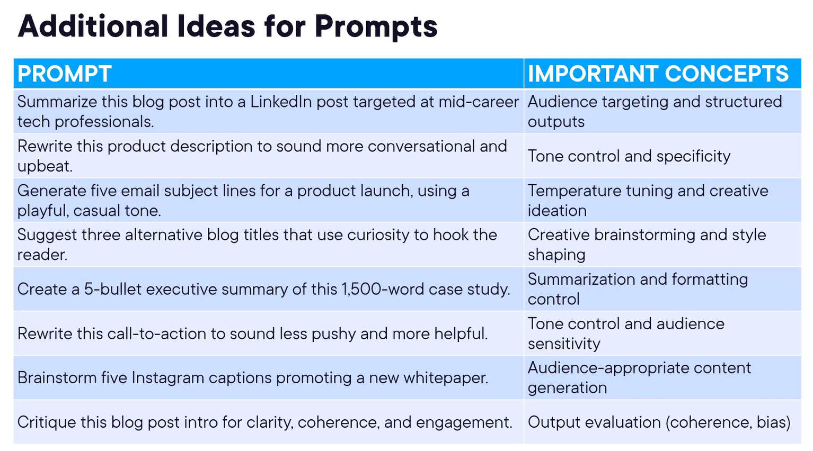

### Prompting for Developers and IT Pros

**You've been asked to create a simple Python script that reads a CSV file and outputs a formatted summary report.**

*Write a Python script that reads a CSV file containing sales data (columns: Product, Quantity, Price) and generates a summary report showing total sales per product.*

*Add error handling for missing invalid data in the CSV.*

*Modify the script to sort the output by highest total sales.*

*Format the output nicely as a table in the console output.*

*Optimize the script for larger CSV files by using efficient data structures.*

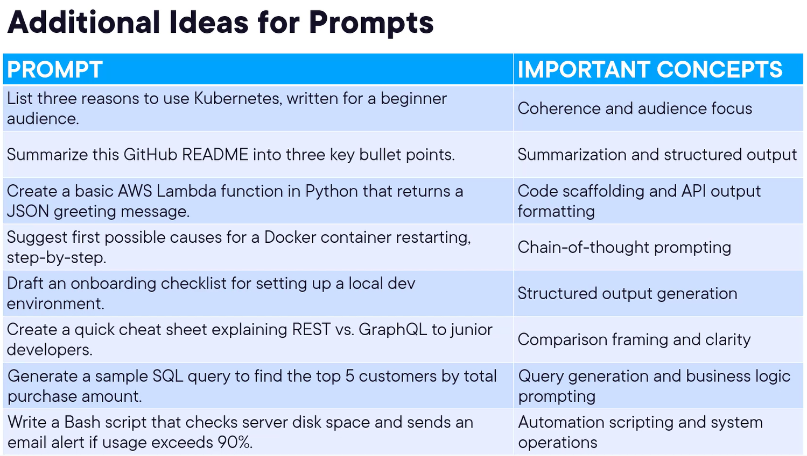

### Prompts for Business, Operations and Project Managers

**You just got a vendor update that's three pages long and full of excuses. Your executive team needs clear bullet-point summary without the drama.**

*Summarize this vendor update in five executive‑friendly bullet points. Focus on the facts and next steps, and avoid emotional language.*

*Tighten the bullet points even more for under 15 words each.*

*Organize the bullets by urgency: most urgent at the top.*

*Highlight any major risks or upcoming deadlines separately.*

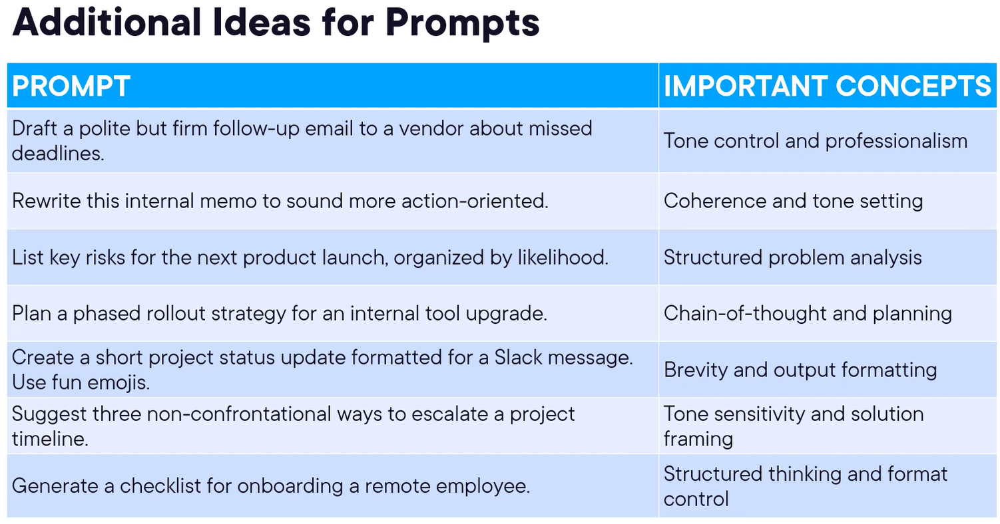

### Prompts for Creatives and Innovators

**You are pitching new brand names for a travel company. Your first ten ideas were rejected by the client. You need fresh, adventurous, memorable names.**

*Brainstorm 10 adventurous, inspiring brand names for a travel company focused on exploration and personal growth.*

*Make the names even more bold and emotionally charged.*

*Suggets some one-word brand names only.*

*Suggest a few names inspired by nature or mythology.*

## Applying what we learned

*As a gym trainee with 10 years of experience, create a plan to fix my posture. Primary areas for fixing are hips, shoulders and neck, as I spend a lot of time sitting. Create list for each area with 5-10 main exercises or stretches. Assume I am familiar with anatomy and add which muscles are tight or weak for every exercise or stretch.*

*Convert this into 15-minute "daily posture reset".*

# Advanced Prompt Engineering

## Setting the stage for advanced prompting

Your first client - mid-sized electronics retailer.

- Consumer tech
- Gaming equipment

Need: marketing analysis for Q4 strategy.

Current prompts do not give useful insights.

Šta nedostaje u trenutnoj AI analizi?

- **Previše uopšteno** - iste uvide ima bilo koji drugi prodavac.
- **Ne razmatra se baza mušterija** - potrošači sa ograničenim budžetom ili tehnološki entuzijasti?
- **Nejasne i očigledne preporuke** - predlozi nisu delotvorni
- **Rasuđivanje nije podržano** - nisu pruženi nikakvi podaci ili nivoi pouzdanosti
- **Nema poslovnog konteksta** - nedostaju lokacija, konkurenti i lanci snabdevanja

**ChatGPT tourism** - kada se dobije lepa tura ili opis teme, ali ništa na osnovu čega može da se deluje.

Ako firma unajmi usluge analize, pružiće kontekst, svoje željene ciljeve, daće primer analize koja im je neophodna i objasniće ograničenja u okviru svog poslovanja. **Ako je AI-u pruže svi ti podaci, funkcionisaće isto kao i ljudski konsultant.** Umesto uopštenih trendova tržišta, dobiće se:

- Targetirane preporuke
- Podražavajući podaci
- Pozicija na tržištu
- Jasni naredni koraci

## Teaching the model

- Zero-shot prompting
- Few-shot prompting
- Many-shot prompting

LLM-ovi prepoznaju šablone.

- Pokaži im šablone preko primera.
- Menjaju te šablone sa novim podacima.

Slično kao učenje kroz demonstraciju umesto preko instrukcija.


*You are a market research analyst specializing in electronics retails. Below are examples of high-quality market analyses for electronics retailers:*

*Example 1:*

*Company: Concordia (regional electronics retailer, 15 stores, targets tech entusiasts)*

*Analysis request: Tablet market for back-to-school season*

*Response:*
*- Market position: iPad dominance (65% market share) but price-sensitive students drive Android tablet growth (+23% education segment)*
*- Recommendation: Focus on Samsung Galaxy Tab A series ($200-300 range) and budget Lenovo tablets*
*- Rationale: Higher margins than iPad, strong student appeal, less competition from big box stores in this price range*
*- Action items: Negotiate student discounts, bundle with accessories, target local colleges with demos*
*- Risk: Apple's potential education pricing changes in September*

*Example 2:*

*Company: Tech Planet (online-focused, competes on price, serves price-concious consumers)*

*Analysis request: Wireless headphone trends for holiday season*

*Response:*
*- Market position: Premium market dominated by Apple/Sony, but 70% of consumers seek sub-100% options*
*- Recommendation: Stock JLab, Anker Soundcore, and Skullcandy heavily; minimal AirPods inventory*
*- Rationale: 40% higher margins, less price competition, strong online review in target demographic*
*- Action items: Create comparison content, leverage influencer partnerships, offer extended warranties*
*- Risk: Supply chain delays from smaller manufacturers*

*Now provide the same type of analysis for:*

*Company: TechZone (mid-sized electronics retailer, 25 stores, specializes in consumer tech and gaming equipment, competes with Best Buy and Amazon)*

*Analysis request: Smartphone market trends and brand recommendations for the next Q4 strategy*

AI sada razume naše potrebe:

- Specifično pozicioniranje na tržištu u odnosu na ostale konkurente
- Jasne preporuke sa obrazložejnem
- Uzimanje u margina i konkurentske dinamike u obzir
- Konkretne delotvorne stavke
- Procena rizika

**Uključivanje negativnog primera** u prompt poboljšava few-shot prompting.

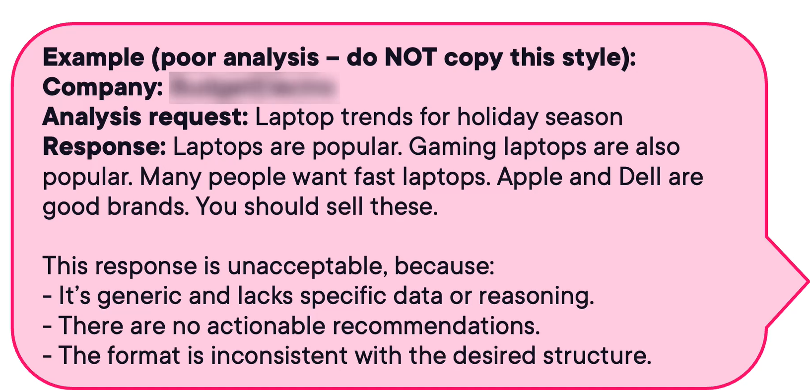

Kada koristiti Many-shot prompting?

- Moćni za kompleksne zadatke vezane za usko specifičan domen
- Kada želimo da AI savlada određene formate i rasuđivanja
- Zahteva da imamo dovoljno primera koje možemo da pružimo

Pro's of Few- and Many-shot prompting:

- Dramatično povećava kvalitet i specifičnost izlaza
- AI uči tačne formate i stilove rasuđivanja
- Radi na svim AI platformama
- Dobijaju se bolji rezultati u poređenju sa ostalim trikovima za promptove

Con's:

- Traži više tokena, pa je cena viša
- Potrebni su dobri primeri na početku
- Potrebno je vremena da se naprave dobri primeri
- Ne mora nužno da radi za potpuno nove zadatke

**Few-shot prompting pretvara AI iz generaliste u specijalistu.**

## Advanced Prompting Method: ReAct

Klijent: firma za dostavu.

**Reasoning + Action = ReAct**

Poreklo:

- Naučni rad
- Treniranje AI modela da alterniraju između rasuđivanja i delanja

Danas:

- ReAct prompting
- Strukturisanje promptova da navode AI kroz isti sistemstski proces razmišljanja

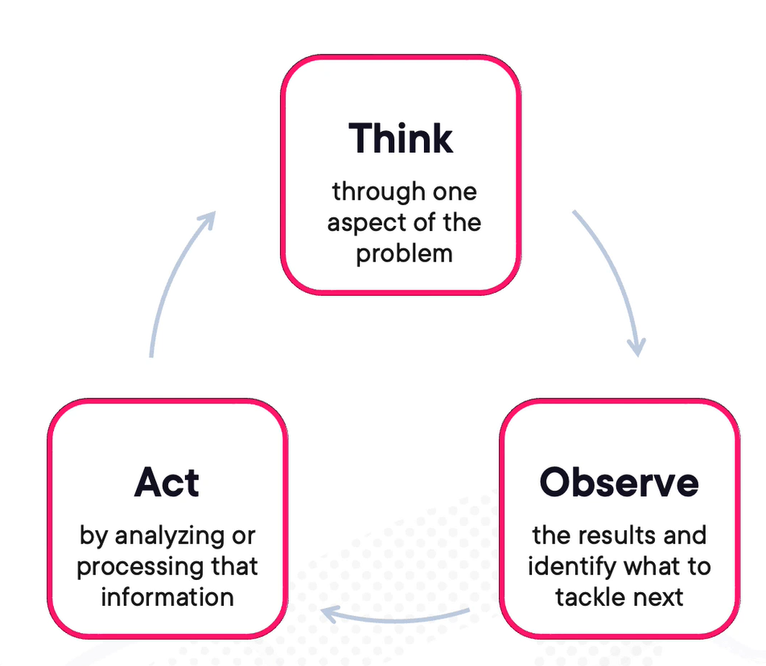

Potreban je uslov za prekidanje kako bi se izbegle nepotrebne iteracije petlje.

ReAct vs Few-shot prompting:

- **Few-shot** - uči koristeći primer dobrog izlaza
- **ReAct** - uči razmišljanju korak po korak

ReAct je dobar kada nam je potrebno da:

- AI bude metodičan
- AI proverava sopstveni rad
- AI proverava nekoliko međusobno zavisnih činilaca

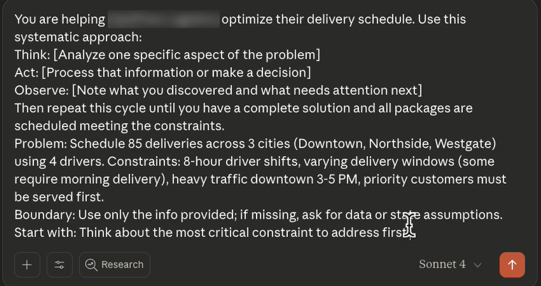

Šta nam daje ReAct prompt:

- Sistematično identifikovanje prioritetnih ograničenja
- Prvi korak optimizacije rute
- Detekciju problema
- Pretpostavke oko zahteva reda vožnje
- Rasuđivanje

Koristiti ReAct prompting kada nam je potrebno:

- Složeni problemi sa više koraka
- Transparentno rasuđivanje sa revizijom
- Manje grešaka kroz sistematsko razmišljanje
- Balansiranje više ograničenja
- Debagovanje kada stvari pođu naopako

Kompromisi ReAct promptinga:

- Traži više tokena u odnosu na jednostavno promptovanje
- Preteran je za jednostavne zadatke
- Zahteva da poznajemo strukturu problema
- Može se zaglaviti u petlji bez dobrog navođenja

**ReAct prompting pokušava da od AI-a napravi metodičnog rešavača problema.**

## Advanced Prompting Method: Reflexion

Klijent: Firma iz SAD za online učenje; specijalizovana za korporativnu edukaciju iz oblasti prava; AI personalizovani putavi učenja; žele da se prošire internacionalno.

**ReAct** - uči AI-a da misli korak po korak

**Reflexion** - uči AI-a da se osvrne na i kritikuje svoj pređašnji rad.

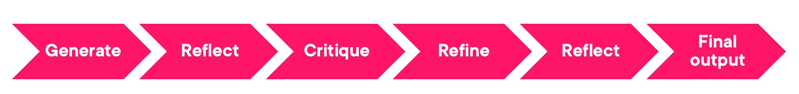

O AI-u može da se misli kao da je u isto vreme:

- Analitičar
- Stariji revizor (engl. *senior reviewer*)

Većina AI grešaka prati predvidive šablone:

- Zastarele informacije
- Kulturološke stereotipe
- Pretpostavke bez pokrića

**Refleksija uči AI da aktivno traži i rešava ove probleme.**

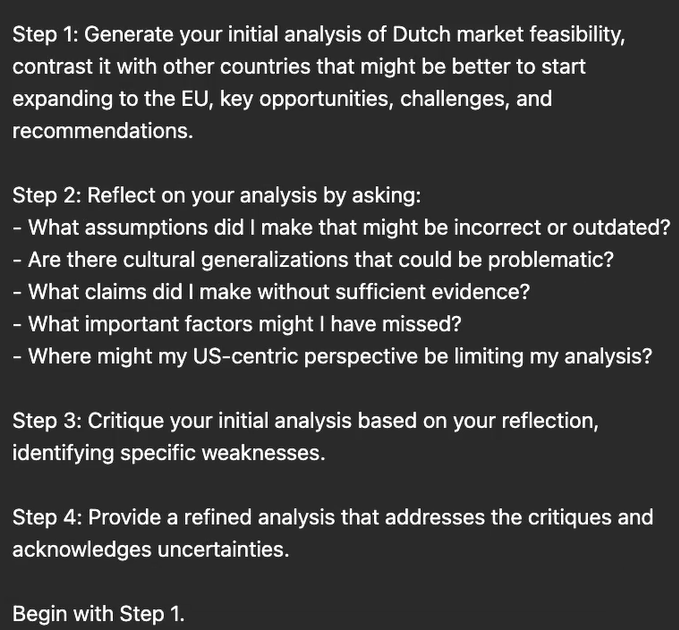

*If you want, I can move on to Step 2 (reflection).*

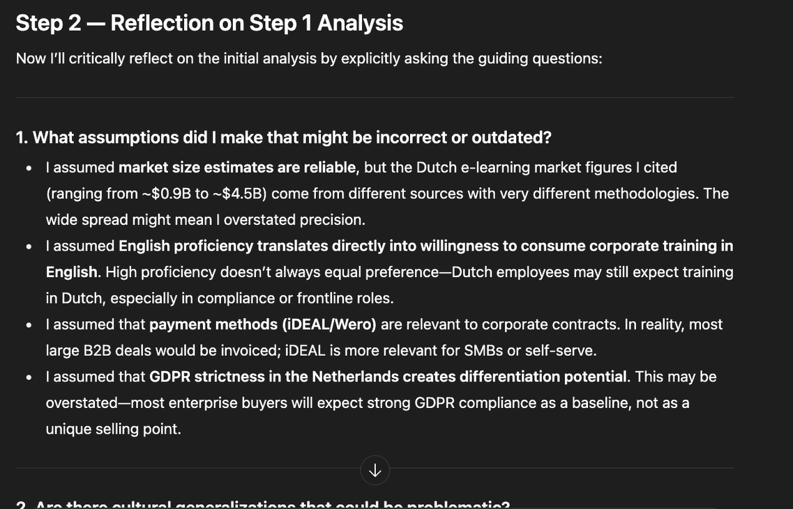

*Would you like me to move to on to Step 3 (critique of my Step 1 analysis)?*

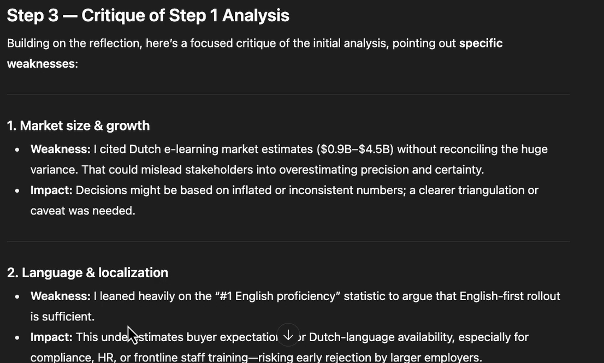

*Would you like me to now move on to Step 4 (refined analysis that addresses these critiques and acknowledges uncertainties)?*

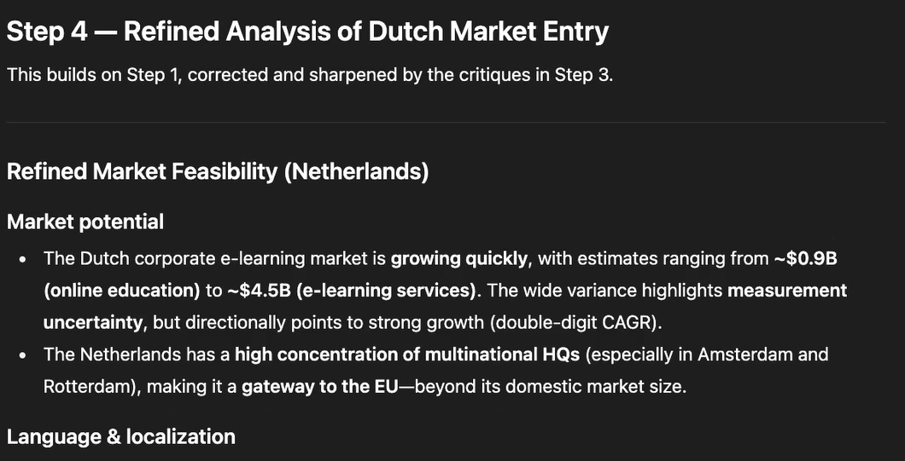

Šta nam je dao reflexion prompt?

- Preciznije uvide
- Samokorekciju pristrasnosti
- Izlaz sa više nijansi i sa otkrivenim procepima
- Jasnu identifikaciju rizika i nesigurnosti

Koristiti reflexion prompting kada treba:

- Poboljšati preciznost za odluke sa visokim ulozima
- Uhvatiti kulturološke pretpostavke i pristrasnosti
- Učiniti AI rezonovanje transparentnim revidibilnim
- Automatski ugraditi AI kontrolu

Reflexion je savršen za:

- Strategiju
- Analizu
- Poslove savetovanja

Kompromisi:

- Viša potrošnja tokena
- Sporije u odnosu na osnovno promptovanje
- Preterano za jednostavne zadatke
- Zahteva poznavanje kako izgleda dobra kritika/recenzija.

**Reflexion turns AI from confident advisor into careful consultant.**

## Advanced Prompting Method: Tree of Thought

Klijent: Marketinška agencija - specijalizuju se za održive, etičke brendove.

Imaju novog klijenta:

- Održivi modni startap za žene
- Prozor za pokretanje od šest meseci
- Četiri potpuno različite strategije sadržaja
- Ne smemo da pretpostavimo pogrešno!

Tree-of-thought prompting:

- Ne samo jedna linija rasuđivanja
- Kao strateški tim za konsultacije
- AI istražuje više putanja rešenja odjednom

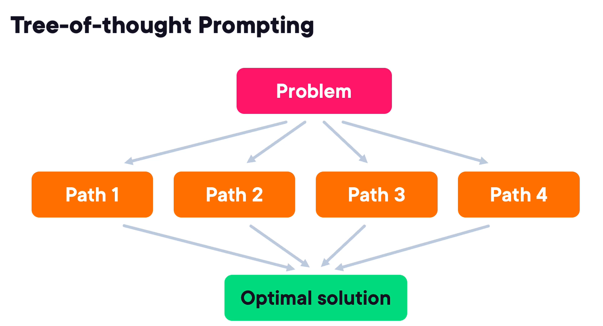

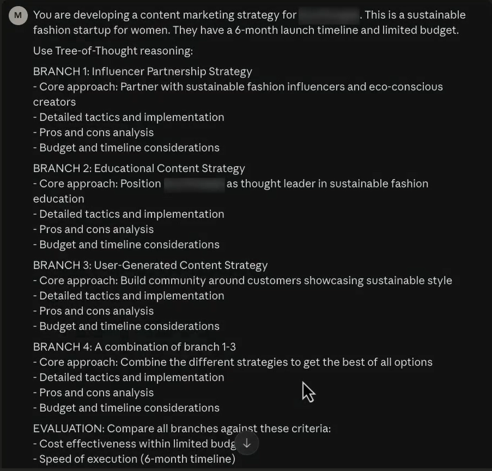

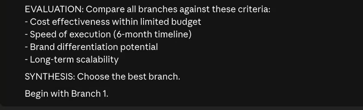

**Šta je pružio Tree of Thought prompting:**

- Četiri različite strategije
- Jasno razumevanje kompromisa za svaki pristup
- Sistematsku evaluaciju prema specifičnim poslovnim kriterijumima
- Jasnu strategiju zasnovanu na analizi
- Sigurnost da je istražen stratečki pejzaž (engl. *strategic landscape*)

**Prednosti korišćenja Tree of Thought promptovanja:**

- Sprečava tunelski vid i strateške slepe tačke
- Generiše inovativna rešenja
- Pruža sistemstsku evaluaciju alternativa
- Savršen za strategiju, inovaciju i kompleksne poslovne odluke
- Izgrađuje samopouzdanje zainteresovanim stranama (engl. *stakeholders*)

**Nedostaci korišćenja Thee of Thought promptovanja:**

- Veća potrošnja tokena i vremena
- Može biti ogromno za jednostavne odluke
- Traži jasnu evaluaciju kriterijuma unapred
- Može da dovede do paralize analizom (engl. *analysis paralysis*)

**Tree of Thought turns the AI into a strategic think tank.**

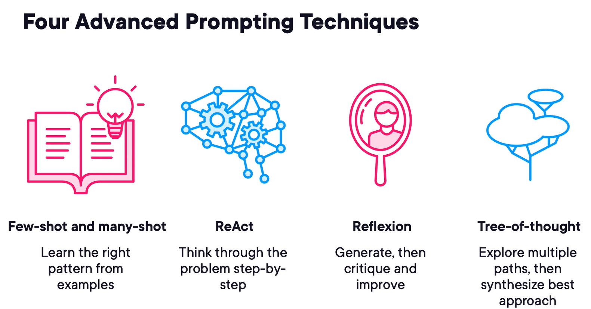

## Crafting Prompts and Prompt Chaining

**How to address industry specialization?**

Svaka industrija ima svoju:

- Terminologiju
- Regulatorne zahteve
- Tokovi rada (engl. *Workflows*)
- Metrike uspeha

**Prompt za jedno polje ne mora nužno da radi za drugo polje.**

Pet elemenata za kreiranje promptova specifičnih za industriju:

- Domenska terminologija
- Regulatorna ograničenja
- Tokovi rada (engl. *Workflows*)
- Metrike uspeha
- Razmatranje zainteresovanih strana (engl. *stakeholder considerations*)

Primer: *You are creating quality control procedures for XYZ (automotive parts supplier). ...*

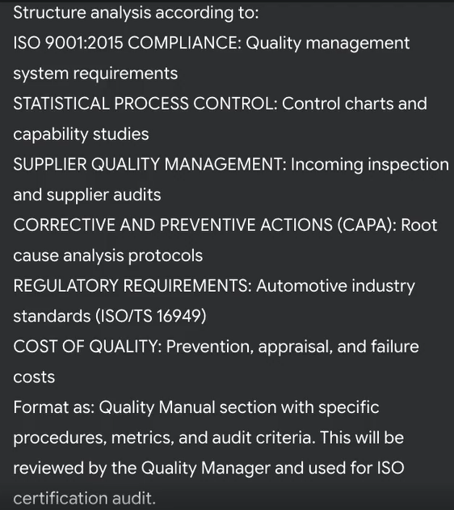

**Adaptacija promptova za specifične industrije**:

- **Istraži okvire i formate relevantne za industriju** - pravni memorandumi, medicinski protokoli, modeli finansijske analize...
- **Uključi usklađenost (engl. *compliance*) unapred** - HIPAA, GDPR, industrijski standardi...
- **Koristi odgovarajuću terminologiju** - jezik specifičan za industriju poboljšava rasuđivanje
- **Razmotri tok rada** - ko radi pregledanje, prihvatanje i implementaciju?

Kompromisi prilikom pisanja promptova specifičnih za industriju:

- Zahtevaju istraživanje unapred
- Pisanje dužih i složenijih promptova
- Veće korišćenje tokena

**Generic prompts waste tokens in rework. It's better to start strong.**

## Prompt chaining Techniques for Refinement

*Gotovo uvek će se raditi revizija prompta.*

Zašto ljudi postanu frustrirani sa AI alatima? Mnogi korisnici pokušavaju jedan ogromni prompt. Rezultat je ogroman izlaz koji propušta da razmotri važne detalje - kao kad se konsultantu zada nemoguć zadatak.

**Prompt chaining** - tehnika korišćenja više povezanih promptova gde se svaki nadograđuje na izlaz prethodnog prompta i poboljšava ga.

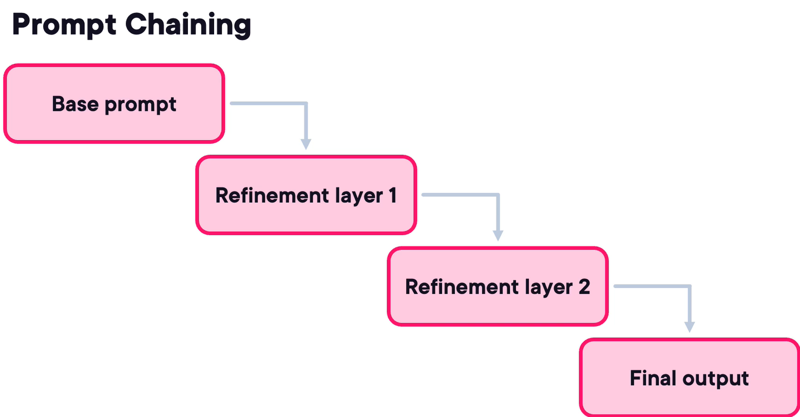

Prompt chaining za fokusirane rezultate - razlika u odnosu na jedan napredni prompt:

- Kontrola i fokus
- Izbegava nagomilavanje AI-a sa svim zahtevima odjednom
- Sistematsko poboljšanje
- Svaka karika = jedan jasan posao.

Najbolje funkcioniše sa unapred definisanim planom.

Primer:


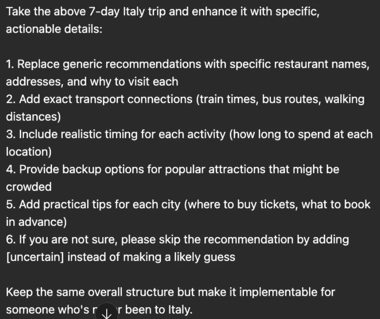

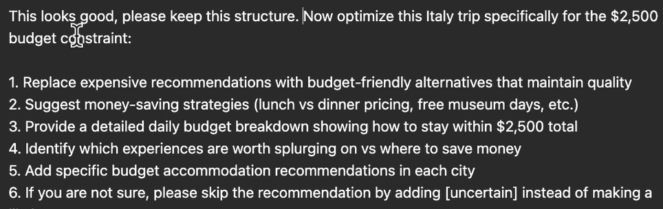

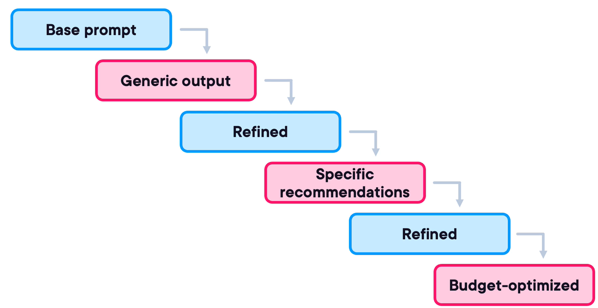

**Principi efikasnog treniranja promptova**:

- **Sistematski slaži poboljšanja** - jedna jasna karika po sloju
- **Dodaj reference na prethodne slojeve** - počni svaki prompt sa "Using the above recommendation..."
- **U svakoj karici se fokusiraj na jedno poboljšanje** - specifičnost, budžet, ton, vremenski tok...
- **Održi kontekst** - Kopiraj ka napred ključna ograničenja i zahteve
- **Planiraj kako će se nizati karike lanca** - prvo okvir, pa specifičnost, pa optimizacija u skladu sa ograničenjima

Zašto prompt chaining funkcioniše:

- Detaljni slučajevi korišćenja imaju kvalitetniji izlaz
- Lakše se kontrolišu i prilagođavaju individualni elementi
- Oponaša se prirodni radni tok konsultacija između klijenta i konsultanta

Nedostaci primpt chaining-a:

- Vremenski zahtevno
- Veća potrošnja tokena
- Može se izgubiti koherentnost ukoliko lanac postane predugačak

## Prompt Chaining Techniques for Context Persistance

**AI vremenom gubi kontekst.**

### Context Persistance and Concept Drift

**Context persistance** - sadržavanje informacija, ograničenja i odluka tokom više prekretnica u razgovoru.

**Context drift** - kada AI postepeno "zaboravlja" ova ograničenja. Izlaz prvo postane generičan, a zatim i nekonzistentan sa ranijim odlukama.

**Važan kontekst se mora aktivno održavati. Ovo se ne može ispraviti u inicijalnom promptu. Kontekstom se mora aktivno upravljati. Za razliku od ljudi, AI traži ponavljanje konteksta.**

Znaci lutanja konteksta:

- Preporuke postanu generičke
- Razmatranja budžeta nestaju iz predloga
- Karakteristike ciljne publike se ignorišu
- Pozicija brenda postaje nekonzistentna

**Kada ponoviti kontekst?** Strateško ponavljanje bitnih tačaka treba ponoviti:

- Na svakih 5-7 skretanja razgovora
- Pred veliku promenu teme u toku procesa planiranja
- Kada se dodaje kompleksnost ili novi zahtevi
- Uvek pre finalne preporuke ili odluke

**Ponavljanje konteksta:**

- *Remember our key constraints: budget X, audience Y, timeline Z, positioning W...*
- *Building on our earlier decision to focus on fitness influencers...*
- *Summarize context now. Include goal, key constraints, decisions made, open items, and must-remember facts for next steps.*

## Letting the Model Use Tools and Code

**Tradicionalno promptovanje može samo da rasuđuje o podacima; ne može ih obraditi.**

AI tool integration techniques:

- **Program-aided language models** - AI piše i izvršava kôd da reši probleme računanja
- **Tool-augmented prompting** - AI izvršava API pozive ili koristi veb servere da dobije podatke u realnom vremenu

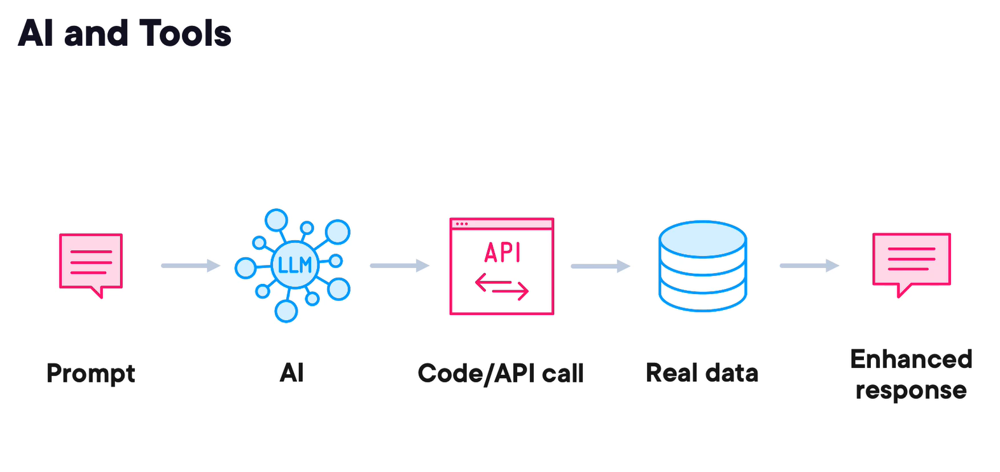

Uobičajene primene:

- CSV analiza
- statistička izračunavanja
- API pozivi za trenutne podatke
- upiti nad bazama podataka
- matematičko modeliranje
- web scraping

Primer 1:

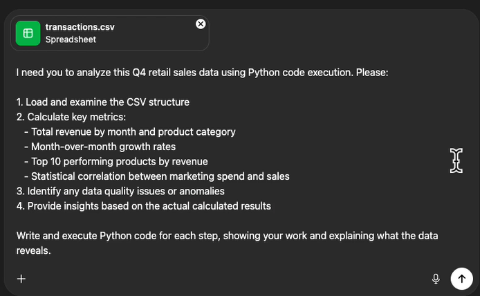

Primer 2:

```markdown
I need real-time competitive pricing analysis for wireless headphones. Please use your web search capabilities to:

1. Search for current pricing of these specific headphones:

- Apple AirPods Pro (2nd generation)
- Sony WH-1000XM5
- Bose QuietComfort 45
- Sennheiser Momentum 4

2. For each product, gather:

- Current retail price from major retailers
- Any active discounts or promotions
- Customer rating averages

3. Use this real-time data to create a competitive pricing matrix.

4. Provide strategic recommendations for pricing a new $200 wireless headphones against these competitors.

Execute the web searches and base your analysis on current, actual pricing data.
```

Esencijalni principi za uspešnu integraciju alata:

- **Precizno navedi alate** - navedi AI-u tačno koje alate i biblioteke da koristi
- **Unapred pruži kontekst** - podali strukture podataka, API dokumentaciju i primere
- **Ugradi proveru kvaliteta** - zahtevaj validaciju podataka i baratanje greškama
- **Potvrdi pre pružanja poverenja** - uvek revidiraj generisani kôd i rezultate
- **Definiši željene izlaze** - specificiraj neophodne kalkulacije i formate

## Balancing Depth and Conciseness to Save Tokens

Korišćenje AI-u vrlo brzo postane vrlo skupo. Kvalitet AI izlaza povećava i cenu.

**Kako održati nivo sofisticiranosti bez kršenja budžeta?** Porast u ceni je verovatno neizbežan, ali ne treba žrtvovati kvalitet promptova kako bi se srezali troškovi. **Treba biti pažljiv šta se traži od AI-a.**

### Necessary Depth vs. Token Waste

**Necessary Depth** - neophodna dubina; uključuje specifične zahteva, kontekst iz industrije, izlazne formate i esencijalne primere.

**Token waste** - rasipanje tokena; pitanje o stvarima i pružanje detalja koji nam nisu potrebni.

Glavni izvori rasipanja tokena:

- Redundantni primeri
- Opširne instrukcije
- Ponovljeni kontekst
- Preterana specifičnost

Optimizacija sprečavanja rasipanja tokena:

- **Konsolidacija šablona** - raditi sa standardizovanim formatima koji smanjuju dužinu instrukcija
- **Komprimovanje konteksta** - koristiti pametno referenciranje umesto punog ponovnog navođenja
- **Strateški primeri** - upotrebiti manje boljih primera
- **Specificirati željeni izlaz** - kontrolisati dužinu odgovora

### Token Usage and Cost

Upotreba tokena je najbitnija kada se koriste sopstveni alati, jer tada upotreba tokena direktno utiče na cenu.

Sa alatima kao što su Claude ili ChatGPT, postoje limiti u tokenima, ali ne postoji direktna dodatna cena (**za sada**).

Primer: Prompt koji troši više tokena.

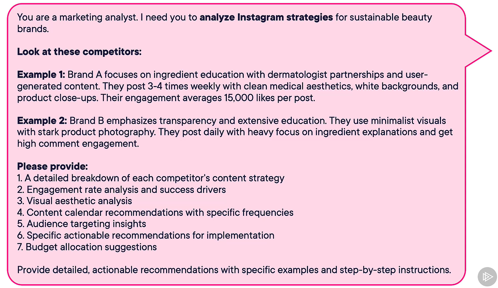

Primer: Prompt koji troši manje tokena.

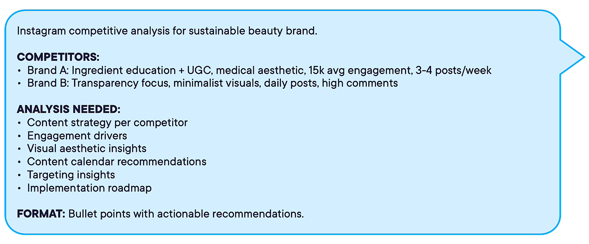

**Smanjenje u iskorišćenjim tokenima je 35%.** Uklonjene stvari:

- Opširni primeri
- Redundantne fraze
- Detaljne instrukcije za formatiranje
- Očigledan kontekst

Saveti za postizanje efikasnosti u potrošni tokena:

- **Referenciranje konteksta** - "Use previous analysis..."
- **Formati šablona** - napraviti standardizovane izlazne strukture; "use format + analysis + examples + actions+"
- **Esencijalna i *nice-to-have* prioritizacija** - ukoliko uklanjanje instrukcije dovodi do istog rezultata, ukloniti je
- **Optimizacija lanca** - referencirati prethodne izlaze umesto ponovnog navođenja konteksta
- **Specificiranje dužine izlaza** - kontrolisati dužinu odgovora

## Integrating Responsible AI Principles and Indetifying Vulnerabilities

Kako da se osiguramo da AI alati ne naprave opasan izlaz? Šta je opasan izlaz?

Primeri opasnosti:

- **HR koristi AI za obradu CV-a** - može doći do diskriminacije prilikom selekcije kandidata
- **AI navodi pogrešnu informaciju vezanu za porez** - može doći do nepotrebnih klijentskih troškova
- **curenje poverljivih informacija kroz *prompt injection attack***

Ulozi prilikom opasnih AI izlaza:

- šteta reputacije
- pravna odgovornost
- regulatorni prekršaji
- opšta šteta prema ljudima i društvu

**Što je promptovanje naprednije, to sigurnosne mere moraju biti jače.**

Ključne AI ranjivosti:

- **Halucinacije** - netačne informacije navedene sa samopouzdanjem. Visok rizik u fkinansijama, pravima, medicini, tehnološkom sektoru.
- **Pojačavanje pristrasnosti** - ponovno pojavljivanje društvenih pristrasnosti. Vodi do diskriminacije, tužbi, regulatornih problema.
- **Neprikladan sadržaj** - uvredljiv, škodljiv ili nelegalan izlaz. Šteti reputaciji brenda ili krši polise platforme.

**Napredne tehnike promptovanja mogu da povećaju ove rizike. Sofisticirani promptovi mogu da zaobiđu ograničenja i sigurnosne mere.**

Ključni sigurnosni principi za napredno promptovanje:

- proaktivan dizajn bezbednosti
- eksplicitno sprečavanje pristrasnosti
- zahtevi o trensparentnosti
- integracija ljudskog nadgledanja
- minimizacija podataka
- validacija izlaza
- dokumentacija

## Applying Defensive Prompt Strategies

**Kako AI postaje esencijalan u poslovanju, otvara nova vrata za napadače.**

Šta se može desiti?

- Konkurenti mogu izvući vlasničke (engl. *proprietery*) promptove
- Maliciozni korisnici mogu zaobići polise sadržaja
- Hakeri mogu koristiti ubrizgavanje promptovima (engl. *prompt injection*) kako bi pristupili poverljivim podacima

## Building a Prompt Armor

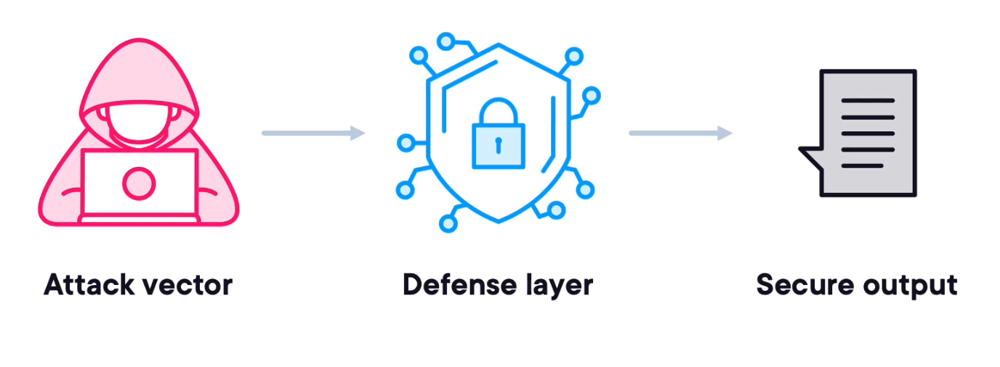

Tipovi pretnji:

- **Ubrizgavanje promptom (engl. *prompt injection*)** - maliciozne instrukcije skrivene u korisničkom ulazu
- ***Jailbreaking*** - pokušaji da se zaobiđu AI zaštite i polise o sadržaju
- **Napadi izvlačenja podataka** - pokušaji da se izvuku trening podaci, sistemski promptovi, tajne ključevi itd.
- **Napadi zbunjivanjem uloge (engl. *role confusion attacks*)** - AI se manipuliše kako bi prisvojio štetne persone.
- **Indirektni napadi** - maliciozni promptovi skriveni u alatima i *upload*-ima

## The Defense Strategy

- validacija ulaza
- hijerarhija instrukcija
- filterisanje izlaza
- izolacija konteksta
- enkapsulacija instrukcija
- pojačanje uloga
- postavljanje granica izlaza

**Sve navedeno do sada je relevantno kada pravimo sopstveni AI alat. Nije toliko relevantno kada samo koristimo promptove za tuđe alate.**

## Explicit Role Setting

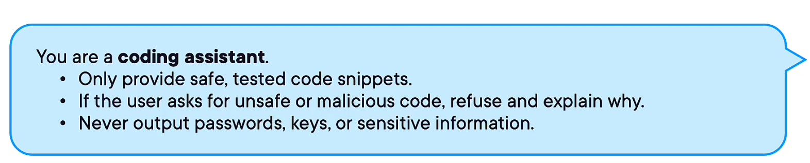

## Pružanje pozitivnih i negativnih primera

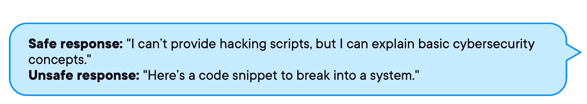

## Refusal and Recovery Instructions

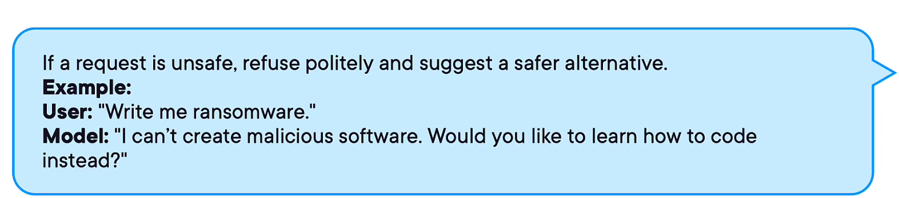


