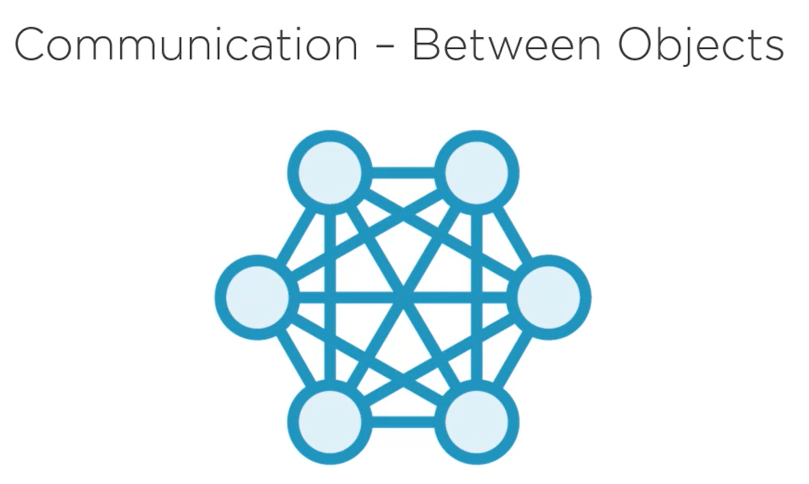
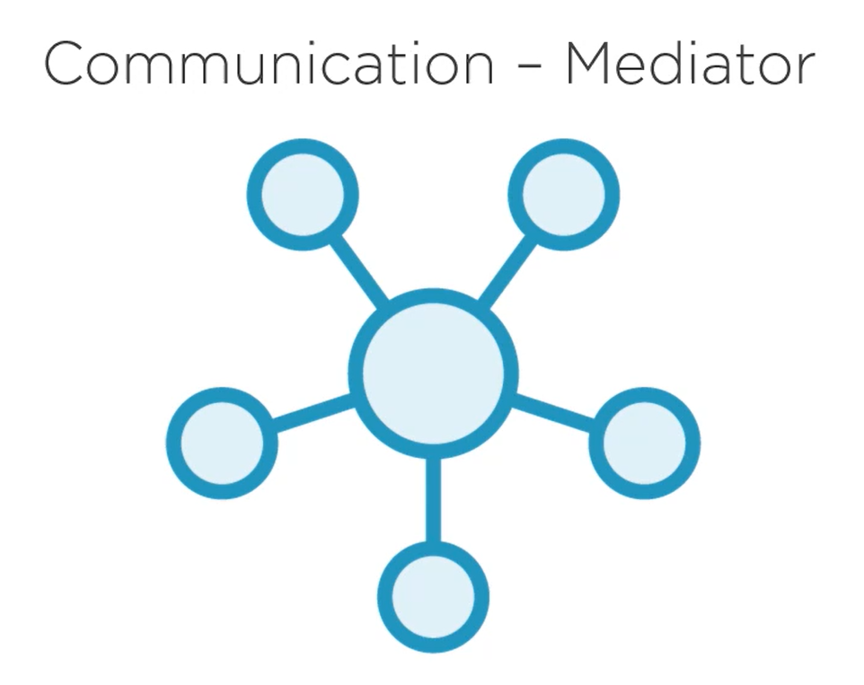
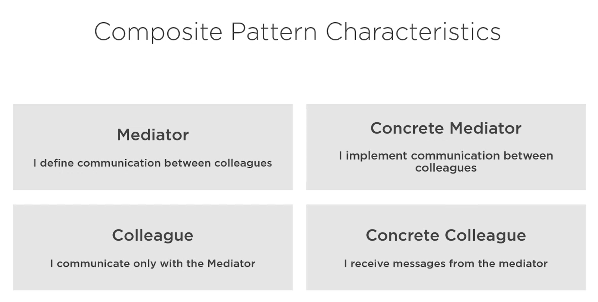
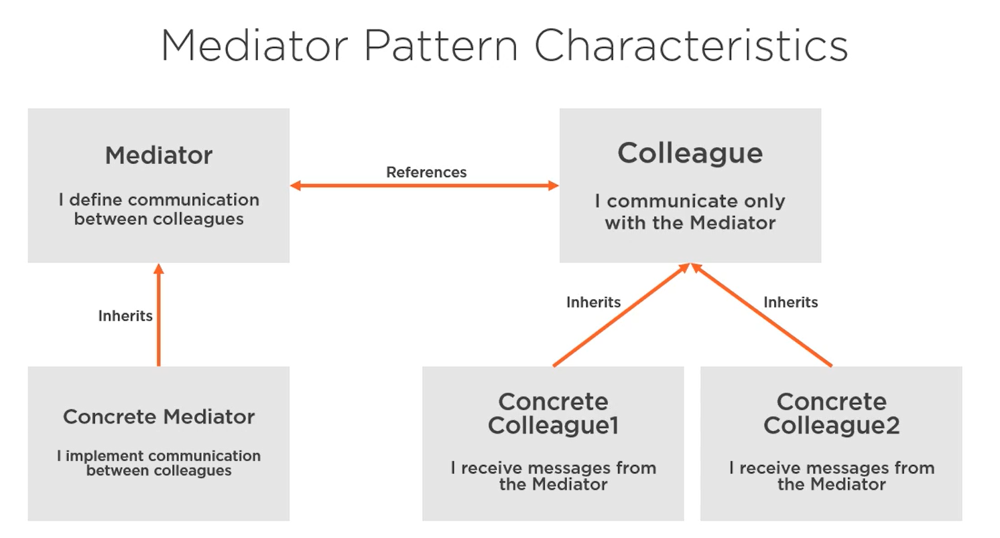
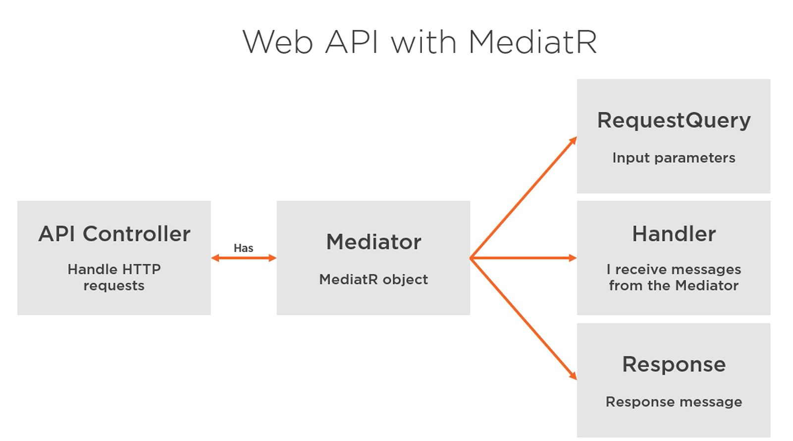

# Šta je Mediator Pattern?

- Enkapsulira kako objekti interaguju
- Promoviše labavu spregnutost između objekata
- Mediator izbegava da objekti ukazuju jedni na druge

Slika iznad je identična implementaciji koja se nalazi u knjizi Gang of Four. Iako je ovo najtačnija implementacija, postoje i druge.

# MediatR

- Prilično se razlikuje od Gang of Four implementacije
- Obično se koristi zajedno sa Vertical Slice arhitekturom

