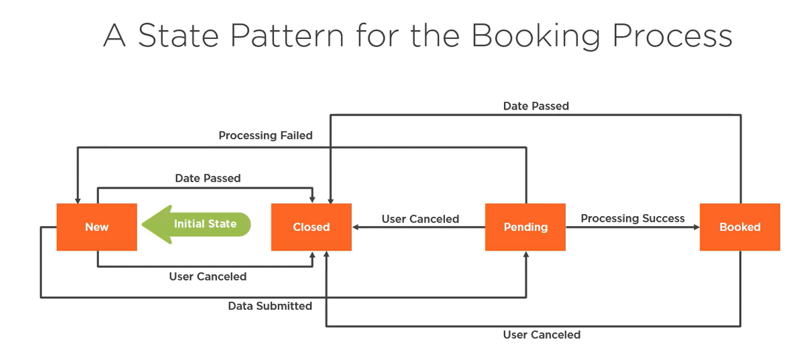

# Design Challenges

- Kako objekat može menjati svoje ponašanje kada mu se interno stanje promeni?
- Kako se mogu definisati ponašanja specifična za stanje tako da se stanja mogu dodavati tako da se ponašanje već postojećih stanja ne menjaju?

# State

State is the condition of something variable.

# Naivni pristup

- međusobno povezana logika
- izgubljeno vreme na upravljanje poljima ( `isNew`, `isPending`, ...)
- proširivanje je teško
- teško za debagovanje i upravljanje

# Prednosti State Pattern-a

- modularnost
- lakše čitanje i održavanje
- lakše debagovanje
- proširivost

# Nedostaci State Pattern-a

- potrebno je vreme za postavljanje
- više pokretnih delova
- moguća degradacija performansi

# Bavljenje izazovima

- Enkapsulacija ponašanja specifičnih za stanje unutar posebnih objekata za stanje
- Izvršenje ponašanja specifičnih za stanje će biti delegirani ka jednom objektu stanja u jednom trenutku

# Elementi State Pattern-a

- **kontekst** - održava instancu konkretnog trenutnog stanja 
- **apstraktno stanje** - definiše interfejse koji enkapsuliraju sva ponašanja koja su specifična za stanje
- **konkretno stanje** - implementira ponašanja specifična za određeno stanje konteksta

# Pristup State Pattern-u

- lista mogućih stanja
- uslovi za prelazak između tih stanja
- inicijalno stanje

