# Start

```sql
USE OnlineShop;
```

```sql
CREATE TABLE Products  
(ProductID int PRIMARY KEY NOT NULL,  
ProductName varchar(50) NOT NULL,  
ProductDescription varchar(max) NOT NULL);
```

```sql
INSERT Products (ProductID, ProductName, ProductDescription)  
VALUES (1, 'The brown fox and the yellow bear', 'A popular book for children.');
```

```sql
SELECT ProductName, ProductDescription
FROM Products;
```
# Views

**Views** are saved queries that you can create in your databases. A single view can reference one or more tables. And, just like a table, a view consists of rows and columns of data. You can use views as a source for your queries in much the same way as tables. However, views don't persistently store data; the definition of your view is unpacked at runtime and the source objects are queried.

Views must be created by a database developer or administrator with appropriate permission in the database.

```sql
CREATE [ OR ALTER ] VIEW [ schema_name . ] view_name [ ( column [ ,...n ] ) ]
[ WITH <view_attribute> [ ,...n ] ]
AS select_statement
[ WITH CHECK OPTION ]
[ ; ]
```

The `WITH` clause supports the following view attributes:

| Option | Description |
| --- | --- |
| `SCHEMABINDING` | Binds the view to the schema of its base tables, preventing changes that would break the view. Required for indexed views. |
| `ENCRYPTION` | Encrypts the view definition in the system catalog so it can't be read. |
| `VIEW_METADATA` | Returns view metadata (rather than base-table metadata) to client APIs. |

The `ORDER BY` clause is not permitted in a view definition unless the view uses a TOP, OFFSET/FETCH, or FOR XML element.

```sql
-- query a view
SELECT custid, ordermonth, qty
FROM Sales.CustOrders;
```

# Temporary tables

You can use Transact-SQL to create temporary tables. Temporary tables come in two types:

- Local temporary tables
- Global temporary tables

## Create local temporary tables

Use local temporary tables to create tables scoped to your current session. This means that your temporary table is only visible to you, and when the session ends, the table is automatically dropped. Multiple users can create tables using the same name, and they would have no effect on each other.

If you create a local temporary table inside a stored procedure, it's dropped when the procedure returns — not at the end of the session. Tables created this way aren't visible to the calling session after the procedure exits.

```sql
CREATE TABLE #Products (
    ProductID INT PRIMARY KEY,
    ProductName varchar(50),
    ...
);
```

## Create global temporary tables

You can also create global temporary tables. In SQL Server, a global temporary table is accessible across all sessions on the instance. In Azure SQL Database, global temporary tables are scoped to the database level — sessions in other databases on the same logical server can't access them. Because a global temporary table is shared, it must have a unique name, unlike a local temporary table. Global temporary tables are dropped automatically when the session that created it ends and all tasks referencing it across all sessions have also ended. You create a global temporary table in the same way you would create a local temporary table, except you'd use **##** instead of the single **#** specify it as a global temporary table:

```sql
CREATE TABLE ##Products (
    ProductID INT PRIMARY KEY,
    ProductName varchar(50),
    ...
);
```

```sql
INSERT #Products (ProductID, ProductName, ProductDescription)  
VALUES (1, 'The temporary time leap', 'A novel about temporary time leaping.');
```

``` sql
SELECT *  
FROM #Products  
ORDER BY ProductName;
```

# Use Common Table Expressions

Common Table Expressions (CTEs) provide a mechanism for you to define a subquery that may then be used elsewhere in a query. Unlike a derived table, a CTE is defined at the beginning of a query and may be referenced multiple times in the outer query.

CTEs are named expressions defined in a query. Like subqueries and derived tables, CTEs provide a means to break down query problems into smaller, more modular units. CTEs are limited in scope to the execution of the outer query. When the outer query ends, so does the CTE's lifetime.

```sql
WITH <CTE_name>
AS (<CTE_definition>)
```

```sql
WITH CTE_year 
AS
(
    SELECT YEAR(orderdate) AS orderyear, custid
    FROM Sales.Orders
)
SELECT orderyear, COUNT(DISTINCT custid) AS cust_count
FROM CTE_year
GROUP BY orderyear;
```

When writing queries with CTEs, consider the following guidelines:

- CTEs require a name for the table expression. Column names in the CTE result set must be unique — either because the underlying `SELECT` columns already have distinct names, or by supplying column aliases. An explicit column list `WITH CTE_name (col1, col2)` is optional when column names are already unique.
- CTEs may use inline or external aliases for columns.
- When a CTE follows another statement in the same batch, the preceding statement must end with a semicolon (`;`). For example: `SELECT 1; WITH CTE_name AS (...) SELECT ....`
- Unlike a derived table, a CTE may be referenced multiple times in the same query with one definition. Multiple CTEs may also be defined in the same WITH clause.
- CTEs support recursion, in which the expression is defined with a reference to itself.

# Write queries that use derived tables

Derived tables allow you to write Transact-SQL statements that are more modular, helping you to break down complex queries into more manageable parts. Using derived tables in your queries can also provide workarounds for some of the restrictions imposed by the logical order of query processing, such as the use of column aliases.

Like subqueries, you create derived tables in the `FROM` clause of an outer `SELECT` statement. Unlike subqueries, you write derived tables using a named expression that is logically equivalent to a table and may be referenced as a table elsewhere in the outer query.

Derived tables are not stored in the database. Therefore, no special security privileges are required to write queries using derived tables, other than the rights to select from the source objects. A derived table is created at the time of execution of the outer query and goes out of scope when the outer query ends. Derived tables do not necessarily have an impact on performance, compared to the same query expressed differently. When the query is processed, the statement is unpacked and evaluated against the underlying database objects.

```sql
SELECT <outer query column list>
FROM
(
    SELECT <inner query column list>
    FROM <table source>
) AS <derived table alias>
```

```sql
SELECT orderyear, COUNT(DISTINCT custid) AS cust_count
FROM 
(
    SELECT YEAR(orderdate) AS orderyear, custid
    FROM Sales.Orders
) AS derived_year
GROUP BY orderyear;
```

## Pass arguments to derived tables

Derived tables can accept arguments passed in from a calling routine, such as a Transact-SQL batch, function, or a stored procedure. You can write derived tables with local variables serving as placeholders. At runtime, the placeholders can be replaced with values supplied in the batch or with values passed as parameters to the stored procedure that invoked the query.

```sql
DECLARE @emp_id INT = 9; --declare and assign the variable
SELECT orderyear, COUNT(DISTINCT custid) AS cust_count
FROM (    
    SELECT YEAR(orderdate) AS orderyear, custid
    FROM Sales.Orders
    WHERE empid=@emp_id --use the variable to pass a value to the derived table query
) AS derived_year
GROUP BY orderyear;
GO
```

When writing queries that use derived tables, keep the following guidelines in mind:
- The nested `SELECT` statement that defines the derived table must have an alias assigned to it. The outer query will use the alias in its `SELECT` statement in much the same way you refer to aliased tables joined in a `FROM` clause.
- All columns referenced in the derived table's `SELECT` clause should be assigned aliases, a best practice that is not always required in Transact-SQL. Each alias must be unique within the expression. The column aliases may be declared inline with the columns or externally to the clause.
- The SELECT statement that defines the derived table expression may not use an `ORDER BY` clause, unless it also includes a `TOP` operator, an `OFFSET/FETCH` clause, or a `FOR XML` clause. As a result, there is no sort order provided by the derived table. You sort the results in the outer query.
- The `SELECT` statement that defines the derived table may be written to accept arguments in the form of local variables. If the `SELECT` statement is embedded in a stored procedure, the arguments may be written as parameters for the procedure.
- Derived table expressions that are nested within an outer query can contain other derived table expressions. Nesting is permitted, but it is not recommended due to increased complexity and reduced readability.
- A derived table may not be referred to multiple times within an outer query. If you need to manipulate the same results, you will need to define the derived table expression every time, such as on each side of a `JOIN` operator.

# Use the UNION operator

The `UNION` operator allows two or more query result sets to be combined into a single result set. There are two ways of doing this:
- `UNION` – the combined result does not include duplicates.
- `UNION ALL` – the combined result set does include duplicates.

A `NULL` in one set is treated as being equal to a `NULL` in another set.

```sql
-- The first query returns customers with a CustomerID between 1 and 9.
SELECT CustomerID, companyname, FirstName + ' ' + LastName AS 'Name'
FROM SalesLT.Customer
WHERE CustomerID BETWEEN 1 AND 9;
```

```sql
-- The second query returns customers with a CustomerID between 10 and 19.
SELECT customerid, companyname, FirstName + ' ' + LastName AS 'Name'
FROM saleslt.Customer
WHERE customerid BETWEEN 10 AND 19;
```
To combine these two queries into the same result set, use the `UNION` operator:

```sql
SELECT customerid, companyname, FirstName + ' ' + LastName AS 'Name'
FROM saleslt.Customer
WHERE customerid BETWEEN 1 AND 9
UNION
SELECT customerid, companyname, FirstName + ' ' + LastName AS 'Name'
FROM saleslt.Customer
WHERE customerid BETWEEN 10 AND 19;
```
As with all Transact-SQL statements, no sort order is guaranteed unless one is explicitly specified. If you require sorted output, add an `ORDER BY` clause at the end of the second query.

With `UNION` or `UNION ALL`, both queries must have the same number of columns, and the columns must be of compatible data types, allowing you to join rows from different queries.

# Use the INTERSECT and EXCEPT operators

`INTERSECT` and `EXCEPT` compare two result sets against each other, and return rows in common, or rows that appear in one but not in the other.

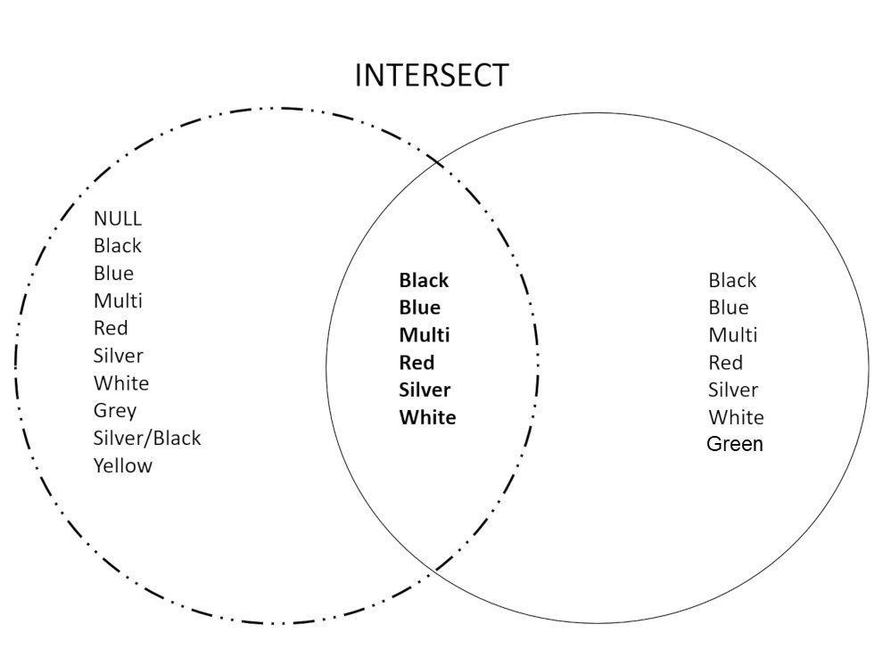

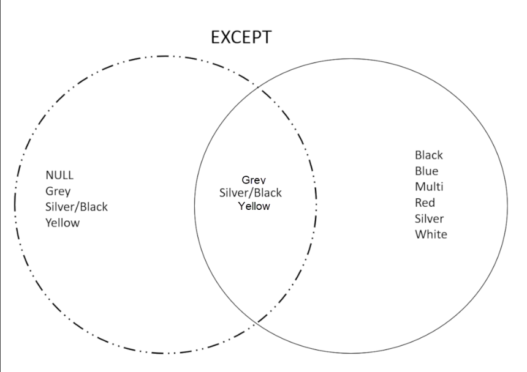

```sql
SELECT color FROM SalesLT.Product
WHERE ProductID BETWEEN 500 and 750
INTERSECT
SELECT color FROM SalesLT.Product
WHERE ProductID BETWEEN 751 and 1000;
```

```sql
SELECT color FROM SalesLT.Product
WHERE ProductID BETWEEN 500 and 750
EXCEPT
SELECT color FROM SalesLT.Product
WHERE ProductID BETWEEN 751 and 1000;
```

```sql
SELECT color FROM SalesLT.Product
WHERE ProductID BETWEEN 751 and 1000
EXCEPT
SELECT color FROM SalesLT.Product
WHERE ProductID BETWEEN 500 and 750;
```

# Use the APPLY operator

As an alternative to combining or comparing rows from two sets, SQL Server provides a mechanism to apply a table expression from one set on each row in the other set. The `APPLY` operator enables queries that evaluate rows in one input set against the expression that defines the second input set. `APPLY` is actually a table operator, not a set operator, and is part of the `FROM` clause. `APPLY` is more like a `JOIN`, rather than as a set operator that operates on two compatible result sets of queries.

Conceptually, the `APPLY` operator is similar to a correlated subquery in that it applies a correlated table expression to each row from a table. However, `APPLY` returns a table-valued result rather than a scalar or multi-valued result. For example, the table expression could be a table-valued function. You can pass elements from the left row as input parameters to the table-valued function.

There are two forms of APPLY:

- `CROSS APPLY`
- `OUTER APPLY`

```sql
SELECT <column_list>
FROM left_table_source { CROSS | OUTER } APPLY right_table_source
```

In the following code example, the tables are joined using an `INNER JOIN`:

```sql
SELECT oh.SalesOrderID, oh.OrderDate,od.ProductID, od.UnitPrice, od.Orderqty 
FROM SalesLT.SalesOrderHeader AS oh 
INNER JOIN SalesLT.SalesOrderDetail AS od 
    ON oh.SalesOrderID = od.SalesOrderID;
```

In the following code example, `CROSS APPLY` applies the right table source to each row in the left table source. Only rows with results in both the left table and right table are returned. Most `INNER JOIN` statements can be rewritten as `CROSS APPLY` statements.

```sql
SELECT oh.SalesOrderID, oh.OrderDate,
od.ProductID, od.UnitPrice, od.Orderqty 
FROM SalesLT.SalesOrderHeader AS oh 
CROSS APPLY
(
    SELECT productid, unitprice, Orderqty 
    FROM SalesLT.SalesOrderDetail AS od 
    WHERE oh.SalesOrderID = SalesOrderID
) AS od;
```

# Use OUTER APPLY

`OUTER APPLY` works like `CROSS APPLY`, except it preserves every row from the left table source — even when the right table expression returns no rows. Where `CROSS APPLY` behaves like an `INNER JOIN`, `OUTER APPLY` behaves like a `LEFT OUTER JOIN`: unmatched left-side rows still appear in the result, with `NULL` values for the columns produced by the right side.

In the following example, `OUTER APPLY` returns every row from `SalesLT.SalesOrderHeader`. Order headers that have no matching detail rows still appear, with `NULL` values for `ProductID`, `UnitPrice`, and `Orderqty`:

```sql
SELECT oh.SalesOrderID, oh.OrderDate,
    od.ProductID, od.UnitPrice, od.Orderqty
FROM SalesLT.SalesOrderHeader AS oh
OUTER APPLY
(
    SELECT productid, unitprice, Orderqty
    FROM SalesLT.SalesOrderDetail AS od
    WHERE oh.SalesOrderID = SalesOrderID
) AS od;
```

# Describe window functions

Window functions allow you to perform calculations such as ranking, aggregations, and offset comparisons between rows.

Window functions require a set of rows to work on, known as a window. The `OVER` clause is used to define the window you want to work on. You can then use a window function on the subset of rows you have defined.

Window functions solve common problems such as generating row numbers in a result set or calculating running totals. Windows also provide an efficient way to compare values in one row with values in another without needing to join a table to itself.

Windows and window functions provide functionality that is difficult to replicate with other SQL commands:

- Ordering the rows that are passed to a window function, without affecting the sort order of the output query.
- Dividing a result set into different parts and applying a window function to each.
- Subdividing a partition, by setting upper and lower boundaries for the window frame.

# Use the OVER clause

Window functions require the `OVER` clause to create and manipulate windows. The `OVER` clause defines the rows that the window function is applied to. This may be all the rows, or a subset of the rows. It can also define the order of the rows for a window function.

You can use the `OVER` clause with functions to compute aggregated values such as moving averages, cumulative aggregates, running totals, or a top N per group results.

The `OVER` clause can take the following arguments:

- `PARTITION BY` – divides the query result set into different parts.
- `ORDER BY` - defines the logical order of the rows of the result set.
- `ROWS`/`RANGE` - limits the rows within the partition by specifying start and end points. If you specify `ORDER BY` without an explicit frame, the default is `RANGE BETWEEN UNBOUNDED PRECEDING AND CURRENT ROW.` If you don't specify `ORDER BY`, the entire partition is used as the frame. This default behavior has an important implication for `LAST_VALUE`, covered later in the module.

If you don't specify an argument to the `OVER` clause, the window functions will be applied on the entire result set.

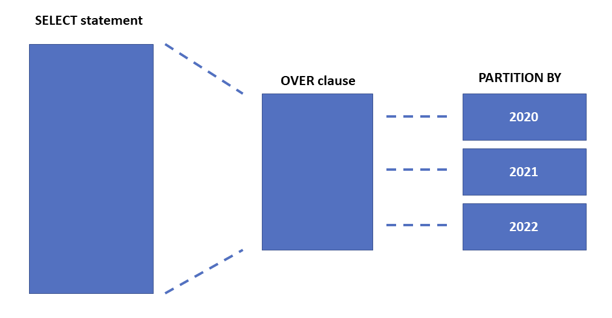

# PARTITION BY

The `PARTITION BY` clause divides up the result set into partitions before applying the window function. If `PARTITION BY` is not specified, the window function is applied to all rows of the query. Partitions use one of the columns made available in the `FROM` clause.

# ORDER BY

`ORDER BY` defines the logical order of the rows within each partition. As an example, the `RANK` function requires rows to be ordered so that it can return the rank position of each row. The default order is `ASC`, but it is best practice to specify `ASC` or `DESC` after the order by expressions. `NULL` is treated as the lowest possible value.

# ROWS or RANGE clauses

The `ROWS` or `RANGE` arguments set a start and end boundary around the rows being operated on. `ROWS` or `RANGE` requires an `ORDER BY` subclause within the `OVER` clause.

The `ROWS` clause limits the rows within a partition by specifying a fixed number of rows preceding or following the current row.

The `RANGE` clause logically limits the rows within a partition by specifying a range of values with respect to the value in the current row.

# CURRENT ROW

Specifies that the window starts or ends at the current row when used with `ROWS` or the current value when used with `RANGE`. `CURRENT ROW` can be specified as both a starting and ending point.

# BETWEEN AND

Used with `ROWS` or `RANGE` to specify the start and end boundary points of the window.

# Use RANK, AGGREGATE, and OFFSET functions

In window operations, you can use aggregate functions such as `SUM`, `MIN`, and `MAX` to operate on a set of rows defined by the `OVER` clause and its arguments.

Window functions can be categorized as:

- **Aggregate functions**. Such as `SUM`, `AVG`, and `COUNT` which operate on a window and return a scalar value.
- **Ranking functions**. Such as `RANK`, `ROW_NUMBER`, and `NTILE`. Ranking functions require a sort order and return a ranking value for each row in a partition.
- **Analytic functions**. Such as `CUME_DIST`, `PERCENTILE_CONT`, `PERCENTILE_DISC`, `LAG`, `LEAD`, `FIRST_VALUE`, and `LAST_VALUE`. Analytic functions calculate the distribution of values in the partition or return a value from another row relative to the current row.

## Aggregate functions

Aggregate functions perform a calculation and return a single value. With the exception of `COUNT(*)`, aggregate functions do not count `NULL` values.

```sql
SELECT
    [Name],
    [ProductNumber],
    [Color],
    SUM([Weight])
    OVER(PARTITION BY [Color]) AS WeightByColor
FROM SalesLT.Product
ORDER BY ProductNumber;
```

This returns a column called WeightByColor which contains the total weight for all products of the same color as show in the partial result set below.

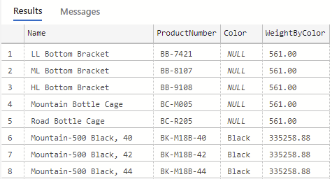

## Ranking functions

Ranking functions assign a number to each row, depending on its position within an order you have specified. The order is specified using the `ORDER BY` clause.

```sql
SELECT productid, name, listprice 
    ,ROW_NUMBER() OVER (ORDER BY productid) AS "Row Number"  
    ,RANK() OVER (ORDER BY listprice) AS PriceRank  
    ,DENSE_RANK() OVER (ORDER BY listprice) AS "Dense Rank"  
    ,NTILE(4) OVER (ORDER BY listprice) AS Quartile  
FROM SalesLT.Product
```

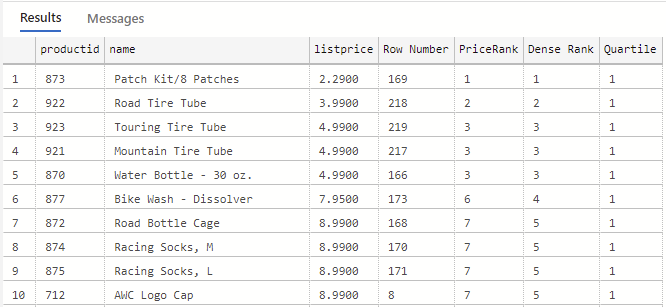

## Analytic functions

Analytic functions calculate a value based on a group of rows. Analytic functions are used to calculate moving averages, running totals, and top-N results, and to return values from other rows relative to the current row. These functions include:

- `CUME_DIST`
- `PERCENT_RANK`
- `PERCENTILE_CONT`
- `PERCENTILE_DISC`
- `LAG`
- `LEAD`
- `FIRST_VALUE`
- `LAST_VALUE`

## LAG, LEAD, FIRST_VALUE, and LAST_VALUE

`LAG`, `LEAD`, `FIRST_VALUE`, and `LAST_VALUE` return a value from another row relative to the current row:

- `LAG` and `LEAD` operate on an offset to the current row and require the `ORDER BY` clause.
- `FIRST_VALUE` and `LAST_VALUE` operate on an offset from the window frame.

In the following code example, the `LEAD` offset function returns the following year’s budget value:

```sql
SELECT
    [Year],
    Budget,
    LEAD(Budget, 1, 0) OVER (ORDER BY [Year]) AS 'Next'
FROM dbo.Budget
ORDER BY [Year];
```

# Write queries that pivot and unpivot result sets

Use `PIVOT` in Transact-SQL to rotate the way data is displayed from a rows-based orientation to a columns-based orientation. When pivoting, you consolidate values in a column to a list of distinct values, and then projecting that list across as column headings. Typically, this includes aggregation to column values in the new columns.


For example, the partial source data below lists repeating values for **Category** and **Orderyear**, along with values for **Qty**, for each instance of a **Category**/**Orderyear** pair:

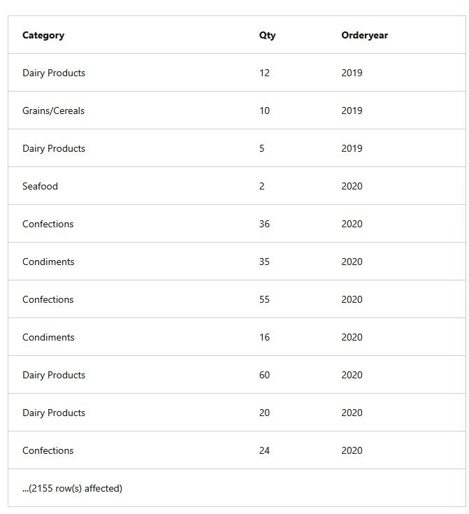

The table above represents over 2000 rows, with many duplicate values. To analyze the results by category and year, you might want to arrange the values to be displayed as follows, summing the **Qty** column along the way:

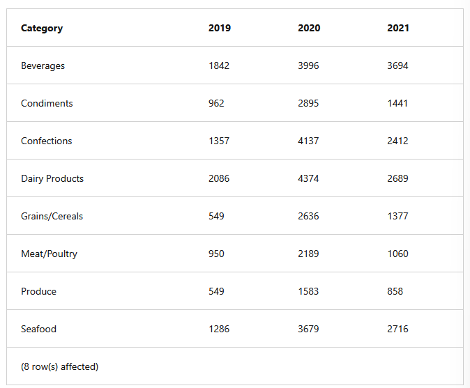

The result set is now a total of eight rows. In the pivoting process, each distinct year was created as a column header, and values in the **Qty** column were grouped by **Category** and aggregated.

# Use PIVOT to pivot a result set

You can pivot a result set using the `PIVOT` operator. The Transact-SQL `PIVOT` table operator works on the output of the `FROM` clause in a `SELECT` statement. To use `PIVOT`, you need to supply three elements to the operator:

- **Grouping**: in the `FROM` clause, you provide the input columns. From those columns, `PIVOT` will determine which column(s) will be used to group the data for aggregation. This is based on looking at which columns aren't being used as other elements in the `PIVOT` operator.
- **Spreading**: you provide a comma-delimited list of values to be used as the column headings for the pivoted data. The values need to occur in the source data.
- **Aggregation**: you provide an aggregation function (`SUM`, and so on) to be performed on the grouped rows.

Additionally, you need to assign a table alias to the result table of the `PIVOT` operator. The following example shows the elements in place:

```sql
SELECT Category, [2019], [2020], [2021]
FROM
(
    SELECT 
        Category,
        Qty,
        Orderyear
    FROM Sales.CategoryQtyYear
) AS D 
PIVOT(SUM(qty) FOR orderyear IN ([2019],[2020],[2021])) AS pvt;
```

In the example above, **Orderyear** is the column providing the spreading values, **Qty** is used for aggregation, and **Category** for grouping. **Orderyear** values are enclosed in delimiters to indicate that they're identifiers of columns in the result.

# Use UNPIVOT to unpivot a result set

Unpivoting data is almost the reverse of pivoting data. Instead of turning rows into columns, unpivot turns columns into rows. This is a technique useful in taking data that has already been pivoted (with or without using a Transact-SQL `PIVOT` operator) and returning it to a row-oriented tabular display. You can use the `UNPIVOT` table operator to accomplish this.

To use the `UNPIVOT` operator, you provide three elements:

- Source columns to be unpivoted.
- A name for the new column that will display the unpivoted values.
- A name for the column that will display the names of the unpivoted values.

The following example specifies 2019, 2020, and 2021 as the columns to be unpivoted, using the new column name **orderyear** and the **qty** values to be displayed in a new **qty** column.

```sql
SELECT category, qty, orderyear
FROM Sales.PivotedCategorySales
UNPIVOT(qty FOR orderyear IN([2019],[2020],[2021])) AS unpvt;
```

When unpivoting data, one or more columns is defined as the source to be converted into rows. The data in those columns is spread, or split, into one or more new rows, depending on how many columns are being unpivoted. In the following source data, three columns will be unpivoted. Each **Orderyear** value will be copied into a new row and associated with its **Category** value. Any NULLs will be removed in the process and no row is created:

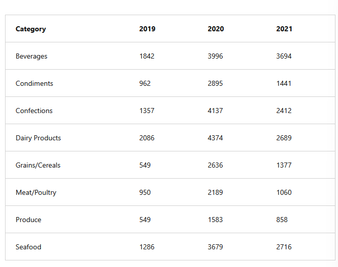

For each intersection of **Category** and **Orderyear**, a new row will be created, as in these partial results:

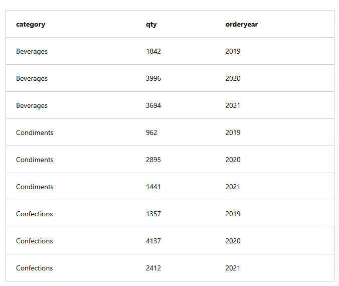

**Unpivoting does not restore the original data.** Detail-level data was lost during the aggregation process in the original pivot. `UNPIVOT` has no ability to allocate values to return to original detail values.

# Write queries that specify multiple groupings with grouping sets

You use the `GROUP BY` clause in a `SELECT` statement in Transact-SQL to arrange rows in groups, typically to support aggregations. However, if you need to group by different attributes at the same time, for example to report at different levels, you would normally need multiple queries combined with `UNION ALL`. Instead, if you need to produce aggregates of multiple groupings in the same query, you can use the `GROUPING SETS` subclause of the `GROUP BY` clause in Transact-SQL. `GROUPING SETS` provides an alternative to using `UNION ALL` to combine results from multiple individual queries, each with its own `GROUP BY` clause.

## Use the GROUPING SETS subclause

To use `GROUPING SETS`, you specify the combinations of attributes on which to group, as in the following syntax example:

```sql
SELECT <column list with aggregate(s)>
FROM <source>
GROUP BY 
GROUPING SETS(
    (<column_name>),--one or more columns
    (<column_name>),--one or more columns
    () -- empty parentheses if aggregating all rows
        );
```

For example, suppose you want to use `GROUPING SETS` to aggregate on the **Category** and **Cust** columns from a **Sales.CategorySales** table, in addition to the empty parentheses notation to aggregate all rows:

```sql
SELECT Category, Cust, SUM(Qty) AS TotalQty
FROM Sales.CategorySales
GROUP BY 
    GROUPING SETS((Category),(Cust),())
ORDER BY Category, Cust;
```

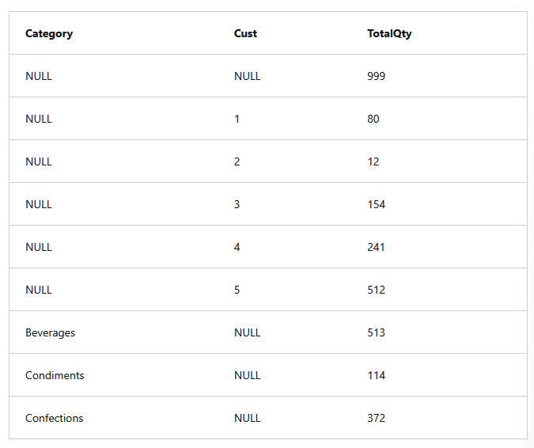

Notice the presence of NULLs in the results. NULLs may be returned because a `NULL` was stored in the underlying source, or because it is a placeholder in a row generated as an aggregate result. For example, in the previous results, the first row displays `NULL, NULL, 999`. This represents a grand total row. The `NULL` in the **Category** and **Cust** columns are placeholders because neither **Category** nor **Cust** take part in the aggregation.

If you want to know whether a `NULL` marks a placeholder or comes from the underlying data, use the `GROUPING()` function — it returns `1` for a placeholder and `0` for an actual `NULL` from the source data. `GROUPING_ID()` extends this to compute the grouping level across multiple columns.

## Use the CUBE and ROLLUP subclauses

Like `GROUPING SETS`, the `CUBE` and `ROLLUP` subclauses also enable multiple groupings for aggregating data. However, `CUBE` and `ROLLUP` do not need you to specify each set of attributes to group. Instead, given a set of columns, `CUBE` will determine all possible combinations and output groupings. `ROLLUP` creates combinations, assuming the input columns represent a hierarchy. Therefore, `CUBE` and `ROLLUP` can be thought of as shortcuts to `GROUPING SETS`.

To use `CUBE`, append the keyword `CUBE` to the `GROUP BY` clause and provide a list of columns to group. For example, to group on all combinations of columns **Category** and **Cust**, you'd use the following syntax in your query:

```sql
SELECT Category, Cust, SUM(Qty) AS TotalQty
FROM Sales.CategorySales
GROUP BY CUBE(Category,Cust);
```

This outputs groupings for the following combinations: (**Category**, **Cust**), (**Cust**), (**Category**), and the aggregate on all empty ():

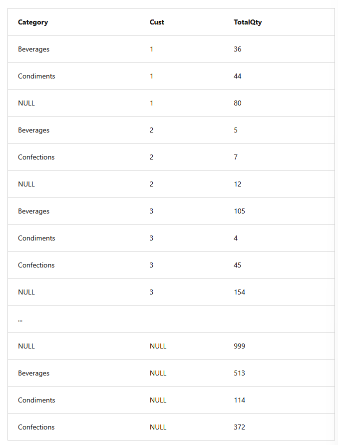

To use `ROLLUP`, you'd append the keyword `ROLLUP` to the `GROUP BY` clause and provide a list of columns to group. For example, to group on combinations of the **Category**, **Subcategory**, and **Product** columns, you'd use the following syntax in your query:

```sql
SELECT Category, Subcategory, Product, SUM(Qty) AS TotalQty
FROM Sales.ProductSales
GROUP BY ROLLUP(Category,Subcategory, Product);
```

This would result in groupings for the following combinations: (**Category**, **Subcategory**, **Product**), (**Category**, **Subcategory**), (**Category**), and the aggregate on all empty (). The order in which columns are supplied matters: **`ROLLUP` assumes that the columns are listed in an order that expresses a hierarchy**. It provides subtotals for each grouping, along with a grand total for all groupings at the end.
